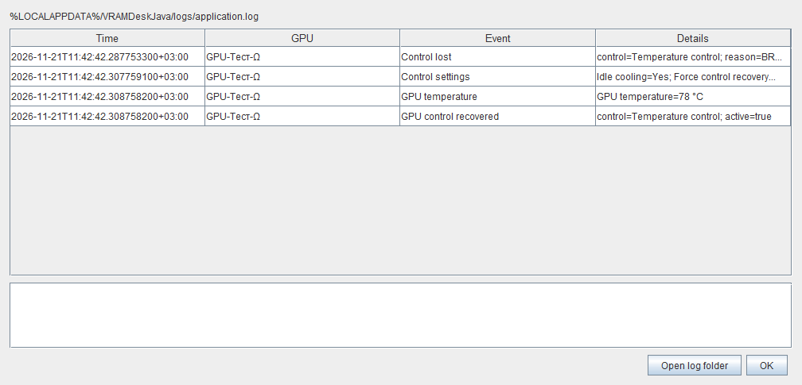

# VRAM GPU Desk 1.22

[English](README.md) · [Русский](README.ru.md) · [Deutsch](README.de.md) · [Español](README.es.md) · [Français](README.fr.md) · [Italiano](README.it.md) · [简体中文](README.zh.md) · [한국어](README.ko.md) · [日本語](README.ja.md) · [العربية](README.ar.md) · [हिन्दी](README.hi.md) · [Tiếng Việt](README.vi.md)

**مراقبة محلية لذاكرة وحدات NVIDIA GPU والتحكم في حرارتها على Windows x64. يدعم NVIDIA فقط، ولا يدعم وحدات AMD أو Intel GPU.**

## الغرض من التطبيق

- **مراقبة NVIDIA VRAM وتحريرها على Windows.** إغلاق التطبيقات قسرياً لتحرير VRAM، بما في ذلك أزرار سريعة قابلة للتخصيص بنقرة واحدة ومرتبطة بنسخة العملية المحددة بدقة.
- **إدارة التطبيقات المتنافسة على VRAM.** لمهام متعددة تعمل في الوقت نفسه، مثل النماذج المحلية لتوليد الشيفرة، وتوليد الصور والفيديو، والتفريغ النصي، وتحليل البيانات.
- **تحكم تدريجي بالحرارة والتبريد.** ضبط حرارة GPU بمرونة عبر حدود القدرة والتردد المدعومة، وتبريدها تحت الحمل وفي الخمول.
- **وضع طوارئ عند فرط الحرارة.** يمكن لوضع اختياري إغلاق التطبيقات كثيفة استخدام GPU قسرياً لتخفيف الحمل. يكون معطلاً عند كل تشغيل؛ وقد يؤدي الإغلاق القسري إلى فقدان العمل غير المحفوظ.

## الميزات الرئيسية

- محاولات مستمرة وآمنة لاستعادة التحكم مع إغلاق التحذير تلقائيًا بعد تأكيد الاستعادة؛ سجل لأحداث التحكم وحالات مربعات الاختيار وتغيّر الحرارة من 78 °C، وتمييز أقصى تيار تلامس عن مجموع تيار الموصل.

- عرض اختياري لقدرة مزوّد الطاقة وتيارات موصلَي GPU كحد أقصى حسب الطراز والمستشعرات؛ متوقف افتراضيًا.
- تباين نص المؤشر العائم تلقائيًا مفعّل افتراضيًا؛ تعطيله يتيح اختيار النص الفاتح أو الداكن يدويًا.

- مراقبة محلية لذاكرة NVIDIA VRAM وحمل GPU وحرارته، وRAM النظام واستخدام CPU، مع رسوم وأشرطة لكل نواة.
- ذاكرة GPU لكل عملية، مع البحث والفرز وتصدير CSV بترميز UTF-8.
- تحكم بالحرارة وتبريد في الخمول وفق القدرات التي تبلغ عنها كل GPU.
- أربعة أزرار قابلة للتخصيص بنقرة واحدة مرتبطة بنُسخ محددة من العمليات؛ الإنهاء الطارئ اختياري ويكون معطلاً عند كل تشغيل.
- أعلى 10 تطبيقات حسب استخدام VRAM المسجّل خلال 30 يوماً.
- 12 لغة، وسمتان، وعلبة النظام، وتشغيل اختياري مع بدء Windows.
- لوحتا NVIDIA بإعدادات مستقلة؛ التحكم في GPU الثانية تجريبي.
- تحذير عند فقدان التحكم وإعادة محاولة يدوية؛ الاستعادة مفعّلة للإعدادات الجديدة مع حفظ اختيار التعطيل السابق.

[تنزيل برنامج التثبيت](downloads/VRAM-GPU-Desk-1.22-Setup-x64.exe) · [حزمة ZIP للتثبيت](downloads/VRAM-GPU-Desk-1.22-Installer.zip)

**RAM وCPU والمراقبة الاختيارية لمزوّدات الطاقة الذكية/AI**

- RAM: المستخدمة/الإجمالية بوحدة GiB، والذاكرة المتاحة ورسم لخمس دقائق.
- CPU: الحمل الإجمالي وأشرطة لكل نواة فعلية؛ دون حرارة المعالج.
- مزوّد ذكي/AI متوافق: قدرة الخرج بالواط وتيارات منفذَي GPU فعليين كحد أقصى عند توفرها؛ متوقف افتراضيًا.

التوافق: قراءة مستشعرات MSI MPG Ai1300TS موثقة على جهاز فعلي؛ تتوفر قارئات بروتوكول مؤهلة لـAi1600TS وبعض Corsair HXi/RMi وThermaltake DPS G/iRGB PLUS، وما زال تحققها المادي منتظرًا.

## الجديد في 1.22: استعادة مستمرة للتحكم، وسجل التطبيق، وتوضيح نوع التيار

**استعادة مستمرة للتحكم.** عند تفعيل الاستعادة القسرية للتحكم، تتكرر المحاولات بفواصل 5 و10 و30 ثانية، ثم كل 60 ثانية دون حد لعدد المحاولات. يبقى اختيار الإيقاف المحفوظ كما هو. تُغلق نافذة التحذير التي لا تحجب التفاعل مع التطبيق تلقائيًا فقط بعد تأكيد استعادة التحكم ببيانات قياس جديدة وصالحة. يُحتفظ بآخر اختيار للمستخدم أثناء إيقاف العميل وإعادة تشغيله. لا يُنشأ عميل جديد قبل تأكيد انتهاء العميل السابق، وتبقى اختبارات هوية العتاد والملكية والسلامة سارية. لا يمنع ذلك وصول MSI Afterburner أو أي أداة تحكم أخرى إلى البطاقة.

**سجل التطبيق.** أُضيف زر للسجل، الذي يسجل لكل GPU فقدان التحكم واستعادته ومحاولات الاستعادة وحالات جميع مربعات الاختيار المتعلقة بالتحكم. ويسجل تغيّر درجة الحرارة الصحيحة بدءًا من **78 °C**، ثم العودة إلى أقل من 78 °C. يتضمن كل حدث توقيت UTC والتوقيت المحلي. يُحفظ السجل بترميز UTF-8 في `%LOCALAPPDATA%/VRAMDeskJava/logs/application.log`، بحد 2 MiB للملف وخمسة ملفات أرشيف دورية. يعرض العارض آخر 500 حدث من الجلسة الحالية، ويفتح زر مجلد السجل مكان ملفات الجلسات السابقة.

**تيار المزوّد: أقصى قيمة أو المجموع.** لكل موصل طاقة GPU فعلي، إذا توفرت قراءة صالحة لتلامس واحد على الأقل، تُعرض أعلى قراءة معروفة حتى مع غياب بقية التلامسات. إذا لم تتوفر تفاصيل التلامسات، يُعرض مجموع تيار الموصل المقاس. توضح التسمية «الأقصى» أو «المجموع»؛ وتظهر القيم المجهولة بشرطة، بينما تبقى قراءة الصفر الحقيقية صالحة. تحتفظ التلميحات بقراءات التلامسات المتاحة ومجموع الموصل، ولا يُعرض تيار خط التغذية بوصفه تيار الموصل.

**الترقية من 1.9.** قد تظل النسخة القديمة 1.9 في LocalAppData قيد التشغيل رغم تثبيت 1.22 بشكل صحيح في Program Files، فتظهر في العلبة والواجهة نسخة قديمة وإعدادات أقل. اخرج من النسخة القديمة عبر قائمة العلبة قبل التثبيت، ثم ثبّت وافتح التطبيق باختصار قائمة ابدأ الحالي، وتحقق من ظهور **v1.22**. لا يُنصح بإنهاء العملية قسريًا.

## مؤشرات RAM وCPU ومزوّدات الطاقة الذكية/AI

- **ذاكرة RAM:** الذاكرة الفعلية المستخدمة/الإجمالية بوحدة GiB، ونسبة الاستخدام والذاكرة المتاحة ورسم لآخر خمس دقائق.
- **المعالج CPU:** نسبة الاستخدام الإجمالية وعدد الأنوية الفعلية والخيوط المنطقية وشريط حمل لكل نواة فعلية. تعرض المؤشرات الحمل فقط، دون حرارة المعالج.
- **مزوّدات الطاقة الرقمية/الذكية/AI المتوافقة عبر USB:** قراءة المستشعرات فقط لعرض قدرة الخرج المقاسة بالواط عند توفرها، وتيارات منفذَي طاقة GPU فعليين كحد أقصى، بما يشمل ست قراءات لتيارات التلامس لكل منفذ عند دعمها. تم التحقق من قراءة المستشعرات على **MSI MPG Ai1300TS**. تُميّز القيم المحسوبة؛ فتيار خط التغذية ليس تيار موصل منفرد.

للمراقبة مربع اختيار مستقل وهي **متوقفة افتراضيًا**. عند إيقافها أو عدم اكتشاف مزوّد متوافق تُخفى بطاقته وتملأ البطاقات الأخرى العرض دون موضع فارغ. وبعد اكتشاف المزوّد تبقى البطاقة مع شرطات إذا تعذرت القراءات مؤقتًا.

مع بطاقتَي NVIDIA، تكون مؤشرات RAM وCPU ومزوّد الطاقة مشتركة وتظهر مرة واحدة. لا تضمن تسمية «AI» أو أي تسمية تسويقية التوافق؛ فهو يعتمد على الطراز والبروتوكول. راجع [توافق مزوّدات الطاقة](docs/psu-compatibility.md). تستخدم الصورة قيماً اصطناعية للعرض وليست نتائج قياسات عتادية.

[دون مزوّد: البطاقات الأخرى تتوسع](images/without-psu-strip.png)

### ما مزوّدات الطاقة المتوافقة؟

| الطرازات / هوية الجهاز المؤهلة | القراءات والتحقق |
| --- | --- |
| MSI MPG Ai1300TS PCIE5 / Ai1600TS PCIE5 | Ai1300TS: مستشعرات متحققة على جهاز فعلي، خرج W مقاس ومنفذان بستة تيارات تلامس لكل منفذ. Ai1600TS: قارئ منفذ وبروتوكول مؤهل، دون اختبار مادي. |
| Corsair HX750i, HX850i, HX1000i, HX1200i, HX1500i; RM650i, RM750i, RM850i, RM1000i | خرج W مقاس؛ لا تيارات منفردة لمنافذ GPU. القارئ منفذ واجتاز الاختبارات الاصطناعية؛ التحقق المادي منتظر. الهويات USB في القائمة الكاملة فقط. |
| Thermaltake DPS G / iRGB PLUS | 264A:2329 فقط. خرج ≈W محسوب من جهد الخط × تياره؛ لا تيار منفرد لمنفذ GPU. اختبارات اصطناعية ناجحة، والتحقق المادي منتظر. |
| NZXT E500 / E650 / E850 | قارئ جزئي إضافي: مستشعرات خطوط التغذية، دون خرج إجمالي مقاس أو تيارات منافذ فعلية لبطاقة PSU. اختبارات اصطناعية ناجحة؛ ليس دعماً كاملاً للبطاقة. |

بحث فقط: لا يوجد محوّل 1.21 لـbe quiet! Dark Power Pro 14 IO 1300W/1600W. ولا قارئ مؤهل لـSeasonic أو ASUS. تسمية «AI» لا تثبت التوافق.

## الجديد في 1.21 — مراقبة اختيارية لمزوّد الطاقة وتباين تلقائي للنص

**تخطيط اختياري.** إذا كانت المراقبة متوقفة أو لم يُكتشف مزوّد طاقة متوافق، تُخفى بطاقته وتستغل البطاقات الأخرى العرض المتاح دون موضع فارغ. بعد اكتشاف المزوّد، تبقى بطاقته مع شرطات إذا تعذرت القراءات مؤقتًا.

**لوحة أكثر اختصارًا.** أُزيلت بطاقة «الوقت مع VRAM > 50%» من تخطيطَي GPU الواحدة والبطاقتين. يبقى ترتيب التطبيقات خلال 30 يوماً والسجل المحفوظ.

**مراقبة مزوّد الطاقة متوقفة افتراضيًا.** يضيف مربع اختيار مستقل بطاقة تعرض قدرة الخرج المتاحة وتيارات موصلَي طاقة GPU فعليين كحد أقصى. تظهر — عند غياب البيانات أو تقادمها؛ ولا تُعرض تيارات خطوط التغذية على أنها تيارات موصلات منفردة. يستخدم الاستعلام للقراءة فقط مكوّنًا محميًا منفصلًا يُثبّت مع إعداد UAC الأول للتطبيق، ولا يستحوذ على التحكم في GPU.

**التوافق مرتبط بالطراز.** تم التحقق من قراءة المستشعرات على MSI MPG Ai1300TS. تم تأهيل بروتوكول Ai1600TS. اجتازت بعض قارئات Corsair HXi/RMi وThermaltake DPS G/iRGB PLUS، وإضافةً إليها NZXT E، اختبارات اصطناعية؛ ولم يكتمل التحقق على أجهزتها الفعلية. يعرض Corsair قدرة مقاسة، ويُوسم مجموع Thermaltake بوضوح بأنه محسوب؛ أما NZXT فيقدّم بيانات الخطوط دون اختلاق إجمالي. جرى بحث be quiet! Dark Power Pro 14 IO؛ ولا توجد قارئات مؤهلة لـSeasonic OptiGuard أو ASUS في هذا الإصدار. لا يُدّعى دعم شامل للعلامات الست. راجع [توافق مزوّدات الطاقة](docs/psu-compatibility.md).

**التباين التلقائي لنص المؤشر العائم مفعّل افتراضيًا.** يتكيف النص مع الخلفية؛ ويمكن تعطيله لاختيار نص فاتح أو داكن يدويًا. تبقى الشفافية والمؤشرات المدمجة والمؤشران المستقلان لبطاقتي NVIDIA وفتح النافذة بالنقر المزدوج والمواضع وألوان الحرارة وأصواتها.

تستخدم صور السمة الجرافيتية التالية بيانات عرض اصطناعية، بما فيها قيم الطاقة. تبقى إعدادات GPU وإجراءات العمليات وأوضاع الطوارئ والخيارات المحفوظة كما هي.

بطاقتا NVIDIA: مع بيانات مزوّد الطاقة / دون مزوّد طاقة متوافق.

## 1.20.1

انقر نقرًا مزدوجًا على المؤشر لفتح النافذة الرئيسية.

## 1.20 — مؤشر GPU العائم

مؤشر صغير شفاف فوق نوافذ Windows العادية بلا لوحة خلفية. لكل بطاقة NVIDIA نافذة مستقلة بحجم ≈164 × 114 بكسل فعلي، حتى بطاقتين. يُحفظ موضع كل نافذة منفردًا مع النقل والتثبيت وتعديل الحجم وتباين النص. العرض مخفي افتراضيًا والصوت مفعّل ويمكن تعطيله مستقلًا. تُستخدم القياسات الحالية دون تحكم إضافي بالبطاقة.

استخدام VRAM وحمل GPU؛ الحرارة: ≤40 أخضر، 41–75 أصفر، 76–81 برتقالي، 82–86 أحمر، ≥87 وميض. يبدأ الصوت عند 88 °C.

بيانات عرض توضيحي اصطناعية وحالات محاكاة للمتحكمات. خيارا الطوارئ معطلان عند كل تشغيل. الاستعادة مفعّلة للإعدادات الجديدة، ويُحفظ اختيار التعطيل السابق.

> **التحكم في GPU:** يتطلب التحكم في معلمات حرارة GPU تأكيد UAC مرة واحدة عند تثبيت مكوّن التحكم. بعد ذلك يمكن تفعيل التحكم الحراري والتبريد دون طلبات UAC أخرى. المراقبة وحدها لا تتطلب UAC.

> **التحكم المتزامن في GPU:** قد يتعارض التحكم في معلمات حرارة GPU مع برامج أخرى تغيّر الطاقة أو الترددات أو سرعة المراوح في الوقت نفسه، مثل MSI Afterburner. استخدم متحكماً فعالاً واحداً فقط لهذه الإعدادات. يتعلق التنبيه بتغيير الإعدادات بالتزامن، وليس بالمراقبة السلبية.

## الجديد في 1.19: تكيّف لكل جهاز NVIDIA RTX 30 و40 و50

**حدود الجهاز الفعلية بدلاً من قدرة ثابتة مسبقة.** تقرأ كل جلسة حدود قدرة GPU الخاصة بها وتحفظ الحد عند البدء كسقف للجلسة ومرجع للاستعادة، بدلاً من إعداد المصنع. لا يكتب الحصول على الجلسة قيمة أولية للقدرة أو التردد. تتدرج تغييرات القدرة بمقدار **1% من حد بداية الجلسة في الثانية** ضمن حدود الجهاز وسقف الجلسة. تتبع تعديلات التردد نطاقاً مدعوماً جرى التحقق منه.

**استخدام عناصر التحكم المتاحة فقط.** إذا لم يكن التحكم في التردد مدعوماً، تظل إدارة القدرة وحدها متاحة إن كانت مدعومة. مع حرارة صالحة يمكنها العمل حتى لو كان استخدام GPU مجهولاً. يُمنع الهدف الذي يتجاوز حد الحرارة العتادي المُبلغ عنه، وتبقى الحدود المفقودة مجهولة. تظل الميزات غير المدعومة مرئية كغير متاحة. استعادة المراوح مستقلة عن استعادة عميل القدرة. قد تختلف الإمكانات بحسب BIOS وOEM وبرنامج التشغيل وقيود الحواسيب المحمولة؛ تُقيّم كل GPU منفردة.

**البيانات المرجعية ليست أوامر تحكم.** يغطي [مرجع RTX 30 والأحدث](docs/nvidia-rtx30-plus/README.md) و[CSV بترميز UTF-8](docs/nvidia-rtx30-plus/REFERENCE-GPUS.csv) **45 مجموعة طرازات/متغيرات: 27 مكتبية و18 محمولة**. هذه مجموعات توثيقية وليست 45 اختباراً عتادياً؛ القدرة المنشورة وTGP المحمول ليست إعدادات قابلة للتنفيذ. صف RTX 3060 Ti بقدرة 200 W يخص المواصفات المرجعية وليس جميع متغيرات GDDR6X أو OEM.

**منطقة CPU مدمجة مع وحدتَي GPU.** أصبحت الحافة السفلية لبطاقة CPU بمحاذاة أسفل لوحة التبريد المجاورة في الخمول، فوق صفوف الطوارئ والاستعادة. تبقى RAM في الأعلى، ويظل حمل CPU وأشرطة الأنوية الفعلية مرئية. لا يتغير تخطيط البطاقات الست لوحدة GPU واحدة.

## الجديد في 1.18: استخدام CPU ومساحة أوضح لوحدتَي GPU

**حمل CPU بجوار RAM النظام.** تعرض بطاقة CPU الاستخدام الإجمالي وعدد الأنوية الفعلية والخيوط المنطقية وشريطاً للاستخدام اللحظي لكل نواة فعلية. يجمع شريط النواة خيوطها المنطقية، وتُوزن النسبة الإجمالية بحسب المعالجات المنطقية. لا تحتاج قياسات Windows المدمجة إلى UAC إضافي أو برامج تشغيل أو تطبيق مراقبة آخر. تظهر القراءات المفقودة أو غير الصالحة أو الأقدم من ست ثوانٍ كـ **—** وأشرطة أنوية غير متاحة.

**GPU واحدة: ست بطاقات عند 1200×900.** تبقى بطاقات GPU الأربع وRAM النظام وحمل CPU مرئية معاً. **وحدتا NVIDIA GPU: الحد الأدنى 1920×1050.** لكل GPU كتلة بطاقات 2×2 مستقلة وقراءات متراصفة وجميع عناصر التحكم. تفصل خطوط عمودية رفيعة مناطق GPU عن العمود المشترك على اليمين، وفيه RAM في الأعلى وبطاقة CPU أطول تحتها. تظهر RAM وCPU مرة واحدة ولا تتبعان اختيار GPU. يظل التحكم في GPU الثانية تجريبياً.

تبقى مؤشرات المراوح الثلاثة ظاهرة بفضل التفافها إلى سطر جديد عند ضيق المساحة. لا يتغير منطق التحكم في المراوح. تبقى الأزرار السريعة المدمجة ووضوح أسماء العمليات وجميع الإعدادات السابقة.

## الجديد في 1.17: RAM النظام بلمحة واحدة

تعرض بطاقة خامسة باسم **RAM النظام** الذاكرة الفعلية المستخدمة/الإجمالية بوحدة GiB، ونسبة الاستخدام، والذاكرة المتاحة ورسم آخر خمس دقائق. الإجمالي هو RAM الفعلية القابلة للاستخدام بواسطة Windows؛ وهي ذاكرة النظام وليست VRAM أو حد الذاكرة الملتزم بها الذي يتضمن ملف الترحيل.

تخص قراءات RAM الكمبيوتر كله ولا تعتمد على GPU المحدد. مع لوحتَي NVIDIA، تحتوي اللوحة الرئيسية على خمس بطاقات وتحتفظ الثانية ببطاقات GPU الأربع؛ تظهر RAM النظام مرة واحدة فقط. تبقى عناصر التحكم السابقة في GPU متاحة.

تُحدّث RAM وفق فترة التحديث الحالية ولا تحتاج إلى UAC. القراءات المفقودة أو غير الصالحة أو الأقدم من ست ثوانٍ تظهر **—**، مع فجوة في الرسم بدلاً من قيمة مختلقة.

## الجديد في 1.16: استعادة أكثر موثوقية واختيار طريقة التصغير

**تكون استعادة التحكم مفعّلة للإعدادات الجديدة أو عند غياب هذا الخيار.** يُحفظ الاختيار لكل GPU، ولا يُلغى التعطيل الصريح المحفوظ سابقاً. تعود المحاولة إلى البطاقة نفسها بعد فترات انتظار والتأكد من انتهاء العميل السابق. لا تمنح هذه الميزة تحكماً حصرياً يمنع MSI Afterburner أو غيره من المتحكمات.

**اختر طريقة تصغير النافذة.** خيار «التصغير إلى علبة النظام» مفعّل افتراضياً. ألغِه لتصغير النافذة إلى شريط مهام Windows كأي تطبيق عادي. يُحفظ الاختيار، ويبقى بدء التشغيل مع Windows إعداداً مستقلاً.

**اتصال أكثر موثوقية وحالة أوضح.** أصبحت مهلة طلب Java سبع ثوانٍ لتغطي نافذة استجابة القناة الأصلية البالغة ست ثوانٍ مع هامش. يبدأ watchdog الأصلي العد بعد نجاح التحكم في GPU، مع بقاء حماية الست ثوانٍ. لم تعد الأخطاء والقراءات القديمة تظهر كأنها حديثة: تُخفى قيم RPM القديمة ويُميّز انتهاء مهلة الاتصال عن التغييرات الخارجية المؤكدة. يحتفظ سجل محلي محدود بالأخطاء وبيانات الاستجابات البطيئة دون أسرار الاتصال.

## الجديد في 1.15: لوحات NVIDIA مستقلة واستعادة التحكم

تحصل وحدتا NVIDIA GPU المدعومتان على مؤشرات مستقلة وأربعة رسوم لكل وحدة وإعدادات تحكم منفصلة. **التحكم في وحدة NVIDIA GPU الثانية تجريبي.** عند وجود NVIDIA واحدة مع AMD/Intel تُستخدم لوحة NVIDIA واحدة. يرشّح محدد GPU جدول العمليات والسجل المشتركين، ولا يغيّر الوحدة المرتبطة بأي متحكم.

**تبقى الأزرار السريعة الأربعة المدمجة في صف أفقي واحد.** تتيح قائمة `⋮` المشتركة التعيين وإعادة التعيين وتغيير الاسم والمسح لكل موضع، حتى عند اختفاء الهدف. يمكن تغيير الاسم المخصص دون إعادة الربط؛ يتكيف النص مع العرض وتحتفظ التلميحات بالاسم الكامل. تبقى الفحوص الدقيقة لـ PID ووقت الإنشاء ومسار الملف التنفيذي.

**يظهر تحذير وإجراء يدوي لإعادة المحاولة عند فقدان التحكم. في 1.16 تُفعّل الاستعادة للإعدادات الجديدة أو عند غياب الخيار وتُحفظ لكل GPU؛ يُحترم التعطيل الصريح المحفوظ.** تستخدم فواصل 5/10/30/60 ثانية وتشترط انتهاء العميل السابق وبيانات حديثة للوحدة نفسها. تبقى فحوص lease والملكية والقراءة الراجعة والسلامة الأصلية إلزامية. لا يمكنها حظر MSI Afterburner أو متحكم آخر حصرياً. يظل خيارا الطوارئ معطلين عند كل تشغيل.

التحقق من 1.15: **2262 فحص واجهة**، و**215 فحصاً أصلياً**، و**61 فحص دورة حياة/I/O للعملاء**، و**48 فحص استعادة**، و**167 ملف حزمة** و**93 فئة Java**. الحد الأدنى: GPU واحدة **1200×900** ولوحتان **1600×950**. يستمر مسار مثبت 1.14 الذي يغلق النسخة بعد الموافقة وخيار التشغيل النهائي المحدد افتراضياً.

## الجديد في 1.14: مساحة مدمجة وتحديث أسهل

**Graphite Studio ‏(1.12).** تبقى جميع الإعدادات والإجراءات الأساسية ظاهرة معاً عند 1200×900: سبعة أعمدة وستة صفوف عمليات على الأقل، وأربعة رسوم ومفتاح كامل لأفضل عشرة تطبيقات. تظهر أسماء العمليات بخط عريض عالي التباين بحجم 14 px. يبدأ الملف الجديد بسمّة Graphite مع حفظ اختيار System أو Graphite السابق. تحتفظ الأزرار الأربعة القابلة للتخصيص بربطها بمثيل العملية المحدد وإجرائي الإغلاق والإنهاء.

**فرق تبريد ظاهر ‏(1.13).** تعرض لوحة التبريد فرق التشغيل الثابت **4 °C**، وتوضح التلميحات أمثلة 32→36 °C و35→39 °C. أصبح السلوك الحالي ظاهراً دون تغيير خوارزمية التبريد.

**التثبيت والتحديث ‏(1.14).** يطلب المثبّت إذناً لإغلاق النسخة المستهدفة التي تعمل. بعد الموافقة يطلب إغلاق JVM العادي عبر Windows Restart Manager، وينتظر خروج التطبيق ومشغّله وتحرير ملفات وحدات التحكم ثم يتابع. يستهدف مثيلات هذا التثبيت المتحقق منها دون إنهاء قسري. يمنع الرفض أو الإلغاء أو اعتراض التطبيق أو بقاء الأقفال أو انتهاء المهلة استبدال الملفات؛ ولا يغلق التثبيت الصامت تطبيقاً يعمل تلقائياً.

خيار **تشغيل VRAM GPU Desk** في الصفحة الأخيرة محدد افتراضياً ويمكن إلغاء تحديده. يتم التشغيل بصلاحيات عادية للمستخدم نفسه الذي سجّل الدخول؛ وعند عدم توفر هذا السياق استخدم اختصار قائمة «ابدأ» العادي. هذا تشغيل واحد بعد التثبيت، مع حفظ اختيار بدء التشغيل مع Windows.

تحقق إصدار 1.14 يشمل **9 حالات لتدفق المثبّت و107 فحوص Restart Manager/JDK و17 فحصاً لبوابة التشغيل الثابتة**، وجميع **166 ملفاً و88 فئة Java** وبصمات الوسطاء ومسارات Unicode والمشغّل ذي Java المضمنة.

## الجديد في 1.11: إنهاء طارئ للعمليات ذات حمل GPU المرتفع

خيار مستقل **معطّل عند كل تشغيل**. بعد بقاء الحرارة المؤكدة أعلى تمامًا من عتبة السخونة لمدة **10 ثوانٍ**، يمكنه إنهاء العمليات التي يمكن الوصول إليها والتي تحمّل GPU المحدد بنسبة **20% افتراضيًا (قابلة للضبط من 10 إلى 100%) لمدة 3 ثوانٍ على الأقل**. القياس لمحرك GPU الأكثر انشغالًا للعملية، **وليس لحجم VRAM**. يعمل مرة واحدة ثم يتوقف بعد المحاولة؛ يلزم تفعيله صراحةً للمحاولة التالية. يلزم توفر قياسات حمل مؤكدة ومستشعر صالح.

**تحذير: قد ينهي تطبيقات مفيدة وغير مرغوبة مع فقدان العمل غير المحفوظ.** تُراجع الحرارة وهوية GPU وPID ووقت الإنشاء ومسار EXE ومقبض العملية نفسه قبل الإنهاء. تُستثنى مكونات Windows/NVIDIA المحمية والعمليات الحرجة أو غير القابلة للتحقق والأداة نفسها. لا يُنهي أشجار العمليات ولا يوقف الخدمات ولا يطلب رفع صلاحيات إضافيًا. يبقى خيار الطوارئ القديم للتطبيق المحدد منفصلًا. هذه وسيلة إضافية وليست ضمانًا ضد تلف GPU.

تم التحقق في 1.11 من **40 اختبار CPU أصليًا و256 اختبار Java/كتالوج/حماية و673 تحقق واجهة في 48 حالة** عبر اثنتي عشرة لغة وسمتين، وقراءة **710 مثيلات عدادات PDH صالحة** دون تعديل، ومراجعة مستقلة، وجميع **164 ملفًا و87 فئة Java** وبصمات الوسطاء، والتثبيت والإزالة المعزولين وتشغيل الحزمة بمسارات Unicode وJava المضمنة.

## الوظائف

- عرض ذاكرة VRAM الفعلية المستخدمة والمتاحة، ونسبة تشغيل GPU وحرارته، مع رسوم تاريخية مصغرة.
- قائمة بالتطبيقات والخدمات التي تستخدم ذاكرة GPU، مع البحث والترتيب ومرشح اختياري للاستخدام الذي يزيد على 0.5 GiB.
- عرض أكثر عشرة تطبيقات وفئة «البقية» كنسب مطبّعة خلال آخر 30 يوماً من العينات المرصودة. مجموع النسب 100%؛ هذه حصص من قراءات ذاكرة العمليات المسجلة، وليست أجزاء قابلة للجمع من الذاكرة الفعلية.
- تصدير CSV بترميز UTF-8 إلى مسار محلي مختار؛ حفظ الاختيار بين التصغير إلى علبة النظام أو شريط مهام Windows، واستعادة النافذة القائمة عند التشغيل المتكرر، وتشغيل اختياري مع Windows.
- سمتان، نظامية وغرافيت داكنة، و12 لغة للواجهة. فترة تحديث الواجهة قابلة للضبط من ثانية إلى خمس ثوانٍ، وافتراضياً ثانيتان.
- هدف حراري مرن من 70 إلى 88°C عبر حدود الطاقة وتردد النواة المدعومة، يعمل بصورة مستقلة عن تحديث الواجهة. تتوفر تهوية أثناء الخمول ومؤشرات RPM ورموز مراوح متحركة.
- تطلب الإعدادات الجديدة تفعيل التحكم الحراري وتهوية الخمول. يُحفظ الإيقاف اليدوي السابق؛ ولا تظهر حالة التحكم النشطة إلا بعد اتصال مؤكَّد بالمكوّن.
- تنبيه اختياري عندما تبقى الحرارة أعلى تماماً من العتبة المختارة، 75–92°C، لمدة عشر ثوانٍ متواصلة على الأقل. لا تؤدي القفزات القصيرة إلى تنبيه.
- خيار طوارئ منفصل، معطّل افتراضياً، للتطبيق المختار مسبقاً. العمليات المحمية أو التي يتعذر التحقق منها لا تصلح هدفاً لهذا الإجراء.

## أربعة أزرار للإجراءات السريعة

عيّن «إغلاق التطبيق» أو «إنهاء العملية» إلى أحد الأزرار الأربعة، وأعد تعيينه من قائمة `⋮` المجاورة. يرتبط الزر بمثيل العملية المختار صراحةً: PID ووقت الإنشاء ومسار EXE. بعد انتهاء هذا المثيل، لا يختار البرنامج عملية مجاورة أو عملية جديدة أعادت استخدام PID تلقائياً.

ينفّذ الزر المضبوط الإجراء بنقرة واحدة **دون تأكيد إضافي**. قد تضيع الأعمال غير المحفوظة عند الإغلاق أو الإنهاء. تظل فحوص العمليات الحرجة والمحمية وغير القابلة للتحقق فعالة. يبقى خيار الطوارئ المنفصل متعلقاً بالتطبيق المختار، ومعطلاً في البداية.

## الأهداف الحرارية والتباطؤ بين حدود الإيقاف وإعادة التشغيل

| الإعداد | السلوك | الغرض |
|---|---|---|
| هدف الخمول: 32°C افتراضياً، قابل للضبط 28–40°C | أثناء الخمول، عند البقاء عند الهدف أو دونه ثلاث ثوانٍ، تعاد إدارة المراوح إلى AUTO في برنامج البطاقة الثابت. تعود التهوية عند الهدف +4°C؛ أي 36°C لهدف 32°C، و39°C لهدف 35°C. | يمنع التبديل المتكرر قرب حد واحد. يقرر البرنامج الثابت في AUTO هل تتوقف المراوح كلياً. |
| تمييز الخمول والحمل | يسمح بالخمول عند تشغيل GPU حتى 10%، وتطبق منحنيات الحمل من 15%. عند 11–14% تبقى الحالة السابقة. القراءة المجهولة تُبقي التهوية فعالة. | يمنع الاهتزاز بين الحالتين بسبب فروق صغيرة. |
| الهدف المرن 70–88°C | تتغير الطاقة وحدود تردد النواة تدريجياً بحسب اتجاه الحرارة. قد تكون الحرارة أقل من الهدف أو تتجاوزه لفترة قصيرة. | الهدف ليس فصلاً طارئاً ثابتاً؛ تؤثر استجابة التبريد والحساسات وقيود التعريف. |
| تنبيه ارتفاع الحرارة | يجب تجاوز العتبة تماماً عشر ثوانٍ على الأقل. | تجاهل الارتفاعات العابرة. |

حرارة الخمول ليست الحد الحراري تحت الحمل المستمر. تؤثر حرارة المكان والبرنامج الثابت والتعريف في النتيجة. لا تشغّل متحكمات متنافسة للمراوح أو الطاقة أو التردد على البطاقة نفسها.

## العتاد والمتطلبات

مخصص لبطاقات NVIDIA GeForce **RTX 30 / 40 / 50**. تعتمد المراقبة والتحكم المتاحان على البطاقة والتعريف؛ لا تُحاكى الوظائف غير المدعومة.

يلزم Windows 10/11 x64 و.NET Framework 4.8 وتعريف NVIDIA مدعوم. يتضمن المثبّت Java runtime؛ لا يلزم تثبيت Java منفصلاً. لا توجد قائمة سماح يدوية لإصدارات التعريف أو بصمات DLL. يجب أن تجتاز مكتبة NVML النظامية المثبتة فحوص المسار الآمن والتوقيع غير المتصل بالإنترنت مع تأكيد NVIDIA Corporation وواجهات API المطلوبة. لا يتطلب تحديث التعريف إضافة رقم إصدار أو بصمة جديدة. قد يفشل التحقق إذا لم تتوفر بيانات الثقة محلياً؛ لا ينزّل التطبيق شهادات أو تعريفات.

يجب أن يكون مستخدم Windows الذي سجّل الدخول مسؤولاً يستخدم رمز سطح مكتب مقيّداً بصورة عادية. يطلب التثبيت UAC مرة واحدة، ويثبت مكوّن التحكم في مجلد Program Files ثابت ومحمي. إدخال بيانات مسؤول آخر غير مدعوم. تستخدم مهمتان محميتان، تعملان عند الطلب، مشغّلات ثابتة واتصالاً محلياً محدد العمليات. صُممت القناة المثبتة لبدء التحكم لاحقاً دون UAC آخر. إذا تعذر توثيق المكوّن، يبقى التحكم غير متاح بدلاً من طلب رفع صلاحيات آخر.

## التثبيت والخصوصية

1. نزّل المثبّت وقارن SHA-256 مع [SHA256SUMS.txt](SHA256SUMS.txt).
2. شغّل المثبّت بصورة عادية من حساب المسؤول الذي سجّل الدخول ووافق على UAC. إذا كانت النسخة المستهدفة تعمل، أجب عن طلب إغلاقها؛ يتابع المثبّت بعد خروجها العادي وتحرير الملفات. مجلد التثبيت المحمي ثابت.
3. افتح الاختصار الجديد، واختر GPU، وتحقق من حالة اتصال المتحكم المؤكدة. اضبط الخيارات والأزرار؛ تحفظ الإعدادات محلياً، ويبقى الإيقاف اليدوي محفوظاً.

يستخدم التطبيق واجهات Windows/GPU المحلية. لا يتضمن إرسالاً مقصوداً للقياسات أو استدلالاً سحابياً أو تحديثاً ذاتياً أو تنزيل نماذج أثناء العمل. تبقى CSV والسجلات والإعدادات محلية. هذا لا يضمن عزل شبكة نظام التشغيل بأكمله أو سلوك التعريفات وتشخيص Windows وبرامج المزامنة الأخرى.

المثبّت غير موقّع بشهادة ناشر شخصية. تُنشر الملفات الثنائية المجمّعة فقط؛ **لا تنشر شيفرة التطبيق المصدرية في هذا المستودع**. Java bytecode غير مشفّر ولا توجد ضمانة تمنع فك ترجمته. تبقى إشعارات تراخيص runtime التابعة للغير في النسخة المثبتة.

تستخدم اللقطات بيانات عرض اصطناعية وحالة متحكم محاكاة، وليست قائمة عمليات خاصة أو دليلاً على أداء حراري.

## تغييرات 1.10 والتحقق

أضيفت الأزرار الأربعة، وصغرت شروح لوحة المعلومات، وارتفع ارتفاع الرسوم من 35 إلى 55 بكسلاً، مع بقاء رمز علبة النظام عالي التباين. يثبت مكوّن التحكم مرة واحدة مع UAC. استبعدت فقط الأسماء المستعارة المؤكدة لشاشات IDD غير القادرة على التصيير؛ لا تُدمج بطاقات GPU المختلفة بحسب الاسم أو حجم الذاكرة. يمكن إصلاح تثبيت آمن غير مكتمل، وتعرض الأخطاء phase وcode وHRESULT محددة. بقيت السمات واللغات والتاريخ وCSV وفحوص هوية GPU وسياسات lease/watchdog/restore.

شمل التحقق 48 حالة واجهة معزولة على 12 لغة وسمتين، والرموز والإعدادات والأزرار وربط العمليات، وفحوص CLR token الفعلية، ومسارات Unicode، وكل ملفات الحزمة البالغ عددها 163 والبصمات المثبتة للوسطاء، وتثبيتاً وإزالةً معزولين. سجّل اختبار Scheduler مرتفع الصلاحيات مؤقتاً المهمتين، وفحص XML/DACL، وجرّب التراجع وحذف موارده. **لم تُشغّل المهمتان**.

## الترخيص

الاستخدام غير التجاري مجاني بموجب [PolyForm Noncommercial 1.0.0](LICENSE.md)، مع الالتزام بشروطها ومتطلبات الإشعار. يتطلب الاستخدام التجاري إذناً منفصلاً. ليست رخصة مفتوحة المصدر؛ لا تنشر الشيفرة المصدرية للتطبيق. تبقى تراخيص runtime التابعة للغير دون تغيير.

[خلفية فاتحة](images/floating-monitor-light.png) · [GPU × 2](images/dual-floating-monitors-light.png)

**1080p → ≈122 × 86 px · 1440p → ≈164 × 114 px · 2160p / 4K → ≈245 × 171 px**

## دعم المشروع

إذا كان VRAM GPU Desk مفيدًا لك، يمكنك [دعم تطويره طوعًا](https://github.com/2018-spec-fdsds/multiroute-downloader/blob/main/docs/support.md).

امسح رمز QR بمحفظة متوافقة.
