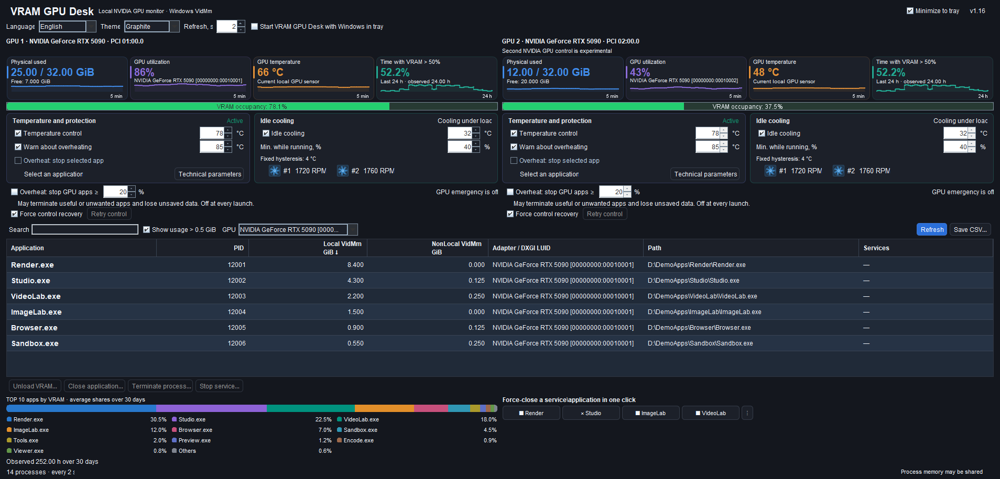

# VRAM GPU Desk

[English](README.md) · [Русский](README.ru.md) · [Deutsch](README.de.md) · [Español](README.es.md) · [Français](README.fr.md) · [Italiano](README.it.md) · [中文](README.zh.md) · [한국어](README.ko.md) · [日本語](README.ja.md) · [العربية](README.ar.md) · [हिन्दी](README.hi.md) · [Tiếng Việt](README.vi.md)

**Lokale Speicherüberwachung und Temperaturregelung für NVIDIA-GPUs unter Windows x64. Nur NVIDIA; AMD- und Intel-GPUs werden nicht unterstützt.**

## Wichtigste Funktionen

- Lokale Überwachung von NVIDIA-VRAM, GPU-Auslastung und Temperatur mit Live-Diagrammen.
- GPU-Speicher je Prozess, Suche, Sortierung und CSV-Export in UTF-8.
- Temperaturregelung und Kühlung im Leerlauf.
- Vier konfigurierbare Ein-Klick-Schaltflächen für exakt gebundene Prozessinstanzen; die optionale Notfallbeendigung ist bei jedem Start AUS.
- 24-Stunden-VRAM-Verlauf und die Top 10 der Anwendungen über 30 Tage.
- 12 Sprachen, zwei Designs, Infobereich und optionaler Start mit Windows.
- Zwei NVIDIA-Bereiche mit unabhängigen Einstellungen; die Steuerung der zweiten GPU ist experimentell.
- Warnung bei Steuerungsverlust und manuelle Wiederholung; Wiederherstellung ist für neue Einstellungen EIN, gespeichertes AUS bleibt erhalten.

Version **1.16** · [Windows-Installer](downloads/VRAM-GPU-Desk-1.16-Setup-x64.exe) · [Installations-ZIP](downloads/VRAM-GPU-Desk-1.16-Installer.zip)

Synthetische Demonstrationsdaten und simulierte Reglerzustände. Beide Notfalloptionen sind bei jedem Start AUS. Wiederherstellung ist für neue Einstellungen EIN; gespeichertes AUS bleibt erhalten.

> **GPU-Steuerung:** Die Steuerung der GPU-Temperaturparameter erfordert eine einmalige UAC-Bestätigung bei der Installation der Steuerungskomponente. Danach lassen sich Temperatursteuerung und Kühlung ohne weitere UAC-Abfragen einschalten. Die reine Überwachung benötigt kein UAC.

> **Gleichzeitige GPU-Steuerung:** Die Steuerung der GPU-Temperaturparameter kann mit anderen Programmen kollidieren, die gleichzeitig Leistungsgrenzen, Taktraten oder Lüfterdrehzahlen ändern, beispielsweise MSI Afterburner. Verwenden Sie nur einen aktiven Regler für diese Einstellungen. Gemeint sind gleichzeitige Änderungen, nicht die passive Überwachung.

## Neu in 1.16: zuverlässigere Wiederherstellung und wählbares Minimieren

**Die Wiederherstellung ist bei neuen oder fehlenden Einstellungen eingeschaltet.** Die Wahl wird je GPU gespeichert; ein ausdrücklich gespeichertes AUS bleibt erhalten. Erneute Verbindungen betreffen dieselbe Karte und erfordern Wartezeiten sowie bestätigte Bereinigung. Eine exklusive Sperre gegen MSI Afterburner oder andere Regler entsteht dadurch nicht.

**Das Minimierverhalten ist wählbar.** „In den Infobereich minimieren“ ist standardmäßig eingeschaltet. Ausgeschaltet wird das Fenster wie üblich in die Windows-Taskleiste minimiert. Die Wahl wird gespeichert; der Windows-Autostart bleibt eine unabhängige Einstellung.

**Zuverlässigere Kommunikation und eindeutigere Anzeige.** Die Java-Anfragefrist beträgt jetzt 7 Sekunden und berücksichtigt das 6-Sekunden-Antwortfenster des nativen Kanals mit Reserve. Der native Watchdog zählt erst nach erfolgreicher GPU-Übernahme; seine 6-Sekunden-Schutzgrenze bleibt bestehen. Fehler und alte Messwerte gelten nicht länger als frisch: veraltete Drehzahlen werden ausgeblendet, Verbindungszeitüberschreitungen von bestätigten externen Änderungen unterschieden. Ein begrenztes lokales Protokoll speichert Fehler und Angaben zu langsamen Antworten ohne Verbindungsgeheimnisse.

## Neu in 1.15: unabhängige NVIDIA-Bereiche und Wiederherstellung der Steuerung

Zwei unterstützte NVIDIA-GPUs erhalten eigene Messwerte, jeweils vier Diagramme und unabhängige Einstellungen. **Die Steuerung der zweiten NVIDIA-GPU ist experimentell.** Eine NVIDIA-GPU zusammen mit AMD/Intel verwendet einen NVIDIA-Bereich. Die GPU-Auswahl filtert die gemeinsame Prozessliste und den Verlauf; sie bindet keinen Regler um.

**Vier kompakte Schnellaktionstasten bleiben in einer horizontalen Reihe.** Das gemeinsame Menü `⋮` bietet für jeden Platz Zuweisen/Neu zuweisen, Umbenennen und Zurücksetzen, auch bei verschwundenen Zielen. Eigene Namen lassen sich ohne neue Bindung ändern; Beschriftungen passen sich der Breite an, der Tooltip enthält den vollständigen Namen. PID, Erstellungszeit und Pfad werden weiterhin exakt geprüft.

**Bei Steuerungsverlust erscheinen eine Warnung und eine manuelle Wiederholen-Aktion. In 1.16 ist die Wiederherstellung bei neuen oder fehlenden Einstellungen EIN und wird je GPU gespeichert; gespeichertes AUS bleibt erhalten.** Versuche folgen nach 5/10/30/60 Sekunden und erfordern bestätigte Bereinigung sowie frische Daten derselben GPU. Native Lease-, Besitz-, Rücklese- und Sicherheitsprüfungen bleiben verpflichtend. MSI Afterburner oder andere Regler lassen sich nicht exklusiv sperren. Beide Notfalloptionen sind bei jedem Start AUS.

Für 1.15 geprüft: **2262 UI-Prüfungen**, **215 native Prüfungen**, **61 Client-Lebenszyklus-/I/O-Prüfungen**, **48 Wiederherstellungsprüfungen**, **167 Paketdateien** und **93 Java-Klassen**. Minimum: eine GPU **1200×900**, zwei Bereiche **1600×950**. Das Beenden mit Zustimmung im Installer und der standardmäßig aktivierte abschließende Start aus 1.14 bleiben erhalten.

## Neu in 1.14

**1.12 – Graphite Studio:** Die kompakte Oberfläche zeigt bei 1200×900 sämtliche 17 Einstellungen und zwölf Hauptaktionen, sieben Tabellenspalten, sechs Prozesszeilen, vier Diagramme und die Top-10-Historie. Prozessnamen sind kontrastreich und 14 pt fett. Neue Profile verwenden Graphite; eine ausdrücklich gespeicherte Wahl von System oder Graphite bleibt erhalten.

**1.13 – sichtbare Hysterese:** Der feste Abstand von 4 °C wird angezeigt. Die dynamische Erläuterung zeigt beispielsweise 32→36 °C und 35→39 °C. Der Kühlalgorithmus wurde dadurch nicht geändert.

**1.14 – Aktualisierung und Start:** Läuft die eigene, genau geprüfte JVM-Instanz, fragt Setup mit Ja/Nein/Abbrechen nach dem Schließen. Windows Restart Manager wird mit Flags 0 verwendet, ohne erzwungenes Beenden. Setup wartet auf das reguläre Ende der Steuerkomponenten und freie Dateien. Nein, verweigerter Ausgang, Zeitüberschreitung oder gesperrte Dateien blockieren die Aktualisierung; eine stille Installation schließt nichts automatisch.

„VRAM GPU Desk nach der Installation starten“ ist standardmäßig **angekreuzt** und abwählbar. Ein fester Starter erlaubt den normalen Start mit Medium-Token desselben Benutzers. Fehlt dieser Kontext, verwenden Sie anschließend die normale Startmenü-Verknüpfung. Die unabhängige Einstellung „Mit Windows starten“ bleibt erhalten.

Verifiziert wurden 107 RM-Fixture-Prüfungen, 17 Starterprüfungen und neun Pascal-Integrationsfälle sowie die 166 Paketdateien, 88 Java-Klassen und Paketstarts über Unicode-Pfade.

## Funktionen

- Zeigt belegten/freien physischen VRAM, GPU-Auslastung und Temperatur mit kompakten Verlaufsdiagrammen.
- Listet lokale Anwendungen und Dienste mit GPU-Speichernutzung, Suche, Sortierung und optionalem Filter **über 0,5 GiB**.
- Zeigt die zehn größten Anwendungen und „Andere“ als normalisierte Anteile der erfassten Prozessspeicherwerte der letzten 30 Tage. Die Summe beträgt 100 %. Dies ist eine historische Messwertverteilung, keine addierbare Aufteilung des physischen VRAM.
- Zeigt den Anteil der gültig beobachteten Zeit der letzten 24 Stunden mit mehr als 50 % physischer VRAM-Belegung. Überwachungslücken zählen nicht mit.
- Exportiert UTF-8-CSV-Berichte in einen gewählten lokalen Pfad.
- Bietet die gespeicherte Wahl zwischen Minimieren in den Infobereich und in die Windows-Taskleiste, stellt beim erneuten Start das vorhandene Fenster wieder her und unterstützt optionalen Windows-Autostart.
- Bietet System- und dunkles Graphitdesign, zwölf Oberflächensprachen und Aktualisierung alle 1–5 Sekunden, standardmäßig 2 Sekunden.
- Optionale sanfte Temperaturregelung über unterstützte Leistungs-/Kerntaktgrenzen. Der Schutz arbeitet unabhängig vom Aktualisierungsintervall der Oberfläche.
- Leerlaufkühlung, Lüfterdrehzahlen und animierte Symbole. Neue Einstellungen fordern Temperaturregelung und Leerlaufkühlung eingeschaltet an; gespeichertes manuelles AUS bleibt erhalten. Aktive Regelung wird erst nach bestätigter Verbindung angezeigt.
- Warnung nach mindestens zehn Sekunden strikt oberhalb der gewählten Schwelle von 75–92 °C. Kurze Spitzen lösen keine Warnung aus.
- Separate, zunächst ausgeschaltete Notfalloption für die ausdrücklich ausgewählte Anwendung. Schließen/Beenden kann ungespeicherte Arbeit verlieren lassen; geschützte oder nicht überprüfbare Prozesse sind ausgeschlossen.

## Vier Schnellaktionstasten

Weisen Sie **Anwendung schließen** oder **Prozess beenden** einer der vier kleinen Tasten zu. Das benachbarte Menü `⋮` ändert die Zuweisung. Jede Bindung gilt nur für die ausdrücklich ausgewählte Prozessinstanz: PID, Erstellungszeit und EXE-Pfad. Nach deren Ende werden andere Prozesse oder wiederverwendete PIDs nicht automatisch ausgewählt.

Die konfigurierte Taste arbeitet mit einem Klick **ohne zusätzliche Bestätigung**. Ungespeicherte Arbeit kann verloren gehen. Native Prüfungen geschützter, kritischer und nicht überprüfbarer Prozesse bleiben aktiv. Die separate Notfalloption ist zunächst aus und behält das Verhalten für die ausgewählte Anwendung.

## Notfall: stark GPU-belastende Prozesse beenden — 1.11

Eine **separate, bei jedem Start ausgeschaltete** Option kann nach mindestens zehn Sekunden bestätigter Temperatur strikt oberhalb der eingestellten Überhitzungsschwelle die zugänglichen, stark belastenden Prozesse der ausgewählten GPU beenden. Die Lastgrenze beträgt standardmäßig **20 %**, einstellbar von **10 bis 100 %**. Ein Prozess muss diese Last mindestens **drei Sekunden** halten. Gemessen wird sein am stärksten ausgelasteter GPU-Engine, **nicht die VRAM-Belegung**.

**Warnung: Die Funktion kann sowohl benötigte als auch unerwünschte Anwendungen beenden und ungespeicherte Arbeit vernichten.** Sie arbeitet einmalig und schaltet sich nach dem Auslöseversuch wieder aus. Für einen weiteren Versuch muss sie ausdrücklich erneut aktiviert werden. Ohne bestätigte Prozesslastdaten und gültigen Sensor lässt sie sich nicht aktivieren; unbekannte oder veraltete Messungen lösen keine Beendigung aus.

Die GPU wird eindeutig gebunden; vor dem Eingriff werden Temperatur und Prozessidentität frisch geprüft. PID, Erstellungszeit, EXE-Pfad und derselbe Prozesshandle verhindern eine automatische Auswahl wiederverwendeter PIDs. Geschützte Windows-/NVIDIA-Komponenten, kritische oder nicht überprüfbare Prozesse und die Anwendung selbst werden ausgelassen. Es werden weder Prozessbäume beendet noch Dienste gestoppt oder zusätzliche Rechte angefordert. Die bestehende Notfalloption für eine ausdrücklich ausgewählte Anwendung bleibt separat erhalten. Dies ist eine zusätzliche Maßnahme, keine Garantie gegen GPU-Schäden.

Für 1.11 geprüft: 40 native CPU-Prüfungen mit simulierten Beendigungen, 256 Java-/Katalog-/Guard-Prüfungen, 673 Oberflächenprüfungen in 48 Fällen über zwölf Sprachen und zwei Designs, lesender Zugriff auf tatsächliche PDH-Zähler, unabhängige native Codeprüfung, alle 164 Paketdateien samt Broker-Hashes, isolierte Installation/Deinstallation und Start des Pakets mit eingebetteter Java-Laufzeit über Unicode-Pfade.

## Temperaturziele und Hysterese

Getrennte Stopp-/Neustartschwellen und kurze Wartezeiten verhindern häufiges Umschalten bei schwankenden Werten.

| Einstellung | Tatsächliches Verhalten | Zweck |
|---|---|---|
| Leerlaufziel, standardmäßig **32 °C**, einstellbar 28–40 °C | Nach drei Sekunden bei höchstens 32 °C im Leerlauf geht die Regelung an Firmware-AUTO zurück. Neustart bei 36 °C, also Ziel +4 °C. Bei Ziel 35 °C: Neustart bei 39 °C. | Die 4-°C-Hysterese verhindert häufige Lüfterstarts. Ob Lüfter ganz stoppen, entscheidet Firmware-AUTO. |
| Leerlauf/Last | Bis 10 % Auslastung ist Leerlauf zulässig; ab 15 % gilt die Lastkurve. Bei 11–14 % bleibt der vorige Zustand. Unbekannte Auslastung hält die Kühlung aktiv. | Verhindert Umschalten durch kleine Schwankungen. |
| Sanftes Temperaturziel, 70–88 °C | Leistungs-/Kerntaktgrenzen werden schrittweise anhand des Temperaturtrends angepasst. Die Temperatur kann unter dem Ziel liegen oder es kurz überschreiten. | Thermische Trägheit, Sensoren und Treiber verhindern eine exakte harte Grenze. Dies ist ein Regelziel, keine Notabschaltung. |
| Überhitzungswarnung | Mindestens zehn Sekunden strikt oberhalb der Schwelle. | Unterdrückt kurze Spitzen. |

Die Leerlauftemperatur ist **nicht** die Grenze unter Dauerlast. Umgebung, Firmware und Treiber beeinflussen erreichbare Temperaturen und Lüfterreaktion. Keine konkurrierenden Lüfter-/Taktregler gleichzeitig für dieselbe Karte verwenden.

## Hardware und Voraussetzungen

Für NVIDIA GeForce **RTX 5000 Series**. Messungen und Regelmöglichkeiten hängen von GPU und Treiber ab; nicht unterstützte Funktionen bleiben nicht verfügbar, statt simuliert zu werden.

Windows 10/11 x64, .NET Framework 4.8 und unterstützter NVIDIA-Treiber. Java ist enthalten; separate Installation ist unnötig. Der angemeldete Benutzer muss Administrator mit normalem gefiltertem Desktop-Token sein. Setup fragt einmal UAC an und installiert in einem festen geschützten Program-Files-Verzeichnis. Anmeldedaten eines anderen Administrators werden nicht unterstützt. Zwei geschützte Aufgaben ohne automatische Trigger verwenden feste Steuerstarter und typisierte lokale Kommunikation. Der installierte Kanal soll Regelung ohne weitere UAC-Abfrage starten; bei fehlgeschlagener Authentifizierung bleibt sie nicht verfügbar, ohne andere Rechteerhöhung.

Treiberversionen und DLL-Hashes werden nicht per Zulassungsliste eingeschränkt. System-NVML muss die Offline-Signaturprüfung von Windows mit bestätigtem NVIDIA-Corporation-Unterzeichner, sicheren Pfaden und erforderlichen APIs bestehen. Treiberupdates brauchen keinen neuen Versions-/Hash-Eintrag. Fehlende lokale Vertrauensdaten können die Offline-Prüfung verhindern; die Anwendung lädt keine Zertifikate oder Treiber.

## Installation und Datenschutz

1. Installer herunterladen und SHA-256 mit [SHA256SUMS.txt](SHA256SUMS.txt) vergleichen.
2. Setup normal vom angemeldeten Administratorkonto starten und UAC bestätigen. Falls eine eigene Instanz läuft, entscheiden Sie über die angebotene normale Beendigung. Setup wartet auf das Ende der Steuerkomponenten und freie Dateien; bei Nein, Ablehnung, Zeitüberschreitung oder Sperren bleibt die Aktualisierung blockiert. Der geschützte Installationspfad ist fest.
3. Lassen Sie den Start nach der Installation angekreuzt oder wählen Sie ihn ab. Ohne geeigneten Medium-Kontext öffnen Sie die normale Startmenü-Verknüpfung. GPU wählen und bestätigten Reglerstatus prüfen. Einstellungen bleiben lokal; gespeichertes AUS bleibt AUS. Der Windows-Autostart wird durch diesen einmaligen Start nicht eingeschaltet.

Die Anwendung verwendet lokale Windows-/GPU-Schnittstellen. Keine vorgesehenen Telemetrie-Uploads, Cloud-Inferenz, automatische Aktualisierung oder Laufzeit-Modell-Downloads. CSV, Verlauf und Einstellungen bleiben lokal. Dies garantiert **keine** systemweite Netzwerksperre und nichts über Drittanbietertreiber, Windows-Diagnose oder Synchronisierungssoftware.

Der Installer ist nicht signiert. Verteilt werden kompilierte Binärdateien; **der Anwendungsquellcode wird in diesem Repository nicht veröffentlicht**. Java-Bytecode ist nicht verschlüsselt und nicht garantiert gegen Dekompilierung geschützt. Lizenzhinweise der mitgelieferten Laufzeit bleiben erhalten.

Screenshots verwenden synthetische Demonstrationsdaten und simulierten Reglerstatus. Sie zeigen die Oberfläche, keinen Nachweis von Hardwarebetrieb oder Leistung.

## Änderungen in 1.10

- Vier konfigurierbare, instanzgebundene Ein-Klick-Tasten zum Schließen/Beenden, neu zuweisbar bei erhaltenen nativen Schutzprüfungen.
- Kleinere Dashboard-Beschreibungen, Mini-Diagramme von 35 auf 55 Pixel erhöht; kontrastreiches Infobereichssymbol erhalten.
- Geschützte Steuerkomponente einmal mit UAC installieren. Neue Temperatur-/Leerlaufkühleinstellungen an; gespeichertes manuelles AUS bleibt erhalten.
- Konservative Aliaskorrektur: bestätigte indirekte Anzeige-Aliase ohne Renderfunktion ausschließen, ohne getrennte physische GPUs nach Namen oder Speicherwerten zusammenzuführen.
- Sichere unvollständige Installationen reparieren; konkrete Phase, Fehlercode und HRESULT bei Komponentenfehlern anzeigen.
- Beide Designs, zwölf Sprachen, lokaler Verlauf, UTF-8-CSV, GPU-Identitätsprüfungen und bisherige Lease-/Watchdog-/Wiederherstellungsregeln erhalten.

Geprüft: 48 isolierte Oberflächenfälle in zwölf Sprachen und zwei Designs, Infobereichssymbole, Standardwerte, Schnellaktionsbindungen/-ausführung, echte CLR-Tokenprüfungen, Unicode-Pfade, alle 163 Paketdateien und eingebetteten Broker-Hashes, isolierte Installation/Deinstallation sowie echte erhöhte Registrierung temporärer Aufgaben mit XML-/DACL-Rücklesen, Rückabwicklung und Bereinigung. Die Aufgaben wurden **nicht ausgeführt**; Produktionsaufgaben wurden durch diesen Test nicht aufgerufen.

Screenshots sind synthetische Demonstrationen mit simuliertem Reglerstatus.

## Lizenz

Die nichtkommerzielle Nutzung ist unter [PolyForm Noncommercial 1.0.0](LICENSE.md) kostenlos, sofern deren Bedingungen und Hinweispflichten eingehalten werden. Kommerzielle Nutzung erfordert eine gesonderte Erlaubnis. Dies ist keine Open-Source-Lizenz; der Anwendungsquellcode wird nicht veröffentlicht. Lizenzen der Laufzeitkomponenten Dritter bleiben unverändert.
