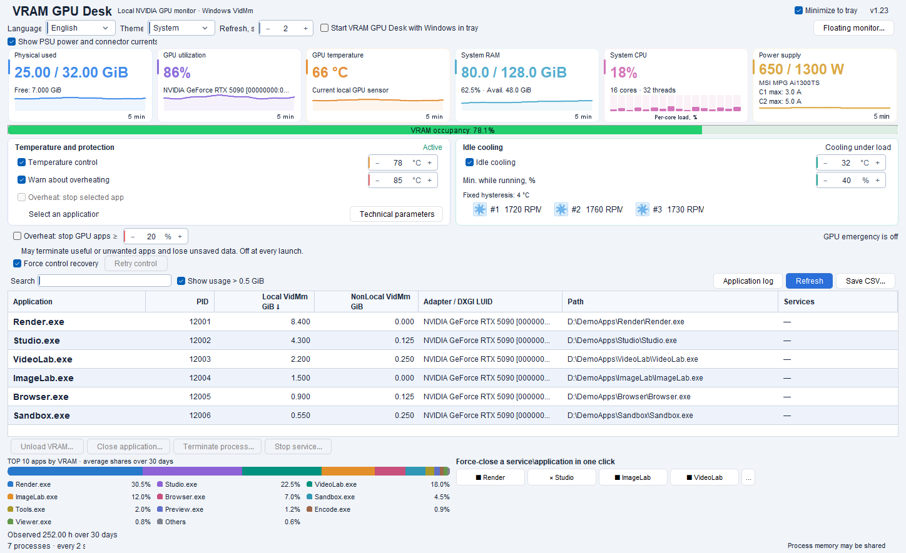

# VRAM GPU Desk 1.21

[English](README.md) · [Русский](README.ru.md) · [Deutsch](README.de.md) · [Español](README.es.md) · [Français](README.fr.md) · [Italiano](README.it.md) · [中文](README.zh.md) · [한국어](README.ko.md) · [日本語](README.ja.md) · [العربية](README.ar.md) · [हिन्दी](README.hi.md) · [Tiếng Việt](README.vi.md)

**Surveillance locale de mémoire et régulation thermique des GPU NVIDIA pour Windows x64. NVIDIA uniquement ; les GPU AMD et Intel ne sont pas pris en charge.**

## À quoi sert l’application

- **Surveiller et libérer la VRAM NVIDIA sous Windows.** Forcer la fermeture d’applications pour libérer de la VRAM, notamment grâce à des boutons rapides configurables en un clic liés à l’instance exacte sélectionnée.
- **Gérer les applications qui se disputent la VRAM.** Pour plusieurs tâches simultanées : modèles locaux de génération de code, génération d’images et de vidéos, transcription et analyse de données.
- **Régulation progressive de la température et refroidissement.** Réguler la température du GPU de manière souple au moyen des limites de puissance et de fréquence prises en charge, et le refroidir en charge comme au repos.
- **Mode d’urgence en cas de surchauffe.** Un mode facultatif peut forcer la fermeture d’applications sollicitant fortement le GPU pour réduire la charge. Il est DÉSACTIVÉ à chaque lancement ; la fermeture forcée peut faire perdre du travail non enregistré.

## Fonctionnalités principales

- Puissance de l’alimentation et courants de deux connecteurs GPU au maximum, selon le modèle et les capteurs ; option désactivée par défaut.
- Contraste automatique du texte activé par défaut ; sa désactivation permet de choisir manuellement un texte clair ou sombre.

- Suivi local de la VRAM, de la charge et de la température NVIDIA, de la RAM système et de la charge CPU, avec graphiques et barres par cœur.
- Mémoire GPU par processus, recherche, tri et export CSV en UTF-8.
- Contrôle de température et refroidissement au repos adaptés aux capacités de chaque GPU.
- Quatre boutons configurables en un clic liés à des instances précises de processus ; la fermeture d’urgence facultative est DÉSACTIVÉE à chaque lancement.
- Les 10 principales applications selon l’utilisation de VRAM enregistrée sur 30 jours.
- 12 langues, deux thèmes, zone de notification et démarrage facultatif avec Windows.
- Deux panneaux NVIDIA avec des réglages indépendants ; le contrôle du second GPU est expérimental.
- Avertissement de perte de contrôle et nouvelle tentative manuelle ; récupération ACTIVÉE pour les nouveaux réglages, arrêt enregistré respecté.

Version **1.21** · [Installation Windows](downloads/VRAM-GPU-Desk-1.21-Setup-x64.exe) · [ZIP d’installation](downloads/VRAM-GPU-Desk-1.21-Installer.zip)

**RAM, CPU et surveillance facultative des alimentations intelligentes/AI**

- RAM : utilisée/totale en GiB, mémoire disponible et graphique sur cinq minutes.
- CPU : utilisation globale et barres par cœur physique ; sans température CPU.
- Alimentation intelligente/AI compatible : watts de sortie et courants de deux ports GPU physiques au maximum si disponibles ; désactivée par défaut.

Compatibilité : capteurs MSI MPG Ai1300TS vérifiés sur matériel réel ; lecteurs qualifiés pour Ai1600TS et certains Corsair HXi/RMi et Thermaltake DPS G/iRGB PLUS, dont la validation matérielle reste à faire.

## Indicateurs RAM, CPU et alimentations intelligentes/AI

- **RAM système :** mémoire physique utilisée/totale en GiB, pourcentage d’utilisation, mémoire disponible et graphique sur cinq minutes.
- **CPU :** pourcentage d’utilisation globale, nombre de cœurs physiques et de threads logiques, avec une barre de charge par cœur physique. Seule la charge est affichée, sans température CPU.
- **Alimentations USB numériques/intelligentes/AI compatibles :** la lecture seule affiche la puissance de sortie mesurée lorsqu’elle est fournie et les courants de deux ports physiques d’alimentation GPU au maximum, dont six courants de contacts par port si disponibles. La lecture a été vérifiée sur **MSI MPG Ai1300TS**. Les valeurs calculées sont identifiées séparément ; un courant de rail n’est pas celui d’un connecteur individuel.

La surveillance de l’alimentation dispose d’une case distincte et est **désactivée par défaut**. Si elle est désactivée ou si aucune alimentation compatible n’est détectée, sa carte est masquée et les autres occupent la largeur sans emplacement vide. Après détection, sa carte reste visible avec des tirets lorsque les mesures sont temporairement indisponibles.

Avec deux GPU NVIDIA, les indicateurs RAM, CPU et alimentation sont communs et n’apparaissent qu’une fois. Une étiquette « AI » ou commerciale ne garantit pas la compatibilité : le modèle et le protocole comptent. Voir [compatibilité des alimentations](docs/psu-compatibility.md). L’image utilise des valeurs synthétiques de démonstration, pas des résultats de mesures matérielles.

[Sans alimentation : autres cartes élargies](images/without-psu-strip.png)

### Quelles alimentations sont compatibles ?

| Modèles / identité qualifiée | Mesures et validation |
| --- | --- |
| MSI MPG Ai1300TS PCIE5 / Ai1600TS PCIE5 | Ai1300TS : capteurs vérifiés sur matériel réel, sortie W mesurée et deux ports avec six courants de contacts chacun. Ai1600TS : lecteur implémenté et protocole qualifié ; pas de test matériel. |
| Corsair HX750i, HX850i, HX1000i, HX1200i, HX1500i; RM650i, RM750i, RM850i, RM1000i | Sortie W mesurée ; pas de courant par port GPU. Lecteur implémenté, tests synthétiques réussis ; validation matérielle en attente. Uniquement les identités USB de la liste complète. |
| Thermaltake DPS G / iRGB PLUS | 264A:2329 uniquement. Sortie ≈W calculée par tension × courant des rails ; pas de courant par port GPU. Tests synthétiques réussis ; validation matérielle en attente. |
| NZXT E500 / E650 / E850 | Lecteur partiel supplémentaire : capteurs de rails, sans sortie totale mesurée ni courants de ports physiques pour la carte PSU. Tests synthétiques réussis ; prise en charge partielle de la carte. |

Recherche uniquement : aucun adaptateur 1.21 pour be quiet! Dark Power Pro 14 IO 1300W/1600W. Aucun lecteur qualifié 1.21 pour Seasonic et ASUS. L’étiquette « AI » ne garantit pas la compatibilité.

## Nouveautés 1.21 — alimentation facultative et contraste automatique

**Disposition facultative.** Si la surveillance est désactivée ou si aucune alimentation compatible n’est détectée, sa carte est masquée et les autres utilisent la largeur disponible, sans emplacement vide. Après détection d’une alimentation, sa carte reste visible avec des tirets lorsque les mesures sont temporairement indisponibles.

**Tableau de bord plus compact.** La carte « Temps avec VRAM > 50 % » a été retirée des vues à un et deux GPU. Le classement des applications sur 30 jours et l’historique enregistré sont conservés.

**La surveillance de l’alimentation est désactivée par défaut.** Une case distincte ajoute une carte indiquant la puissance de sortie disponible et les courants de deux connecteurs GPU réels au maximum. Les valeurs absentes ou périmées affichent — ; les courants des rails ne sont pas assimilés à ceux de connecteurs individuels. Le composant protégé de lecture seule s’installe lors de la configuration UAC unique et n’acquiert aucun contrôle GPU.

**La compatibilité dépend du modèle.** La lecture a été vérifiée sur MSI MPG Ai1300TS. Ai1600TS est qualifié par protocole. Certains Corsair HXi/RMi, Thermaltake DPS G/iRGB PLUS et, en complément, NZXT E ont passé des tests synthétiques ; leur validation matérielle reste à faire. Corsair fournit des watts mesurés, le total Thermaltake est explicitement calculé ; NZXT fournit les rails sans inventer de total. be quiet! Dark Power Pro 14 IO a été étudié ; aucun lecteur n’est qualifié pour Seasonic OptiGuard ou ASUS. Aucune prise en charge globale des six marques n’est annoncée. Voir [compatibilité des alimentations](docs/psu-compatibility.md).

**Le contraste automatique du texte est activé par défaut.** Le texte s’adapte au fond ; désactivez cette option pour choisir manuellement un texte clair ou sombre. Transparence, indicateurs compacts, deux superpositions NVIDIA distinctes, double-clic vers la fenêtre, positions et couleurs/sons de température sont conservés.

Les captures graphite utilisent des données synthétiques, alimentation comprise. Les réglages GPU, actions sur les processus, modes d’urgence et choix enregistrés sont conservés.

Deux GPU NVIDIA : avec les mesures de l’alimentation / sans alimentation compatible.

## 1.20.1

Double-cliquez sur l’indicateur pour ouvrir la fenêtre principale.

## 1.20 — Moniteur GPU flottant

Moniteur compact transparent au-dessus des fenêtres Windows ordinaires, sans panneau de fond. Une fenêtre indépendante de ≈164 × 114 pixels physiques par GPU NVIDIA, pour deux cartes au maximum. Position séparée enregistrée, déplacement, verrouillage, échelle et contraste réglables. Affichage masqué par défaut ; son activé par défaut et désactivable séparément. Utilise la télémétrie existante sans contrôle GPU supplémentaire.

Occupation VRAM et charge GPU ; température : ≤40 vert, 41–75 jaune, 76–81 orange, 82–86 rouge, ≥87 clignotant. Son dès 88 °C.

Données synthétiques de démonstration et états simulés des régulateurs. Les deux options d’urgence sont DÉSACTIVÉES à chaque lancement. La récupération est ACTIVÉE pour les nouveaux réglages ; un arrêt enregistré est préservé.

> **Contrôle du GPU:** Le contrôle des paramètres de température du GPU nécessite une confirmation UAC lors de l’installation du composant de contrôle. L’activation ultérieure du contrôle de température et du refroidissement ne demande plus de confirmation UAC. La surveillance seule ne nécessite pas d’UAC.

> **Contrôle simultané du GPU:** Le contrôle des paramètres de température du GPU peut entrer en conflit avec des programmes qui modifient simultanément la puissance, les fréquences ou la vitesse des ventilateurs, par exemple MSI Afterburner. Utilisez un seul régulateur actif pour ces paramètres. Cet avertissement concerne les modifications simultanées, pas la surveillance passive.

## Nouveautés de 1.19 : adaptation par GPU pour NVIDIA RTX 30, 40 et 50

**Les limites réelles du GPU, sans puissance fixe prédéfinie.** Chaque session lit ses limites de puissance et conserve la limite initiale comme plafond de session et référence de restauration, au lieu de la valeur d’usine. L’acquisition de la session n’écrit initialement ni puissance ni fréquence. Les variations de puissance sont proportionnées à **1 % de la valeur initiale de session par seconde**, dans les limites communiquées et le plafond de session. Les ajustements de fréquence sont relatifs à une plage prise en charge et validée.

**Utiliser uniquement les commandes disponibles.** Si le contrôle des fréquences est indisponible, la régulation prise en charge par la seule puissance reste possible. Une température valide permet ce mode même si la charge GPU est inconnue. Une cible supérieure à une limite thermique matérielle communiquée est bloquée ; les limites absentes restent inconnues. Les fonctions non prises en charge restent visibles comme indisponibles. La récupération des ventilateurs est indépendante de celle du client de puissance. BIOS, OEM, pilote et restrictions des portables peuvent modifier les capacités ; chaque GPU est évalué séparément.

**Les références sont distinctes des commandes.** La [référence RTX 30 et suivantes](docs/nvidia-rtx30-plus/README.md) et le [CSV UTF-8](docs/nvidia-rtx30-plus/REFERENCE-GPUS.csv) couvrent **45 groupes de modèles/variantes : 27 de bureau et 18 portables**. Il s’agit de groupes documentaires, pas de 45 essais matériels ; les puissances publiées et le TGP ne sont pas des préréglages exécutables. La ligne RTX 3060 Ti à 200 W décrit la spécification de référence, pas toutes les variantes GDDR6X ou OEM.

**Zone CPU compacte avec deux GPU.** Le bas de la carte CPU s’aligne désormais sur le panneau voisin de refroidissement au repos, au-dessus des lignes d’urgence et de récupération. La RAM reste au-dessus ; la charge CPU et les barres des cœurs physiques restent visibles. La vue à six cartes pour un seul GPU ne change pas.

## Nouveautés de 1.18 : charge CPU et espace plus clair pour deux GPU

**La charge CPU à côté de la RAM système.** La carte CPU affiche la charge globale, les nombres de cœurs physiques et de threads logiques et une barre de charge instantanée par cœur physique. Chaque barre regroupe les threads logiques de son cœur ; le pourcentage global est pondéré par les processeurs logiques. Les mesures intégrées à Windows ne demandent ni UAC supplémentaire, ni pilote, ni autre application de surveillance. Les mesures absentes, invalides ou vieilles de plus de six secondes affichent **—** et des barres de cœur indisponibles.

**Un GPU : six cartes à 1200×900.** Les quatre cartes GPU, la RAM et la charge CPU restent visibles ensemble. **Deux GPU NVIDIA : minimum 1920×1050.** Chaque GPU dispose de son bloc 2×2 de quatre cartes, de mesures alignées et de toutes ses commandes. De fines séparations verticales délimitent les zones GPU et la colonne commune à droite : RAM en haut, carte CPU plus haute en dessous. RAM et CPU n’apparaissent qu’une fois et ne dépendent pas du GPU sélectionné. Le contrôle du second GPU reste expérimental.

Les trois indicateurs de ventilateur restent visibles grâce au retour à la ligne lorsque l’espace manque. La logique de commande des ventilateurs reste inchangée. Les boutons rapides compacts, la lisibilité des processus et tous les réglages précédents sont conservés.

## Nouveautés de 1.17 : la RAM système en un coup d’œil

Une cinquième carte **RAM système** affiche la mémoire physique utilisée/totale en GiB, le pourcentage utilisé, la mémoire disponible et un graphique sur cinq minutes. Le total correspond à la RAM physique utilisable par Windows ; il s’agit de mémoire système, distincte de la VRAM et de la limite d’engagement incluant le fichier d’échange.

Les mesures de RAM concernent tout l’ordinateur et ne dépendent pas du GPU sélectionné. Avec deux panneaux NVIDIA, le principal affiche cinq cartes et le second conserve ses quatre cartes GPU ; la RAM système n’apparaît qu’une fois. Les commandes GPU existantes restent disponibles.

La RAM utilise l’intervalle de rafraîchissement existant et ne demande pas d’UAC. Les mesures absentes, invalides ou vieilles de plus de six secondes affichent **—**, avec une interruption du graphique plutôt qu’une valeur inventée.

## Nouveautés de 1.16 : récupération plus fiable et réduction au choix

**La récupération du contrôle est activée pour les réglages nouveaux ou sans ce paramètre.** Le choix est enregistré par GPU ; une désactivation explicite déjà enregistrée est conservée. La reconnexion concerne la même carte, avec des délais et une fin confirmée de l’ancien client. Elle ne garantit pas un contrôle exclusif face à MSI Afterburner ou à un autre régulateur.

**Choisissez comment réduire la fenêtre.** « Réduire dans la zone de notification » est activé par défaut. Désactivez cette option pour une réduction classique dans la barre des tâches Windows. Le choix est conservé ; le démarrage avec Windows reste indépendant.

**Communication plus fiable et état plus clair.** Le délai des requêtes Java passe à 7 secondes pour couvrir la fenêtre de réponse de 6 secondes du canal natif avec une marge. Le watchdog natif commence après la prise en charge réussie du GPU ; sa protection de 6 secondes est conservée. Les erreurs et anciennes mesures ne sont plus présentées comme récentes : les anciennes valeurs RPM sont masquées et les délais de communication distingués des changements externes confirmés. Un journal local limité conserve erreurs et métadonnées des réponses lentes, sans secrets de connexion.

## Nouveautés de 1.15 : panneaux NVIDIA indépendants et récupération du contrôle

Deux GPU NVIDIA pris en charge disposent de mesures propres, de quatre graphiques chacun et de réglages indépendants. **Le contrôle du second GPU NVIDIA est expérimental.** Une NVIDIA associée à AMD/Intel utilise un panneau NVIDIA. Le sélecteur GPU filtre la liste commune des processus et leur historique ; il ne réaffecte aucun régulateur.

**Les quatre boutons rapides compacts restent sur une ligne horizontale.** Le menu commun `⋮` permet Affecter/Réaffecter, Renommer et Effacer pour chaque emplacement, même si la cible a disparu. Un nom personnalisé se modifie sans nouvelle liaison ; le texte tient dans la largeur disponible et le nom complet reste dans l’infobulle. Les vérifications exactes du PID, de la date de création et du chemin sont conservées.

**La perte de contrôle affiche un avertissement et une nouvelle tentative manuelle. Dans 1.16, la récupération est ACTIVÉE pour les réglages nouveaux ou sans ce paramètre et enregistrée par GPU ; un arrêt explicite enregistré est préservé.** Les tentatives utilisent des délais de 5/10/30/60 secondes, une fin confirmée de l’ancien client et des mesures récentes du même GPU. Les contrôles natifs de lease, propriété, relecture et sécurité restent obligatoires. Elle ne peut pas bloquer exclusivement MSI Afterburner ou un autre régulateur. Les deux options d’urgence restent DÉSACTIVÉES à chaque lancement.

Vérifié pour 1.15 : **2262 contrôles UI**, **215 natifs**, **61 de cycle de vie/I/O des clients**, **48 de récupération**, **167 fichiers** et **93 classes Java**. Minimum : un GPU **1200×900**, deux panneaux **1600×950**. Le consentement à la fermeture par l’installateur et le lancement final coché par défaut de 1.14 sont conservés.

## Nouveautés de la version 1.14

**1.12 – Graphite Studio :** L’interface compacte affiche les 17 réglages et douze actions principales à 1200×900, avec sept colonnes, six lignes de processus, quatre graphiques et l’historique Top 10. Les noms des processus sont en gras, 14 pt, avec un contraste élevé. Graphite est proposé aux nouveaux profils ; un choix explicite enregistré de System ou Graphite est conservé.

**1.13 – hystérésis visible :** L’écart fixe de 4 °C est affiché. L’explication dynamique donne notamment 32→36 °C et 35→39 °C. Cet ajout ne change pas l’algorithme de refroidissement.

**1.14 – mise à jour et lancement :** Si l’instance JVM propre à l’application et précisément vérifiée fonctionne encore, l’installation demande Oui/Non/Annuler avant de la fermer. Windows Restart Manager utilise les flags 0, sans arrêt forcé. L’installation attend la fin normale des composants de contrôle et la libération des fichiers. Non, refus, délai dépassé ou fichier verrouillé bloquent la mise à jour ; le mode silencieux ne ferme rien automatiquement.

« Lancer VRAM GPU Desk après l’installation » est **coché par défaut** et peut être décoché. Un lanceur fixe autorise le démarrage normal avec le jeton Medium du même utilisateur. Si ce contexte manque, utilisez ensuite le raccourci normal du menu Démarrer. Le démarrage avec Windows reste un choix séparé, conservé.

La validation couvre 107 contrôles RM, 17 du lanceur et neuf cas d’intégration Pascal, les 166 fichiers, 88 classes Java et des lancements empaquetés via des chemins Unicode.

## Fonctions

- Affiche VRAM physique utilisée/libre, charge GPU et température avec de petits graphiques historiques.
- Liste les applications et services locaux utilisant la mémoire GPU, avec recherche, tri et filtre facultatif **au-delà de 0,5 GiB**.
- Affiche les dix principales applications et « Autres » en parts normalisées des relevés de mémoire des processus observés pendant les 30 derniers jours. Le total vaut 100 % ; c’est une répartition historique des relevés, pas une décomposition additive de la VRAM physique.
- Exporte un rapport CSV UTF-8 vers un emplacement local choisi.
- Enregistre le choix entre réduction dans la zone de notification et réduction classique dans la barre des tâches Windows, restaure la fenêtre existante au lancement suivant et propose le démarrage facultatif avec Windows.
- Offre thèmes système et graphite sombre, douze langues et rafraîchissement de 1 à 5 secondes, 2 secondes par défaut.
- Régulation thermique douce facultative par les limites de puissance et de fréquence prises en charge. La protection est indépendante du rafraîchissement de l’interface.
- Refroidissement au repos, régimes des ventilateurs et icônes animées. Les nouveaux réglages demandent régulation et refroidissement au repos activés ; un arrêt manuel enregistré est conservé. La régulation active n’est affichée qu’après connexion confirmée.
- Alerte après au moins dix secondes strictement au-dessus du seuil choisi de 75–92 °C. Les pointes brèves ne déclenchent pas d’alerte.
- Option d’urgence distincte, initialement désactivée, pour l’application explicitement choisie. Fermer/terminer peut perdre le travail non enregistré ; les processus protégés ou invérifiables sont exclus.

## Quatre boutons d’action rapide

Attribuez **Fermer l’application** ou **Terminer le processus** à l’un des quatre boutons et modifiez l’attribution avec le menu `⋮` voisin. Chaque liaison vise l’instance explicitement choisie : PID, date de création et chemin de l’exécutable. À sa disparition, aucun autre processus ni PID réutilisé n’est sélectionné automatiquement.

Le bouton configuré agit d’un clic **sans confirmation supplémentaire**. Le travail non enregistré peut être perdu. Les contrôles natifs des processus protégés, critiques ou invérifiables restent actifs. L’option d’urgence distincte est initialement désactivée et conserve son comportement sur l’application sélectionnée.

## Urgence : terminer les processus sollicitant fortement le GPU — 1.11

Une option **distincte, désactivée à chaque lancement**, peut terminer les processus accessibles sollicitant fortement le GPU choisi après au moins **dix secondes** de température confirmée strictement supérieure au seuil de surchauffe. Le seuil de charge vaut **20 % par défaut**, réglable de **10 à 100 %** ; le processus doit maintenir cette charge pendant au moins **trois secondes**. La mesure utilise son moteur GPU le plus chargé, **pas la quantité de VRAM**.

**Attention : la fonction peut terminer des applications utiles comme indésirables et faire perdre le travail non enregistré.** Elle agit une seule fois et se désactive après la tentative. Une nouvelle tentative nécessite une réactivation explicite. Elle ne peut être activée sans mesures confirmées de charge des processus et capteur valide ; des données inconnues ou périmées n’autorisent aucune terminaison.

Le GPU est lié sans ambiguïté ; température et identité sont vérifiées à nouveau avant l’action. PID, date de création, chemin EXE et même handle de processus empêchent la sélection automatique d’un PID réutilisé. Les composants Windows/NVIDIA protégés, processus critiques ou invérifiables et l’utilitaire lui-même sont exclus. Aucun arbre de processus n’est terminé, aucun service arrêté et aucune élévation supplémentaire demandée. L’option existante pour une application explicitement choisie reste indépendante. C’est une mesure supplémentaire, pas une garantie contre les dommages matériels.

Vérifié pour 1.11 : 40 tests CPU natifs avec terminaisons simulées, 256 contrôles Java/catalogues/guardes, 673 contrôles d’interface dans 48 cas couvrant douze langues et deux thèmes, lecture de compteurs PDH réels, examen natif indépendant, les 164 fichiers et empreintes des brokers, installation/désinstallation isolée et lancement empaqueté avec Java intégrée dans des chemins Unicode.

## Températures cibles et hystérésis

Des seuils d’arrêt/reprise distincts et de courts délais évitent les basculements fréquents lorsque les valeurs fluctuent.

| Paramètre | Comportement réel | Raison |
|---|---|---|
| Cible au repos, **32 °C** par défaut, réglable 28–40 °C | Après trois secondes à 32 °C ou moins au repos, retour au mode AUTO du micrologiciel. Reprise à 36 °C, soit cible +4 °C. Avec une cible de 35 °C : reprise à 39 °C. | L’hystérésis de 4 °C évite les démarrages/arrêts répétés. Le micrologiciel AUTO décide de l’arrêt complet des ventilateurs. |
| Repos/charge | Jusqu’à 10 % de charge GPU, repos permis ; à partir de 15 %, courbe de charge. Entre 11 et 14 %, état précédent conservé. Charge inconnue : refroidissement maintenu. | Évite les basculements sur de petites variations. |
| Cible thermique douce, 70–88 °C | Puissance et fréquence sont ajustées progressivement selon la tendance thermique. La température peut être inférieure ou dépasser brièvement la cible. | Inertie, capteurs et pilote empêchent un plafond exact. C’est une cible de régulation, pas une coupure d’urgence. |
| Alerte de surchauffe | Relevé strictement supérieur au seuil pendant au moins dix secondes. | Écarte les pointes brèves. |

La température au repos **n’est pas** la limite en charge soutenue. Ambiance, micrologiciel et pilote influencent températures et ventilateurs. N’utilisez pas simultanément des régulateurs de ventilateur/fréquence concurrents sur la même carte.

## Matériel et prérequis

Pour NVIDIA GeForce **RTX 30 / 40 / 50**. Mesures et commandes dépendent du GPU et du pilote ; les commandes non prises en charge restent indisponibles, sans simulation.

Windows 10/11 x64, .NET Framework 4.8 et pilote NVIDIA compatible. Le runtime Java est inclus, sans installation séparée. L’utilisateur Windows connecté doit être administrateur avec un jeton de bureau filtré normal. L’installation demande UAC une fois et utilise un répertoire Program Files fixe et protégé. Les identifiants d’un autre administrateur ne sont pas pris en charge. Deux tâches protégées, uniquement à la demande, utilisent des lanceurs fixes et une communication locale typée. Le canal installé vise un démarrage sans nouvelle demande UAC ; si l’authentification échoue, la régulation reste indisponible sans autre élévation.

Pas de liste d’autorisation limitant versions de pilote ou empreintes DLL. NVML système doit réussir la vérification hors ligne de signature Windows avec signataire NVIDIA Corporation confirmé, chemins sûrs et API requises. Un nouveau pilote ne nécessite pas d’ajouter version/empreinte. L’absence de données de confiance locales peut empêcher la vérification ; l’application ne télécharge ni certificats ni pilotes.

## Installation et confidentialité

1. Téléchargez l’installateur et comparez SHA-256 à [SHA256SUMS.txt](SHA256SUMS.txt).
2. Lancez normalement depuis le compte administrateur connecté et acceptez UAC. Si une instance propre à l’application fonctionne, choisissez d’autoriser ou non sa fermeture normale. L’installation attend la fin des composants de contrôle et des fichiers libres ; Non, refus, délai dépassé ou verrouillage bloquent la mise à jour. Le dossier protégé est fixe.
3. Conservez le lancement après installation coché ou décochez-le. Sans contexte Medium adapté, ouvrez le raccourci normal du menu Démarrer. Choisissez le GPU et vérifiez le statut confirmé. Les réglages restent locaux et les désactivations enregistrées sont conservées. Ce lancement ponctuel n’active pas le démarrage avec Windows.

L’application utilise les interfaces locales Windows/GPU. Aucun envoi de télémétrie, inférence cloud, mise à jour automatique ou téléchargement de modèle à l’exécution n’est prévu. CSV, historique et réglages restent locaux. Cela **ne garantit pas** l’isolation réseau du système ni le comportement des pilotes tiers, diagnostics Windows ou logiciels de synchronisation.

L’installateur n’est pas signé. L’application est distribuée en binaires compilés ; **son code source n’est pas publié dans ce dépôt**. Le bytecode Java n’est pas chiffré et sa résistance à la décompilation n’est pas garantie. Les notices de licence du runtime tiers sont conservées.

Les captures utilisent des données synthétiques et un état de régulation simulé. Elles illustrent l’interface sans démontrer fonctionnement ou performances matérielles.

## Nouveautés de 1.10

- Quatre boutons configurables liés à une instance pour fermer/terminer d’un clic, réattribuables avec contrôles natifs conservés.
- Descriptions réduites, mini-graphiques de 35 à 55 pixels ; icône de notification contrastée conservée.
- Installation unique du composant protégé avec UAC. Nouveaux réglages thermiques/repos activés ; arrêts manuels enregistrés conservés.
- Correction prudente des alias : exclusion des alias confirmés d’affichage indirect sans rendu, sans fusionner des GPU physiques distincts par nom ou mémoire.
- Réparation des installations incomplètes sûres et indication précise de phase, code et HRESULT si le composant échoue.
- Conservation des thèmes, douze langues, historique local, CSV UTF-8, identité GPU et politiques de bail, surveillance et restauration.

Vérifié : 48 cas d’interface isolés dans douze langues et deux thèmes, icônes, valeurs initiales, liaisons/exécution des actions rapides, contrôles réels de jetons CLR, chemins Unicode, les 163 fichiers et empreintes des brokers intégrées, installation/désinstallation isolée et véritable enregistrement élevé de tâches temporaires avec relecture XML/DACL, annulation et nettoyage. Les tâches **n’ont pas été exécutées** ; aucune tâche de production n’a été appelée par le test.

Les captures sont synthétiques avec régulation simulée.

## Licence

L’utilisation non commerciale est gratuite sous [PolyForm Noncommercial 1.0.0](LICENSE.md), dans le respect de ses conditions et obligations de notification. L’usage commercial nécessite une autorisation distincte. Il ne s’agit pas d’une licence open source ; le code source de l’application n’est pas publié. Les licences des runtimes tiers restent inchangées.

[Fond clair](images/floating-monitor-light.png) · [GPU × 2](images/dual-floating-monitors-light.png)

**1080p → ≈122 × 86 px · 1440p → ≈164 × 114 px · 2160p / 4K → ≈245 × 171 px**

## Soutenir le projet

Si VRAM GPU Desk vous est utile, vous pouvez [soutenir volontairement son développement](https://github.com/2018-spec-fdsds/multiroute-downloader/blob/main/docs/support.md).

Scannez le code QR avec un portefeuille compatible.
