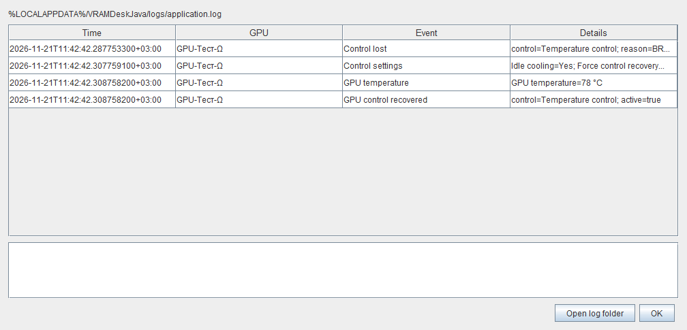
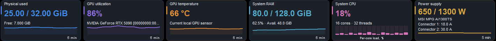
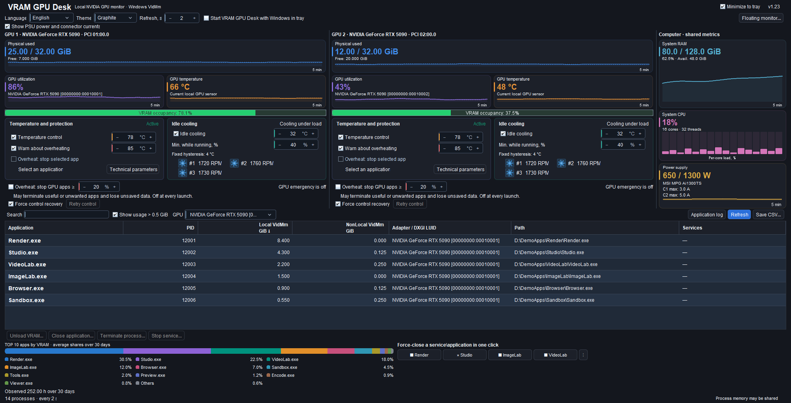
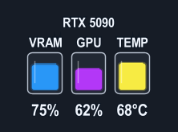

# VRAM GPU Desk 1.22

[English](README.md) · [Русский](README.ru.md) · [Deutsch](README.de.md) · [Español](README.es.md) · [Français](README.fr.md) · [Italiano](README.it.md) · [中文](README.zh.md) · [한국어](README.ko.md) · [日本語](README.ja.md) · [العربية](README.ar.md) · [हिन्दी](README.hi.md) · [Tiếng Việt](README.vi.md)

**Monitoraggio locale della memoria e controllo della temperatura delle GPU NVIDIA per Windows x64. Solo NVIDIA; le GPU AMD e Intel non sono supportate.**

## A cosa serve l’applicazione

- **Monitorare e liberare la VRAM NVIDIA in Windows.** Forzare la chiusura delle applicazioni per liberare VRAM, anche con pulsanti rapidi configurabili a un clic associati all’esatta istanza selezionata.
- **Gestire le applicazioni che competono per la VRAM.** Per più attività contemporanee: modelli locali per generare codice, generazione di immagini e video, trascrizione e analisi dei dati.
- **Regolazione graduale della temperatura e raffreddamento.** Regolare la temperatura della GPU in modo flessibile tramite i limiti di potenza e frequenza supportati e raffreddarla sia sotto carico sia in inattività.
- **Modalità di emergenza per surriscaldamento.** Una modalità facoltativa può forzare la chiusura di applicazioni che caricano molto la GPU per ridurne il carico. È DISATTIVATA a ogni avvio; la chiusura forzata può causare la perdita del lavoro non salvato.

## Funzionalità principali

- Tentativi continui di ripristino, registro con data e ora ed etichette distinte per corrente massima del contatto o totale del connettore.

- Potenza dell’alimentatore e correnti di un massimo di due connettori GPU, se disponibili per il modello; opzione disattivata per impostazione predefinita.
- Contrasto automatico del testo attivo per impostazione predefinita; disattivandolo si sceglie manualmente testo chiaro o scuro.

- Monitoraggio locale di VRAM, carico e temperatura NVIDIA, RAM di sistema e utilizzo CPU, con grafici e barre per core.
- Memoria GPU per processo, ricerca, ordinamento ed esportazione CSV in UTF-8.
- Controllo della temperatura e raffreddamento in inattività adattati alle capacità di ogni GPU.
- Quattro pulsanti configurabili con un clic associati a istanze precise dei processi; la terminazione di emergenza facoltativa è DISATTIVATA a ogni avvio.
- Le 10 applicazioni principali per uso di VRAM registrato su 30 giorni.
- 12 lingue, due temi, area di notifica e avvio facoltativo con Windows.
- Due pannelli NVIDIA con impostazioni indipendenti; il controllo della seconda GPU è sperimentale.
- Avviso di perdita del controllo e nuovo tentativo manuale; ripristino ATTIVO per le nuove impostazioni, disattivazione salvata rispettata.

Versione **1.20.1** · [Installer Windows](downloads/VRAM-GPU-Desk-1.22-Setup-x64.exe) · [ZIP di installazione](downloads/VRAM-GPU-Desk-1.22-Installer.zip)

**RAM, CPU e monitoraggio opzionale di alimentatori intelligenti/AI**

- RAM: usata/totale in GiB, memoria disponibile e grafico di cinque minuti.
- CPU: utilizzo complessivo e barre per core fisico; senza temperatura CPU.
- Alimentatore intelligente/AI compatibile: watt in uscita e correnti di massimo due porte GPU fisiche quando disponibili; disattivato per impostazione predefinita.

Compatibilità: sensori MSI MPG Ai1300TS verificati su hardware reale; lettori qualificati per Ai1600TS e alcuni Corsair HXi/RMi e Thermaltake DPS G/iRGB PLUS, con verifica fisica ancora da effettuare.

## Novità della versione 1.22 — ripristino continuo, registro e correnti dell’alimentatore più chiare

**Ripristino continuo del controllo.** Finché il ripristino forzato è attivo, i tentativi verificati continuano senza limite di numero: dopo 5, 10, 30 e poi ogni 60 secondi. L’ultima scelta ATTIVO/DISATTIVO viene conservata durante l’arresto e il riavvio del controller. L’avviso non modale di perdita del controllo si chiude automaticamente solo dopo la conferma da telemetria recente. Restano attivi i controlli di proprietà, arresto completo del client precedente e limiti hardware; ciò non fornisce controllo esclusivo rispetto a MSI Afterburner o altri regolatori.

**Registro dell’applicazione.** Un pulsante dedicato apre gli eventi di perdita, ripristino e nuovo tentativo per ogni GPU, oltre agli stati iniziali e alle modifiche di tutte le caselle relative al controllo. Ogni voce contiene ora UTC e locale. La temperatura viene registrata da **78 °C**, con le successive variazioni in gradi interi e il ritorno sotto 78 °C. Il visualizzatore mostra fino a 500 eventi della sessione corrente. I file UTF-8 restano locali in `%LOCALAPPDATA%/VRAMDeskJava/logs/application.log`, con rotazione a 2 MiB e cinque archivi.

**Corrente massima del contatto o totale del connettore.** Per ciascuna delle due porte fisiche di alimentazione GPU al massimo, la scheda mostra la maggiore corrente individuale disponibile se almeno una lettura è nota, anche con dati parziali. In assenza di letture individuali mostra invece la corrente totale misurata del connettore. Le etichette distinguono esplicitamente **massimo** e **totale**. I sensori sconosciuti restano —; uno zero misurato resta zero. Le descrizioni conservano le letture dei contatti e il totale disponibili. La corrente di un rail non sostituisce una misura del connettore.

**Aggiornamento da una vecchia installazione 1.9.** Una copia in LocalAppData può restare in esecuzione anche se 1.22 è correttamente installata in Program Files, mostrando l’interfaccia precedente senza le nuove opzioni. Prima dell’installazione, esci dalla vecchia copia tramite il menu nell’area di notifica; dopo usa il collegamento attuale del menu Start e verifica **v1.22**. Se un collegamento punta ancora alla vecchia cartella, apri la copia installata in Program Files e correggilo. Una vecchia finestra ancora aperta non significa che le nuove impostazioni siano state eliminate.

## Indicatori di RAM, CPU e alimentatori intelligenti/AI

- **RAM di sistema:** memoria fisica usata/totale in GiB, percentuale di utilizzo, memoria disponibile e grafico di cinque minuti.
- **CPU:** percentuale complessiva di utilizzo, numero di core fisici e thread logici, più una barra di carico per ciascun core fisico. Si mostra solo il carico, senza temperatura CPU.
- **Alimentatori USB digitali/intelligenti/AI compatibili:** lettura dei sensori con potenza di uscita misurata, quando comunicata, e correnti di un massimo di due porte fisiche di alimentazione GPU, comprese sei letture di corrente dei contatti per porta se disponibili. La lettura è stata verificata su **MSI MPG Ai1300TS**. I valori calcolati sono indicati separatamente; la corrente di una linea non è quella di un singolo connettore.

Il monitoraggio dell’alimentatore ha una casella separata ed è **disattivato per impostazione predefinita**. Se disattivato o senza un alimentatore compatibile rilevato, la scheda è nascosta e le altre sfruttano la larghezza senza spazi vuoti. Dopo il rilevamento, la scheda rimane con trattini quando le letture sono temporaneamente indisponibili.

Con due GPU NVIDIA, gli indicatori RAM, CPU e alimentatore sono condivisi e compaiono una sola volta. Un’etichetta «AI» o commerciale non garantisce compatibilità: contano modello e protocollo. Vedere [compatibilità degli alimentatori](docs/psu-compatibility.md). L’immagine usa valori dimostrativi sintetici, non risultati di misurazioni hardware.

[Senza alimentatore: altre schede allargate](images/without-psu-strip.png)

### Quali alimentatori sono compatibili?

| Modelli / identità qualificata | Dati e verifica |
| --- | --- |
| MSI MPG Ai1300TS PCIE5 / Ai1600TS PCIE5 | Ai1300TS: sensori verificati su hardware reale, uscita W misurata e due porte con sei correnti di contatto ciascuna. Ai1600TS: lettore implementato e protocollo qualificato; nessuna prova fisica. |
| Corsair HX750i, HX850i, HX1000i, HX1200i, HX1500i; RM650i, RM750i, RM850i, RM1000i | W in uscita misurati; nessuna corrente per singola porta GPU. Lettore implementato, test sintetici superati; verifica fisica da effettuare. Solo le identità USB nell’elenco completo. |
| Thermaltake DPS G / iRGB PLUS | Solo 264A:2329. Uscita ≈W calcolata da tensione × corrente delle linee; nessuna corrente per porta GPU. Test sintetici superati; verifica fisica da effettuare. |
| NZXT E500 / E650 / E850 | Lettore parziale aggiuntivo: sensori delle linee, senza uscita totale misurata né correnti delle porte fisiche per la scheda PSU. Test sintetici superati; supporto della scheda non completo. |

Solo ricerca: nessun adattatore 1.21 per be quiet! Dark Power Pro 14 IO 1300W/1600W. Seasonic e ASUS non hanno lettori qualificati in 1.21. L’etichetta «AI» non garantisce compatibilità.

## Novità 1.21 — alimentatore opzionale e contrasto automatico

**Disposizione opzionale.** Se il monitoraggio è disattivato o non viene rilevato un alimentatore compatibile, la sua scheda è nascosta e le altre sfruttano la larghezza disponibile, senza spazi vuoti. Dopo il rilevamento, se le letture sono temporaneamente indisponibili, la scheda rimane visibile con trattini.

**Pannello più compatto.** La scheda «Tempo con VRAM > 50%» è stata rimossa dalle viste con una e due GPU. Restano la classifica delle applicazioni su 30 giorni e la cronologia salvata.

**Il monitoraggio dell’alimentatore è disattivato per impostazione predefinita.** Una casella separata aggiunge una scheda con la potenza di uscita disponibile e le correnti di un massimo di due connettori GPU reali. Valori mancanti o obsoleti mostrano —; le correnti delle linee non vengono presentate come correnti di singoli connettori. Il componente protetto di sola lettura viene installato con l’unica configurazione UAC e non acquisisce il controllo GPU.

**La compatibilità dipende dal modello.** La lettura è stata verificata su MSI MPG Ai1300TS. Ai1600TS è qualificato a livello di protocollo. Alcuni Corsair HXi/RMi, Thermaltake DPS G/iRGB PLUS e, inoltre, NZXT E hanno superato test sintetici; manca la verifica fisica. Corsair fornisce watt misurati, il totale Thermaltake è indicato come calcolato; NZXT fornisce le linee senza inventare un totale. be quiet! Dark Power Pro 14 IO è stato studiato; nessun lettore è qualificato per Seasonic OptiGuard o ASUS. Non si dichiara supporto universale per sei marchi. Vedere [compatibilità degli alimentatori](docs/psu-compatibility.md).

**Il contrasto automatico del testo è attivo per impostazione predefinita.** Il testo si adatta allo sfondo; disattivare l’opzione per scegliere manualmente testo chiaro o scuro. Restano trasparenza, indicatori compatti, due overlay NVIDIA separati, doppio clic verso la finestra, posizioni e colori/suoni della temperatura.

Le immagini in grafite usano dati dimostrativi sintetici, alimentatore incluso. Restano invariati impostazioni GPU, azioni sui processi, modalità di emergenza e preferenze salvate.

Due GPU NVIDIA: con dati dell’alimentatore / senza alimentatore compatibile.

## 1.20.1

Fai doppio clic sull’indicatore per aprire la finestra principale.

## 1.20 — Monitor GPU mobile

Monitor compatto trasparente sopra le normali finestre Windows, senza pannello di sfondo. Una finestra indipendente di ≈164 × 114 pixel fisici per GPU NVIDIA, fino a due schede. Posizioni salvate separatamente, spostamento, blocco, scala e contrasto regolabili. Nascosto per impostazione predefinita; audio attivo e disattivabile separatamente. Riutilizza la telemetria esistente senza ulteriore controllo GPU.

Uso VRAM e carico GPU; temperatura: ≤40 verde, 41–75 giallo, 76–81 arancione, 82–86 rosso, ≥87 lampeggiante. Suono da 88 °C.

Dati dimostrativi sintetici e stati simulati dei regolatori. Entrambe le opzioni di emergenza sono DISATTIVATE a ogni avvio. Il ripristino è ATTIVO per le nuove impostazioni; una disattivazione salvata viene mantenuta.

> **Controllo GPU:** Il controllo dei parametri di temperatura della GPU richiede una conferma UAC durante l’installazione del componente di controllo. In seguito, controllo della temperatura e raffreddamento si attivano senza ulteriori richieste UAC. Il solo monitoraggio non richiede UAC.

> **Controllo simultaneo della GPU:** Il controllo dei parametri di temperatura della GPU può entrare in conflitto con altri programmi che modificano contemporaneamente potenza, frequenze o velocità delle ventole, ad esempio MSI Afterburner. Usare un solo regolatore attivo per questi parametri. L’avviso riguarda le modifiche simultanee, non il monitoraggio passivo.

## Novità della 1.19: adattamento per dispositivo NVIDIA RTX 30, 40 e 50

**Limiti effettivi della GPU, non una potenza fissa.** Ogni sessione legge i limiti di potenza della propria GPU e conserva il limite iniziale come tetto di sessione e base di ripristino, anziché usare il valore di fabbrica. L’acquisizione della sessione non scrive inizialmente potenza o frequenza. Le variazioni di potenza scalano dell’**1% del valore iniziale di sessione al secondo**, entro i limiti rilevati e il tetto di sessione. Le regolazioni delle frequenze sono relative a un intervallo supportato e validato.

**Solo controlli disponibili.** Se il controllo delle frequenze non è supportato, resta disponibile la regolazione supportata della sola potenza. Una temperatura valida consente questa modalità anche con utilizzo GPU sconosciuto. Un obiettivo superiore a un limite termico hardware comunicato viene bloccato; i limiti mancanti restano sconosciuti. Le funzioni non supportate restano visibili come indisponibili. Il ripristino delle ventole è indipendente da quello del client di potenza. BIOS, OEM, driver e restrizioni dei portatili possono variare le capacità; ogni GPU viene valutata separatamente.

**I riferimenti non sono comandi di controllo.** Il [riferimento RTX 30 e successive](docs/nvidia-rtx30-plus/README.md) e il [CSV UTF-8](docs/nvidia-rtx30-plus/REFERENCE-GPUS.csv) comprendono **45 gruppi di modelli/varianti: 27 desktop e 18 portatili**. Sono gruppi documentali, non 45 prove hardware; potenze pubblicate e TGP non sono preimpostazioni eseguibili. La riga RTX 3060 Ti da 200 W indica la specifica di riferimento, non tutte le varianti GDDR6X o OEM.

**Area CPU compatta con due GPU.** Il bordo inferiore della scheda CPU è ora allineato al pannello adiacente di raffreddamento in inattività, sopra le righe di emergenza e ripristino. La RAM resta sopra; carico CPU e barre dei core fisici rimangono visibili. La vista a sei schede per una sola GPU non cambia.

## Novità della 1.18: utilizzo CPU e spazio più chiaro per due GPU

**Carico CPU accanto alla RAM di sistema.** La scheda CPU mostra utilizzo totale, numero di core fisici e thread logici e una barra di utilizzo istantaneo per ogni core fisico. Ogni barra raggruppa i thread logici del suo core; la percentuale totale è ponderata per processori logici. Le misurazioni integrate di Windows non richiedono UAC aggiuntivo, driver o altre applicazioni di monitoraggio. Le letture mancanti, non valide o vecchie di oltre sei secondi mostrano **—** e barre dei core non disponibili.

**Una GPU: sei schede a 1200×900.** Le quattro schede GPU, la RAM e il carico CPU restano visibili insieme. **Due GPU NVIDIA: minimo 1920×1050.** Ogni GPU ha il proprio blocco 2×2 di quattro schede, letture allineate e tutti i controlli. Sottili separatori verticali distinguono le aree GPU dalla colonna condivisa a destra: RAM sopra e una scheda CPU più alta sotto. RAM e CPU compaiono una sola volta e non dipendono dalla GPU selezionata. Il controllo della seconda GPU rimane sperimentale.

Tutti e tre gli indicatori delle ventole restano visibili andando a capo quando manca spazio. La logica di controllo delle ventole non cambia. Sono mantenuti pulsanti rapidi compatti, leggibilità dei processi e tutte le impostazioni precedenti.

## Novità della 1.17: RAM di sistema a colpo d’occhio

Una quinta scheda **RAM di sistema** mostra memoria fisica usata/totale in GiB, percentuale di utilizzo, memoria disponibile e un grafico di cinque minuti. Il totale è la RAM fisica utilizzabile da Windows; è memoria di sistema, distinta dalla VRAM e dal limite di memoria impegnata che include il file di paging.

Le letture RAM riguardano l’intero computer e non dipendono dalla GPU selezionata. Con due pannelli NVIDIA, il principale ha cinque schede e il secondario mantiene le quattro schede GPU; la RAM di sistema compare una sola volta. I controlli GPU esistenti restano disponibili.

La RAM usa l’intervallo di aggiornamento esistente e non richiede UAC. Le letture mancanti, non valide o vecchie di oltre sei secondi mostrano **—**, con un’interruzione nel grafico invece di un valore inventato.

## Novità della 1.16: ripristino più affidabile e riduzione a icona configurabile

**Il ripristino del controllo è attivo per impostazioni nuove o prive di questo parametro.** La scelta viene salvata per GPU; una disattivazione esplicita precedente viene rispettata. La riconnessione riguarda la stessa scheda, con intervalli e chiusura confermata del vecchio client. Non assicura il controllo esclusivo rispetto a MSI Afterburner o ad altri regolatori.

**Scegli come ridurre la finestra a icona.** «Riduci nell’area di notifica» è attivo per impostazione predefinita. Disattivalo per la normale riduzione nella barra delle applicazioni di Windows. La scelta viene salvata; l’avvio con Windows rimane indipendente.

**Comunicazione più affidabile e stato più chiaro.** Il limite delle richieste Java passa a 7 secondi per coprire la finestra di risposta di 6 secondi del canale nativo con un margine. Il watchdog nativo inizia dopo l’acquisizione riuscita della GPU e mantiene la protezione di 6 secondi. Errori e vecchie letture non appaiono più recenti: gli RPM obsoleti sono nascosti e i timeout distinti dalle modifiche esterne confermate. Un registro locale limitato conserva errori e metadati delle risposte lente, senza segreti di connessione.

## Novità di 1.15: pannelli NVIDIA indipendenti e ripristino del controllo

Due GPU NVIDIA supportate hanno metriche proprie, quattro grafici ciascuna e impostazioni indipendenti. **Il controllo della seconda GPU NVIDIA è sperimentale.** Una NVIDIA insieme ad AMD/Intel utilizza un pannello NVIDIA. Il selettore GPU filtra la tabella condivisa dei processi e la cronologia; non cambia il dispositivo dei regolatori.

**I quattro pulsanti rapidi compatti restano su una riga orizzontale.** Il menu comune `⋮` consente Assegna/Riassegna, Rinomina e Cancella per ogni posizione, anche con una destinazione scomparsa. Il nome personalizzato si modifica senza rifare il collegamento; il testo si adatta alla larghezza e il suggerimento conserva il nome completo. Restano i controlli esatti di PID, ora di creazione e percorso.

**La perdita del controllo mostra un avviso e un nuovo tentativo manuale. Nella 1.16 il ripristino è ATTIVO per impostazioni nuove o prive del parametro e si salva per GPU; una disattivazione esplicita salvata viene rispettata.** Usa intervalli di 5/10/30/60 secondi, chiusura confermata del vecchio client e dati recenti della stessa GPU. Restano obbligatori i controlli nativi di lease, proprietà, rilettura e sicurezza. Non può bloccare esclusivamente MSI Afterburner o un altro regolatore. Entrambe le opzioni di emergenza restano DISATTIVATE a ogni avvio.

Verificato per 1.15: **2262 controlli UI**, **215 nativi**, **61 sul ciclo di vita/I/O dei client**, **48 sul ripristino**, **167 file** e **93 classi Java**. Minimo: una GPU **1200×900**, due pannelli **1600×950**. Restano la chiusura con consenso tramite installer e l’avvio finale selezionato per impostazione predefinita di 1.14.

## Novità della versione 1.14

**1.12 – Graphite Studio:** L’interfaccia compatta mostra tutti i 17 controlli e dodici azioni principali a 1200×900, con sette colonne, sei righe di processi, quattro grafici e la cronologia Top 10. I nomi dei processi sono in grassetto, 14 pt, ad alto contrasto. I nuovi profili usano Graphite; una scelta esplicita salvata di System o Graphite resta invariata.

**1.13 – isteresi visibile:** Viene mostrato lo scarto fisso di 4 °C. La spiegazione dinamica riporta esempi quali 32→36 °C e 35→39 °C. Questo non cambia l’algoritmo di raffreddamento.

**1.14 – aggiornamento e avvio:** Se è attiva l’istanza JVM propria e verificata esattamente, l’installer chiede Sì/No/Annulla prima di chiuderla. Usa Windows Restart Manager con flag 0, senza terminazione forzata, e attende la fine normale dei componenti di controllo e lo sblocco dei file. No, rifiuto, timeout o file bloccati impediscono l’aggiornamento. L’installazione silenziosa non chiude app automaticamente.

«Avvia VRAM GPU Desk dopo l’installazione» è **selezionato per impostazione predefinita** e può essere deselezionato. Un launcher fisso consente l’avvio normale con token Medium dello stesso utente. Se tale contesto manca, usa il normale collegamento nel menu Start. La scelta separata di avvio con Windows viene conservata.

Sono stati verificati 107 controlli RM, 17 del launcher e nove casi d’integrazione Pascal, oltre ai 166 file del pacchetto, 88 classi Java e avvii del pacchetto tramite percorsi Unicode.

## Funzioni

- Mostra VRAM fisica occupata/libera, utilizzo GPU e temperatura con grafici storici compatti.
- Elenca applicazioni e servizi locali che usano memoria GPU, con ricerca, ordinamento e filtro facoltativo **oltre 0,5 GiB**.
- Mostra le dieci applicazioni principali e «Altre» come quote normalizzate delle letture di memoria dei processi osservate negli ultimi 30 giorni. Il totale è 100 %: è una ripartizione storica delle letture, non una suddivisione additiva della VRAM fisica.
- Esporta CSV UTF-8 in un percorso locale scelto.
- Salva la scelta tra riduzione nell’area di notifica e nella barra delle applicazioni di Windows, ripristina la finestra esistente agli avvii successivi e supporta l’avvio facoltativo con Windows.
- Offre tema di sistema e grafite scuro, dodici lingue e aggiornamento ogni 1–5 secondi, predefinito 2 secondi.
- Controllo termico graduale facoltativo tramite limiti supportati di potenza e frequenza del core. La protezione è indipendente dal refresh dell’interfaccia.
- Raffreddamento a riposo, RPM e icone animate. Le nuove impostazioni richiedono controllo termico e raffreddamento a riposo attivi; una disattivazione manuale salvata viene conservata. Il controllo attivo appare solo dopo connessione confermata.
- Avviso dopo almeno dieci secondi strettamente sopra la soglia scelta di 75–92 °C. I picchi brevi non generano avvisi.
- Opzione di emergenza separata, inizialmente disattivata, per l’applicazione scelta esplicitamente. Chiudere/terminare può perdere lavoro non salvato; processi protetti o non verificabili sono esclusi.

## Quattro pulsanti rapidi

Assegna **Chiudi applicazione** o **Termina processo** a uno dei quattro pulsanti e modifica l’assegnazione dal menu `⋮` adiacente. Ogni associazione vale solo per l’istanza scelta: PID, ora di creazione e percorso eseguibile. Alla sua fine non viene selezionato automaticamente un altro processo né un PID riutilizzato.

Il pulsante configurato agisce con un clic **senza ulteriore conferma**. Può andare perso lavoro non salvato. Restano i controlli nativi su processi protetti, critici o non verificabili. L’opzione di emergenza separata è inizialmente disattivata e mantiene il comportamento per l’applicazione selezionata.

## Emergenza: terminare i processi con carico GPU elevato — 1.11

Un’opzione **separata e disattivata a ogni avvio** può terminare i processi accessibili che caricano intensamente la GPU scelta dopo almeno **dieci secondi** di temperatura confermata strettamente superiore alla soglia di surriscaldamento. Il limite di carico è **20 % per impostazione predefinita**, regolabile da **10 a 100 %**; ogni processo deve mantenerlo per almeno **tre secondi**. Si misura il suo motore GPU più occupato, **non la quantità di VRAM**.

**Attenzione: può terminare applicazioni necessarie e indesiderate, perdendo il lavoro non salvato.** Interviene una sola volta e si disattiva dopo il tentativo. Un nuovo tentativo richiede una riattivazione esplicita. Senza dati di carico dei processi confermati e un sensore valido non può essere attivata; dati sconosciuti o scaduti non consentono terminazioni.

La GPU viene associata senza ambiguità e temperatura e identità sono ricontrollate prima dell’azione. PID, ora di creazione, percorso EXE e lo stesso handle del processo impediscono la selezione automatica di PID riutilizzati. Si escludono componenti Windows/NVIDIA protetti, processi critici o non verificabili e l’utilità stessa. Non termina alberi di processi, non ferma servizi e non richiede ulteriori privilegi. L’opzione esistente per un’applicazione scelta esplicitamente resta separata. È una misura aggiuntiva, non una garanzia contro danni GPU.

Verificato per 1.11: 40 test CPU nativi con terminazioni simulate, 256 controlli Java/cataloghi/guardie, 673 controlli d’interfaccia in 48 casi su dodici lingue e due temi, lettura di contatori PDH reali, revisione nativa indipendente, tutti i 164 file e hash dei broker, installazione/disinstallazione isolata e avvio del pacchetto con Java inclusa in percorsi Unicode.

## Temperature obiettivo e isteresi

Soglie distinte di arresto/riavvio e brevi attese evitano commutazioni frequenti con letture oscillanti.

| Impostazione | Comportamento effettivo | Motivo |
|---|---|---|
| Obiettivo a riposo, predefinito **32 °C**, regolabile 28–40 °C | Dopo tre secondi a 32 °C o meno a riposo, torna ad AUTO del firmware. Riparte a 36 °C, obiettivo +4 °C. Con obiettivo 35 °C: riparte a 39 °C. | L’isteresi di 4 °C evita avvii/arresti ripetuti. AUTO del firmware decide l’arresto completo delle ventole. |
| Riposo/carico | Fino al 10 % di utilizzo GPU è ammesso riposo; dal 15 % vale la curva di carico. Fra 11 e 14 % resta lo stato precedente. Utilizzo sconosciuto mantiene raffreddamento attivo. | Evita commutazioni per piccole variazioni. |
| Obiettivo termico graduale, 70–88 °C | Potenza e frequenza si adattano gradualmente alla tendenza termica. La temperatura può restare inferiore o superare brevemente l’obiettivo. | Inerzia, sensori e driver impediscono un tetto esatto. È un obiettivo di regolazione, non un arresto di emergenza. |
| Avviso di surriscaldamento | Lettura strettamente superiore alla soglia per almeno dieci secondi. | Ignora picchi brevi. |

La temperatura a riposo **non** è il limite sotto carico prolungato. Ambiente, firmware e driver influenzano temperature e ventole. Non usare contemporaneamente regolatori di ventole/frequenze concorrenti sulla stessa scheda.

## Hardware e requisiti

Per NVIDIA GeForce **RTX 30 / 40 / 50**. Monitoraggio e controlli dipendono da GPU e driver; quelli non supportati restano indisponibili, senza simulazione.

Windows 10/11 x64, .NET Framework 4.8 e driver NVIDIA compatibile. Java è incluso, senza installazione separata. L’utente Windows connesso deve essere amministratore con normale token desktop filtrato. L’installer chiede UAC una volta e installa il componente in una cartella Program Files fissa e protetta; non supporta credenziali di un altro amministratore. Due attività protette, solo su richiesta, usano launcher fissi e comunicazione locale tipizzata. Il canale installato è progettato per avviare il controllo senza altre richieste UAC; se l’autenticazione fallisce, resta indisponibile senza altra elevazione.

Versioni del driver e hash DLL non sono limitati da una lista autorizzata. NVML di sistema deve superare firma Windows offline con firmatario NVIDIA Corporation verificato, percorsi sicuri e API richieste. Aggiornare il driver non richiede nuovi hash/versioni. La verifica può fallire se mancano dati locali di attendibilità; l’app non scarica certificati o driver.

## Installazione e privacy

1. Scarica l’installer e confronta SHA-256 con [SHA256SUMS.txt](SHA256SUMS.txt).
2. Avvia normalmente dall’account amministratore connesso e approva UAC. Se è attiva un’istanza propria, scegli se consentirne la chiusura normale. L’installer attende la fine dei componenti di controllo e lo sblocco dei file; No, rifiuto, timeout o blocchi impediscono l’aggiornamento. La cartella protetta è fissa.
3. Lascia selezionato l’avvio dopo l’installazione oppure deselezionalo. Senza un contesto Medium adatto, apri il normale collegamento del menu Start. Seleziona GPU e verifica lo stato confermato. Le impostazioni restano locali e le disattivazioni salvate si conservano. Questo avvio non attiva l’esecuzione con Windows.

L’app usa interfacce locali Windows/GPU. Non prevede invii di telemetria, inferenza cloud, aggiornamento automatico o download di modelli in esecuzione. CSV, cronologia e impostazioni restano locali. Questo **non** garantisce isolamento di rete del sistema né comportamento di driver esterni, diagnostica Windows o sincronizzazione.

L’installer non è firmato. L’app è distribuita in binari compilati; **il codice sorgente non è pubblicato in questo repository**. Il bytecode Java non è cifrato né garantito resistente alla decompilazione. Restano gli avvisi di licenza del runtime esterno.

Le schermate usano dati sintetici e stato di controllo simulato. Illustrano l’interfaccia, non dimostrano funzionamento o prestazioni hardware.

## Novità della 1.10

- Quattro pulsanti configurabili legati a un’istanza per chiudere/terminare con un clic, riassegnabili, mantenendo i controlli nativi.
- Descrizioni ridotte, mini-grafici aumentati da 35 a 55 pixel; resta l’icona di notifica ad alto contrasto.
- Installazione unica del componente protetto con UAC. Nuove impostazioni termiche/riposo attive; disattivazioni manuali salvate conservate.
- Correzione prudente degli alias: esclude alias confermati di display indiretto senza rendering, senza unire GPU fisiche distinte per nome o memoria.
- Ripara installazioni incomplete sicure e segnala fase, codice e HRESULT precisi in caso di errore.
- Conserva temi, dodici lingue, cronologia locale, CSV UTF-8, identità GPU e politiche di lease, watchdog e ripristino.

Verificati: 48 casi isolati d’interfaccia in dodici lingue e due temi, icone, impostazioni iniziali, associazioni/esecuzione dei pulsanti, controlli reali di token CLR, percorsi Unicode, tutti i 163 file e hash dei broker incorporati, installazione/disinstallazione isolata e registrazione reale elevata di attività temporanee con rilettura XML/DACL, rollback e pulizia. Le attività **non sono state eseguite**; il test non ha invocato attività di produzione.

Le schermate sono sintetiche con controllo simulato.

## Licenza

L’uso non commerciale è gratuito secondo [PolyForm Noncommercial 1.0.0](LICENSE.md), rispettandone condizioni e obblighi di avviso. L’uso commerciale richiede un’autorizzazione separata. Non è una licenza open source; il codice sorgente dell’applicazione non viene pubblicato. Le licenze dei runtime di terze parti rimangono invariate.

[Sfondo chiaro](images/floating-monitor-light.png) · [GPU × 2](images/dual-floating-monitors-light.png)

**1080p → ≈122 × 86 px · 1440p → ≈164 × 114 px · 2160p / 4K → ≈245 × 171 px**

## Sostieni il progetto

Se VRAM GPU Desk ti è utile, puoi [sostenere volontariamente il suo sviluppo](https://github.com/2018-spec-fdsds/multiroute-downloader/blob/main/docs/support.md).

Scansiona il codice QR con un portafoglio compatibile.
