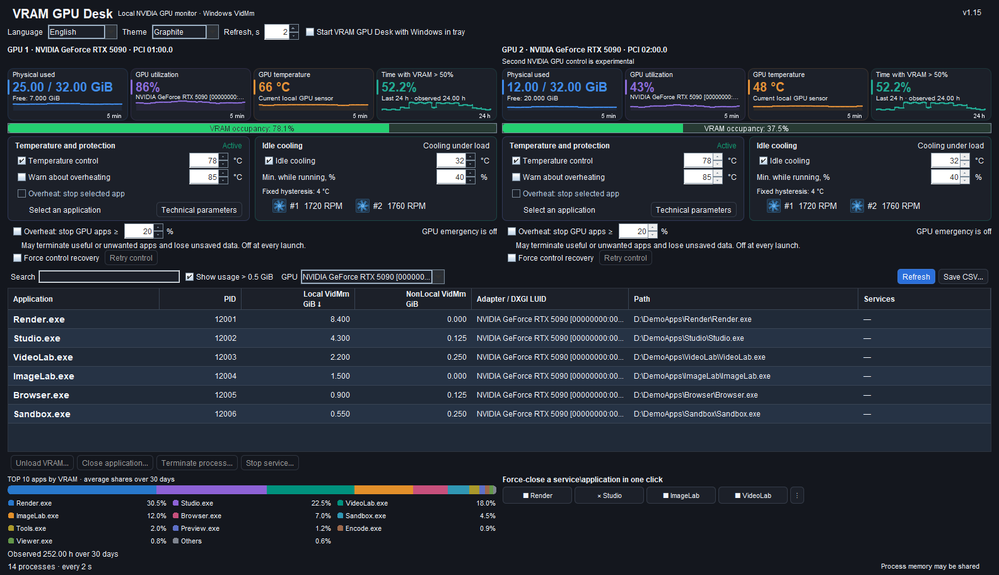

# VRAM GPU Desk

[English](README.md) · [Русский](README.ru.md) · [Deutsch](README.de.md) · [Español](README.es.md) · [Français](README.fr.md) · [Italiano](README.it.md) · [中文](README.zh.md) · [한국어](README.ko.md) · [日本語](README.ja.md) · [العربية](README.ar.md) · [हिन्दी](README.hi.md) · [Tiếng Việt](README.vi.md)

**Monitoraggio locale della memoria e controllo della temperatura delle GPU NVIDIA per Windows x64. Solo NVIDIA; le GPU AMD e Intel non sono supportate.**

## Funzionalità principali

- Monitoraggio locale di VRAM, carico e temperatura delle GPU NVIDIA con grafici in tempo reale.
- Memoria GPU per processo, ricerca, ordinamento ed esportazione CSV in UTF-8.
- Controllo della temperatura e raffreddamento in inattività.
- Quattro pulsanti configurabili con un clic associati a istanze precise dei processi; la terminazione di emergenza facoltativa è DISATTIVATA a ogni avvio.
- Cronologia VRAM di 24 ore e classifica delle 10 applicazioni principali su 30 giorni.
- 12 lingue, due temi, area di notifica e avvio facoltativo con Windows.
- Due pannelli NVIDIA con impostazioni indipendenti; il controllo della seconda GPU è sperimentale.
- Avviso di perdita del controllo e riprova manuale; ripristino forzato DISATTIVATO per impostazione predefinita.

Versione **1.15** · [Installer Windows](downloads/VRAM-GPU-Desk-1.15-Setup-x64.exe) · [ZIP di installazione](downloads/VRAM-GPU-Desk-1.15-Installer.zip)

Dati sintetici dimostrativi e stati simulati dei regolatori. Entrambe le opzioni di emergenza sono OFF a ogni avvio; il ripristino forzato è OFF per impostazione predefinita.

> **Controllo GPU:** Il controllo dei parametri di temperatura della GPU richiede una conferma UAC durante l’installazione del componente di controllo. In seguito, controllo della temperatura e raffreddamento si attivano senza ulteriori richieste UAC. Il solo monitoraggio non richiede UAC.

> **Controllo simultaneo della GPU:** Il controllo dei parametri di temperatura della GPU può entrare in conflitto con altri programmi che modificano contemporaneamente potenza, frequenze o velocità delle ventole, ad esempio MSI Afterburner. Usare un solo regolatore attivo per questi parametri. L’avviso riguarda le modifiche simultanee, non il monitoraggio passivo.

## Novità di 1.15: pannelli NVIDIA indipendenti e ripristino del controllo

Due GPU NVIDIA supportate hanno metriche proprie, quattro grafici ciascuna e impostazioni indipendenti. **Il controllo della seconda GPU NVIDIA è sperimentale.** Una NVIDIA insieme ad AMD/Intel utilizza un pannello NVIDIA. Il selettore GPU filtra la tabella condivisa dei processi e la cronologia; non cambia il dispositivo dei regolatori.

**I quattro pulsanti rapidi compatti restano su una riga orizzontale.** Il menu comune `⋮` consente Assegna/Riassegna, Rinomina e Cancella per ogni posizione, anche con una destinazione scomparsa. Il nome personalizzato si modifica senza rifare il collegamento; il testo si adatta alla larghezza e il suggerimento conserva il nome completo. Restano i controlli esatti di PID, ora di creazione e percorso.

**La perdita del controllo mostra un avviso e un comando manuale per riprovare. Il ripristino forzato è DISATTIVATO per impostazione predefinita e salvato per GPU.** Quando attivo, riprova dopo 5/10/30/60 secondi, solo dopo la fine confermata del vecchio client e con dati recenti della stessa GPU. Restano obbligatori i controlli nativi di lease, proprietà, rilettura e sicurezza. Non può bloccare in modo esclusivo MSI Afterburner o altri regolatori. La scelta manuale OFF salvata viene rispettata; entrambe le opzioni di emergenza sono OFF a ogni avvio.

Verificato per 1.15: **2262 controlli UI**, **215 nativi**, **61 sul ciclo di vita/I/O dei client**, **48 sul ripristino**, **167 file** e **93 classi Java**. Minimo: una GPU **1200×900**, due pannelli **1600×950**. Restano la chiusura con consenso tramite installer e l’avvio finale selezionato per impostazione predefinita di 1.14.

## Novità della versione 1.14

**1.12 – Graphite Studio:** L’interfaccia compatta mostra tutti i 17 controlli e dodici azioni principali a 1200×900, con sette colonne, sei righe di processi, quattro grafici e la cronologia Top 10. I nomi dei processi sono in grassetto, 14 pt, ad alto contrasto. I nuovi profili usano Graphite; una scelta esplicita salvata di System o Graphite resta invariata.

**1.13 – isteresi visibile:** Viene mostrato lo scarto fisso di 4 °C. La spiegazione dinamica riporta esempi quali 32→36 °C e 35→39 °C. Questo non cambia l’algoritmo di raffreddamento.

**1.14 – aggiornamento e avvio:** Se è attiva l’istanza JVM propria e verificata esattamente, l’installer chiede Sì/No/Annulla prima di chiuderla. Usa Windows Restart Manager con flag 0, senza terminazione forzata, e attende la fine normale dei componenti di controllo e lo sblocco dei file. No, rifiuto, timeout o file bloccati impediscono l’aggiornamento. L’installazione silenziosa non chiude app automaticamente.

«Avvia VRAM GPU Desk dopo l’installazione» è **selezionato per impostazione predefinita** e può essere deselezionato. Un launcher fisso consente l’avvio normale con token Medium dello stesso utente. Se tale contesto manca, usa il normale collegamento nel menu Start. La scelta separata di avvio con Windows viene conservata.

Sono stati verificati 107 controlli RM, 17 del launcher e nove casi d’integrazione Pascal, oltre ai 166 file del pacchetto, 88 classi Java e avvii del pacchetto tramite percorsi Unicode.

## Funzioni

- Mostra VRAM fisica occupata/libera, utilizzo GPU e temperatura con grafici storici compatti.
- Elenca applicazioni e servizi locali che usano memoria GPU, con ricerca, ordinamento e filtro facoltativo **oltre 0,5 GiB**.
- Mostra le dieci applicazioni principali e «Altre» come quote normalizzate delle letture di memoria dei processi osservate negli ultimi 30 giorni. Il totale è 100 %: è una ripartizione storica delle letture, non una suddivisione additiva della VRAM fisica.
- Mostra la percentuale del tempo osservato valido nelle ultime 24 ore con occupazione di VRAM fisica oltre il 50 %. Esclude gli intervalli senza monitoraggio.
- Esporta CSV UTF-8 in un percorso locale scelto.
- Si riduce nell’area di notifica, ripristina la finestra esistente agli avvii successivi e supporta avvio facoltativo con Windows.
- Offre tema di sistema e grafite scuro, dodici lingue e aggiornamento ogni 1–5 secondi, predefinito 2 secondi.
- Controllo termico graduale facoltativo tramite limiti supportati di potenza e frequenza del core. La protezione è indipendente dal refresh dell’interfaccia.
- Raffreddamento a riposo, RPM e icone animate. Le nuove impostazioni richiedono controllo termico e raffreddamento a riposo attivi; una disattivazione manuale salvata viene conservata. Il controllo attivo appare solo dopo connessione confermata.
- Avviso dopo almeno dieci secondi strettamente sopra la soglia scelta di 75–92 °C. I picchi brevi non generano avvisi.
- Opzione di emergenza separata, inizialmente disattivata, per l’applicazione scelta esplicitamente. Chiudere/terminare può perdere lavoro non salvato; processi protetti o non verificabili sono esclusi.

## Quattro pulsanti rapidi

Assegna **Chiudi applicazione** o **Termina processo** a uno dei quattro pulsanti e modifica l’assegnazione dal menu `⋮` adiacente. Ogni associazione vale solo per l’istanza scelta: PID, ora di creazione e percorso eseguibile. Alla sua fine non viene selezionato automaticamente un altro processo né un PID riutilizzato.

Il pulsante configurato agisce con un clic **senza ulteriore conferma**. Può andare perso lavoro non salvato. Restano i controlli nativi su processi protetti, critici o non verificabili. L’opzione di emergenza separata è inizialmente disattivata e mantiene il comportamento per l’applicazione selezionata.

## Emergenza: terminare i processi con carico GPU elevato — 1.11

Un’opzione **separata e disattivata a ogni avvio** può terminare i processi accessibili che caricano intensamente la GPU scelta dopo almeno **dieci secondi** di temperatura confermata strettamente superiore alla soglia di surriscaldamento. Il limite di carico è **20 % per impostazione predefinita**, regolabile da **10 a 100 %**; ogni processo deve mantenerlo per almeno **tre secondi**. Si misura il suo motore GPU più occupato, **non la quantità di VRAM**.

**Attenzione: può terminare applicazioni necessarie e indesiderate, perdendo il lavoro non salvato.** Interviene una sola volta e si disattiva dopo il tentativo. Un nuovo tentativo richiede una riattivazione esplicita. Senza dati di carico dei processi confermati e un sensore valido non può essere attivata; dati sconosciuti o scaduti non consentono terminazioni.

La GPU viene associata senza ambiguità e temperatura e identità sono ricontrollate prima dell’azione. PID, ora di creazione, percorso EXE e lo stesso handle del processo impediscono la selezione automatica di PID riutilizzati. Si escludono componenti Windows/NVIDIA protetti, processi critici o non verificabili e l’utilità stessa. Non termina alberi di processi, non ferma servizi e non richiede ulteriori privilegi. L’opzione esistente per un’applicazione scelta esplicitamente resta separata. È una misura aggiuntiva, non una garanzia contro danni GPU.

Verificato per 1.11: 40 test CPU nativi con terminazioni simulate, 256 controlli Java/cataloghi/guardie, 673 controlli d’interfaccia in 48 casi su dodici lingue e due temi, lettura di contatori PDH reali, revisione nativa indipendente, tutti i 164 file e hash dei broker, installazione/disinstallazione isolata e avvio del pacchetto con Java inclusa in percorsi Unicode.

## Temperature obiettivo e isteresi

Soglie distinte di arresto/riavvio e brevi attese evitano commutazioni frequenti con letture oscillanti.

| Impostazione | Comportamento effettivo | Motivo |
|---|---|---|
| Obiettivo a riposo, predefinito **32 °C**, regolabile 28–40 °C | Dopo tre secondi a 32 °C o meno a riposo, torna ad AUTO del firmware. Riparte a 36 °C, obiettivo +4 °C. Con obiettivo 35 °C: riparte a 39 °C. | L’isteresi di 4 °C evita avvii/arresti ripetuti. AUTO del firmware decide l’arresto completo delle ventole. |
| Riposo/carico | Fino al 10 % di utilizzo GPU è ammesso riposo; dal 15 % vale la curva di carico. Fra 11 e 14 % resta lo stato precedente. Utilizzo sconosciuto mantiene raffreddamento attivo. | Evita commutazioni per piccole variazioni. |
| Obiettivo termico graduale, 70–88 °C | Potenza e frequenza si adattano gradualmente alla tendenza termica. La temperatura può restare inferiore o superare brevemente l’obiettivo. | Inerzia, sensori e driver impediscono un tetto esatto. È un obiettivo di regolazione, non un arresto di emergenza. |
| Avviso di surriscaldamento | Lettura strettamente superiore alla soglia per almeno dieci secondi. | Ignora picchi brevi. |

La temperatura a riposo **non** è il limite sotto carico prolungato. Ambiente, firmware e driver influenzano temperature e ventole. Non usare contemporaneamente regolatori di ventole/frequenze concorrenti sulla stessa scheda.

## Hardware e requisiti

Per NVIDIA GeForce **RTX 5000 Series**. Monitoraggio e controlli dipendono da GPU e driver; quelli non supportati restano indisponibili, senza simulazione.

Windows 10/11 x64, .NET Framework 4.8 e driver NVIDIA compatibile. Java è incluso, senza installazione separata. L’utente Windows connesso deve essere amministratore con normale token desktop filtrato. L’installer chiede UAC una volta e installa il componente in una cartella Program Files fissa e protetta; non supporta credenziali di un altro amministratore. Due attività protette, solo su richiesta, usano launcher fissi e comunicazione locale tipizzata. Il canale installato è progettato per avviare il controllo senza altre richieste UAC; se l’autenticazione fallisce, resta indisponibile senza altra elevazione.

Versioni del driver e hash DLL non sono limitati da una lista autorizzata. NVML di sistema deve superare firma Windows offline con firmatario NVIDIA Corporation verificato, percorsi sicuri e API richieste. Aggiornare il driver non richiede nuovi hash/versioni. La verifica può fallire se mancano dati locali di attendibilità; l’app non scarica certificati o driver.

## Installazione e privacy

1. Scarica l’installer e confronta SHA-256 con [SHA256SUMS.txt](SHA256SUMS.txt).
2. Avvia normalmente dall’account amministratore connesso e approva UAC. Se è attiva un’istanza propria, scegli se consentirne la chiusura normale. L’installer attende la fine dei componenti di controllo e lo sblocco dei file; No, rifiuto, timeout o blocchi impediscono l’aggiornamento. La cartella protetta è fissa.
3. Lascia selezionato l’avvio dopo l’installazione oppure deselezionalo. Senza un contesto Medium adatto, apri il normale collegamento del menu Start. Seleziona GPU e verifica lo stato confermato. Le impostazioni restano locali e le disattivazioni salvate si conservano. Questo avvio non attiva l’esecuzione con Windows.

L’app usa interfacce locali Windows/GPU. Non prevede invii di telemetria, inferenza cloud, aggiornamento automatico o download di modelli in esecuzione. CSV, cronologia e impostazioni restano locali. Questo **non** garantisce isolamento di rete del sistema né comportamento di driver esterni, diagnostica Windows o sincronizzazione.

L’installer non è firmato. L’app è distribuita in binari compilati; **il codice sorgente non è pubblicato in questo repository**. Il bytecode Java non è cifrato né garantito resistente alla decompilazione. Restano gli avvisi di licenza del runtime esterno.

Le schermate usano dati sintetici e stato di controllo simulato. Illustrano l’interfaccia, non dimostrano funzionamento o prestazioni hardware.

## Novità della 1.10

- Quattro pulsanti configurabili legati a un’istanza per chiudere/terminare con un clic, riassegnabili, mantenendo i controlli nativi.
- Descrizioni ridotte, mini-grafici aumentati da 35 a 55 pixel; resta l’icona di notifica ad alto contrasto.
- Installazione unica del componente protetto con UAC. Nuove impostazioni termiche/riposo attive; disattivazioni manuali salvate conservate.
- Correzione prudente degli alias: esclude alias confermati di display indiretto senza rendering, senza unire GPU fisiche distinte per nome o memoria.
- Ripara installazioni incomplete sicure e segnala fase, codice e HRESULT precisi in caso di errore.
- Conserva temi, dodici lingue, cronologia locale, CSV UTF-8, identità GPU e politiche di lease, watchdog e ripristino.

Verificati: 48 casi isolati d’interfaccia in dodici lingue e due temi, icone, impostazioni iniziali, associazioni/esecuzione dei pulsanti, controlli reali di token CLR, percorsi Unicode, tutti i 163 file e hash dei broker incorporati, installazione/disinstallazione isolata e registrazione reale elevata di attività temporanee con rilettura XML/DACL, rollback e pulizia. Le attività **non sono state eseguite**; il test non ha invocato attività di produzione.

Le schermate sono sintetiche con controllo simulato.

## Licenza

L’uso non commerciale è gratuito secondo [PolyForm Noncommercial 1.0.0](LICENSE.md), rispettandone condizioni e obblighi di avviso. L’uso commerciale richiede un’autorizzazione separata. Non è una licenza open source; il codice sorgente dell’applicazione non viene pubblicato. Le licenze dei runtime di terze parti rimangono invariate.
