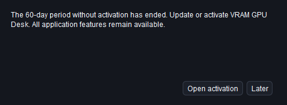
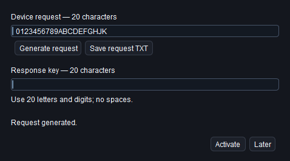
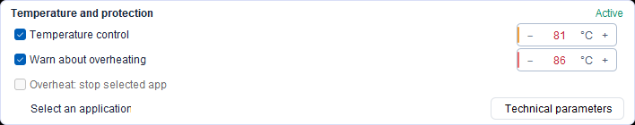
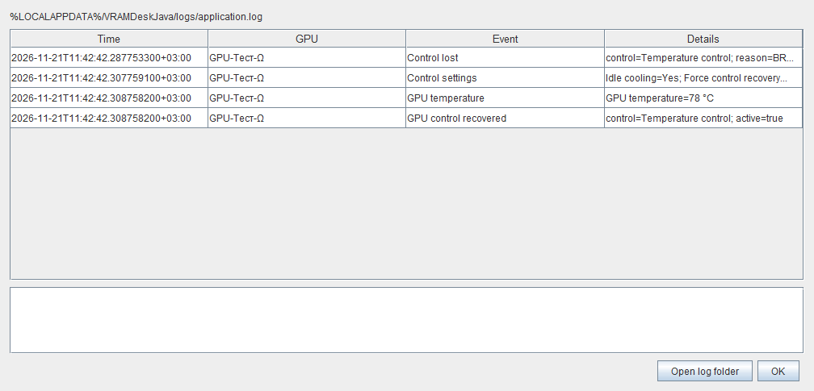

# VRAM GPU Desk 1.24

[English](README.md) · [Русский](README.ru.md) · [Deutsch](README.de.md) · [Español](README.es.md) · [Français](README.fr.md) · [Italiano](README.it.md) · [简体中文](README.zh.md) · [한국어](README.ko.md) · [日本語](README.ja.md) · [العربية](README.ar.md) · [हिन्दी](README.hi.md) · [Tiếng Việt](README.vi.md)

**Windows x64용 로컬 NVIDIA GPU 메모리 모니터링 및 온도 제어 도구입니다. NVIDIA만 지원하며 AMD 및 Intel GPU는 지원하지 않습니다.**

## 이 앱의 용도

- **Windows에서 NVIDIA 비디오 메모리를 모니터링하고 확보합니다.** 앱별 VRAM 사용량을 확인하고 선택한 앱을 강제로 종료하여 메모리를 확보할 수 있습니다. 사용자 지정 원클릭 빠른 버튼도 지원합니다.
- **VRAM을 두고 경쟁하는 앱을 관리합니다.** 로컬 코드 생성 모델, 이미지·동영상 생성, 음성 전사, 데이터 분석 등 하나 또는 여러 작업을 동시에 실행할 때 유용합니다.
- **온도와 냉각을 완만하게 조절합니다.** GPU에 부하가 걸릴 때와 유휴 상태 모두에서 하드웨어가 지원하는 온도 관련 설정과 냉각을 유연하게 제어합니다.
- **과열 비상 모드.** 선택 사항인 이 모드는 과열이 감지되면 GPU 부하가 높은 앱을 강제로 종료하여 부하를 줄일 수 있습니다. 앱을 시작할 때마다 꺼져 있으며, 강제 종료 시 저장하지 않은 작업이 손실될 수 있습니다.

## 주요 기능

- 활성화 기능이 포함된 버전을 이 컴퓨터에서 처음 실행한 날부터 60일 동안 전체 기능을 사용하며, 이후에도 모든 기능은 유지되고 오프라인 장치 활성화로 해제하는 정기 알림만 표시됩니다.

- 숫자 필드 7개에 소형 −/+ 버튼, 내부 단위 표시와 얇은 색상 강조선을 적용했습니다. 테마에 따라 명암이 반전되며 높은 온도 설정값은 빨간색으로 표시됩니다.

- 제어가 끊기면 안전한 복구를 계속 시도하며 확인된 복구 후 경고를 자동으로 닫습니다. 앱 로그는 제어 이벤트, 체크박스 상태와 78 °C 이상의 온도 변화를 기록하고 전원 전류는 접점 최댓값과 커넥터 합계를 구분합니다.

- 모델과 센서가 지원하는 전원 출력 및 최대 두 GPU 전원 커넥터 전류를 선택적으로 표시하며 기본적으로 꺼져 있습니다.
- 오버레이 텍스트 자동 대비는 기본적으로 켜져 있으며 끄면 밝거나 어두운 텍스트를 수동 선택할 수 있습니다.

- 실시간 그래프로 NVIDIA VRAM, GPU 부하와 온도, 시스템 RAM을 모니터링하고 코어별 막대로 CPU 사용률을 표시합니다.
- 프로세스별 GPU 메모리, 검색, 정렬 및 UTF-8 CSV 내보내기를 지원합니다.
- 각 GPU가 보고하는 기능에 맞춘 온도 제어와 유휴 냉각을 제공합니다.
- 정확한 프로세스 인스턴스에 연결되는 설정 가능한 원클릭 버튼 4개를 제공합니다. 선택형 긴급 종료 기능은 매번 시작할 때 꺼져 있습니다.
- 30일 동안 기록된 VRAM 사용량 기준 상위 10개 앱을 표시합니다.
- 12개 언어, 두 가지 테마, 시스템 트레이 및 선택형 Windows 시작 실행을 지원합니다.
- 독립 설정을 갖춘 NVIDIA 패널 두 개; 두 번째 GPU 제어는 실험 기능입니다.
- 제어 손실 경고와 수동 재시도; 새 설정은 복구가 켜지며 명시적으로 저장한 끄기는 유지됩니다.

[Windows 설치 프로그램 다운로드](downloads/VRAM-GPU-Desk-1.24-Setup-x64.exe) · [설치 프로그램 ZIP](downloads/VRAM-GPU-Desk-1.24-Installer.zip)

**RAM, CPU 및 선택적 스마트/AI 전원 모니터링**

- 시스템 RAM: 사용량/총량 GiB, 사용 가능한 메모리 및 5분 그래프.
- CPU: 전체 부하와 각 물리 코어 막대, CPU 온도는 표시하지 않습니다.
- 호환 스마트/AI 전원: 제공되는 출력 W와 최대 두 실제 GPU 전원 포트 전류, 기본적으로 꺼져 있습니다.

호환성: MSI MPG Ai1300TS 센서 읽기를 실물에서 검증했습니다. Ai1600TS와 일부 Corsair HXi/RMi 및 Thermaltake DPS G/iRGB PLUS는 프로토콜 리더가 구현되었지만 실물 검증은 남아 있습니다.

## 1.24의 새로운 기능: 60일 전체 사용 기간과 오프라인 장치 활성화

**보호된 상태 경로와 제어 시작 수정.** 활성화 상태는 최소 환경의 예약 작업으로 시작할 때도 Windows의 표준 컴퓨터 공용 데이터 폴더를 사용합니다. 이로써 상대 경로 및 권한 오류가 네이티브 GPU 제어 시작을 막는 문제를 해결합니다. 소유권, 접근 권한 및 복구 검사는 유지되며, 다른 GPU 유틸리티에 대한 독점 제어를 보장하지는 않습니다.

**이 컴퓨터의 첫 실행부터 계산합니다.** 활성화 기능이 포함된 버전을 이 컴퓨터에서 처음 실행하면 60일 전체 사용 기간이 시작됩니다. 보호된 로컬 시작 기록은 일반 업데이트와 제거 후에도 유지됩니다. 앱을 업데이트해도 60일이 다시 시작되거나 활성화 알림이 자동으로 해제되지 않습니다.

**기간이 지나도 모든 기능을 유지합니다.** 60일 후에도 모니터링, 온도 및 냉각 제어, 빠른 버튼과 비상 기능을 사용할 수 있습니다. 앱이 실행 중일 때 선택한 언어로 적어도 한 시간마다 모달이 아닌 알림을 일반 Windows 창 위에 표시합니다. 알림은 GPU 제어를 일시 중지하지 않으며, 활성화에 성공하면 중단됩니다.

**20자 요청과 20자 오프라인 응답.** 기간이 끝나면 인터페이스에 활성화 확인란이 나타납니다. 활성화 창에서 ‘요청 생성’을 선택하면 이 장치의 HWID에 연결된 20자 요청을 만들고 UTF-8 TXT로 저장할 수 있습니다. 소유자가 제공한 20자 응답 키를 응답 입력란에 입력하고 활성화합니다. 검증은 로컬에서 수행하며 HWID를 자동 업로드하거나 온라인 활성화 서비스를 사용하지 않습니다.

**장치 연결과 보호 범위.** 하드웨어 식별자가 변경되면 기존 활성화가 무효화되지만 사용 기간은 다시 시작되지 않습니다. 요청은 원시 하드웨어 식별자가 아닌 파생 코드입니다. 전용 생성기와 마스터 키는 소유자가 비공개로 보관하며 공개 설치 패키지나 저장소에 포함하지 않습니다. 선택한 짧은 오프라인 방식은 변조 불가능한 DRM이 아닙니다. 프로그램의 검증 비밀은 역공학으로 추출될 수 있으며 관리자에 의한 변조를 절대적으로 막지는 못합니다.

## 1.23의 새로운 기능: 통일된 소형 입력 필드와 온도 설정값 색상

**통일된 소형 컨트롤.** 숫자 필드 7개에 −/+ 버튼, 필드 내부의 °C·% 같은 단위와 얇은 색상 강조선을 적용했습니다. 대상은 목표 온도, 과열 경고 임계값, 유휴 냉각 온도, 최소 팬 속도 비율, GPU 비상 부하 비율, 새로 고침 간격, 오버레이 배율입니다. 키보드 조작과 하드웨어가 동적으로 보고하는 모델 범위는 그대로 유지됩니다. 언어·테마·GPU 선택 상자, 검색 필드와 빠른 버튼 편집기도 같은 강조 스타일을 사용합니다.

**테마에 맞춘 대비.** System에서는 흰색 필드와 어두운 글자, Graphite에서는 어두운 필드와 밝은 글자를 사용합니다. 비활성화, 포커스, 선택 영역과 드롭다운 팝업도 테마에 맞춥니다.

**빨간색은 온도 설정값을 나타냅니다.** 설정한 목표 온도가 **80 °C를 초과하면(81 °C부터)** 숫자 글자가 빨간색이 됩니다. 설정한 과열 경고 임계값은 **86 °C 이상**일 때 빨간색입니다. 이는 설정값의 시각적 표시이며 실시간 GPU 온도 경보가 아닙니다. 제어 알고리즘, 기본 목표 **78 °C**, 기본 경고 임계값 **85 °C**와 저장된 선택은 바뀌지 않습니다. 1.22의 제어 복구, 로그와 전원 전류 기능도 유지됩니다.

## 1.22의 새로운 기능: 지속적인 제어 복구, 앱 로그와 명확한 전류 표시

**지속적인 제어 복구.** 강제 제어 복구가 켜져 있으면 5초, 10초, 30초 간격으로 재시도한 뒤 60초마다 횟수 제한 없이 계속합니다. 저장된 끄기 선택은 유지됩니다. 새로운 유효 원격 측정으로 제어 복구가 확인된 뒤에만 비모달 경고 창이 자동으로 닫힙니다. 중지와 재시작 중에도 사용자가 마지막으로 선택한 체크박스 상태를 유지합니다. 이전 제어기의 종료가 확인된 뒤에만 새 제어기를 생성하며 하드웨어 식별, 소유권 및 안전 검사를 유지합니다. MSI Afterburner 등 다른 제어기의 GPU 접근을 차단하는 기능은 아닙니다.

**앱 로그.** 로그 버튼이 추가되었습니다. GPU별 제어 손실·복구·재시도, 모든 제어 관련 체크박스 상태, **78 °C** 이상에서 정수 온도가 바뀔 때의 값과 78 °C 미만으로 돌아온 이벤트를 기록합니다. 각 항목에는 UTC 및 현지 시간 정보가 있습니다. UTF-8 로그 경로는 `%LOCALAPPDATA%/VRAMDeskJava/logs/application.log`이며 파일당 2 MiB, 순환 보관 파일은 5개입니다. 뷰어는 현재 세션의 최근 500개 이벤트를 표시하고 로그 폴더 버튼으로 이전 세션의 파일도 찾을 수 있습니다.

**전원 전류: 최댓값 또는 합계.** 실제 GPU 전원 커넥터마다 유효한 접점 전류가 하나라도 있으면 다른 접점의 누락 여부와 관계없이 알려진 값 중 최댓값을 표시합니다. 접점별 정보가 없을 때는 측정된 커넥터 전체 전류를 표시합니다. 레이블에 ‘최대’ 또는 ‘합계’를 명시하며 알 수 없는 값은 대시, 실제 0은 유효한 값으로 취급합니다. 툴팁에는 사용 가능한 접점별 값과 커넥터 합계를 유지하며 레일 전류를 커넥터 전류로 표시하지 않습니다.

**1.9에서 업그레이드.** 1.22가 Program Files에 올바르게 설치되어도 LocalAppData의 기존 1.9가 계속 실행되면 트레이와 화면에 이전 버전 및 적은 설정이 나타날 수 있습니다. 설치 전에 이전 버전의 트레이 메뉴에서 종료한 뒤 설치하고 현재 시작 메뉴 바로가기로 실행하세요. 주 창에서 **v1.22**를 확인하세요. 강제 프로세스 종료는 권장하지 않습니다.

## 시스템 RAM, CPU 및 스마트/AI 전원 지표

- **시스템 RAM:** 물리 메모리 사용량/총량(GiB), 사용률, 사용 가능한 메모리 및 5분 기록 그래프를 표시합니다.
- **CPU:** 전체 사용률, 물리 코어와 논리 스레드 수, 각 물리 코어의 부하 막대를 표시합니다. CPU 온도 없이 부하만 표시합니다.
- **호환 USB 디지털/스마트/AI 전원:** 읽기 전용 센서 조회로 제공되는 측정 출력 전력(W)과 최대 두 개의 실제 GPU 전원 포트 전류를 표시하며, 지원되는 경우 각 포트의 여섯 접점 전류도 포함합니다. **MSI MPG Ai1300TS**에서 센서 읽기를 검증했습니다. 계산값은 별도로 표시하며 레일 전류는 개별 커넥터의 전류가 아닙니다.

전원 모니터링에는 별도 체크박스가 있으며 **기본적으로 꺼져 있습니다**. 꺼져 있거나 호환 전원이 감지되지 않으면 전원 카드를 숨기고 다른 카드가 빈 자리 없이 너비를 채웁니다. 전원이 감지된 뒤 읽기를 일시적으로 사용할 수 없으면 카드는 유지하고 대시를 표시합니다.

NVIDIA GPU가 두 개여도 RAM, CPU 및 전원 지표는 공유되어 한 번만 표시됩니다. ‘AI’ 같은 마케팅 이름만으로 호환성을 보장하지 않으며 정확한 모델과 프로토콜을 확인해야 합니다. [전원 호환성](docs/psu-compatibility.md)을 참고하세요. 이미지는 실제 하드웨어 측정 결과가 아닌 합성 데모 값입니다.

[전원 없음: 다른 카드 확장](images/without-psu-strip.png)

### 어떤 전원과 호환되나요?

| 모델 / 확인된 장치 식별자 | 측정값과 검증 상태 |
| --- | --- |
| MSI MPG Ai1300TS PCIE5 / Ai1600TS PCIE5 | Ai1300TS: 실물 센서 검증, 측정 출력 W와 두 포트의 각 여섯 접점 전류. Ai1600TS: 리더 구현 및 프로토콜 확인, 실물 테스트 없음. |
| Corsair HX750i, HX850i, HX1000i, HX1200i, HX1500i; RM650i, RM750i, RM850i, RM1000i | 측정 출력 W, 개별 GPU 포트 전류 없음. 리더 구현 및 합성 테스트 통과, 실물 검증 대기. 전체 목록의 USB 식별자만 해당합니다. |
| Thermaltake DPS G / iRGB PLUS | 264A:2329만 해당. 출력 ≈W는 레일 전압×전류로 계산, 개별 GPU 포트 전류 없음. 합성 테스트 통과, 실물 검증 대기. |
| NZXT E500 / E650 / E850 | 추가 부분 리더: 레일 센서만 제공하며 PSU 카드용 실측 총출력 W나 실제 GPU 포트 전류가 없습니다. 합성 테스트 통과, 완전한 카드 지원이 아닙니다. |

조사 단계: 1.21에는 be quiet! Dark Power Pro 14 IO 1300W/1600W 어댑터가 없습니다. Seasonic과 ASUS도 확인된 리더가 없습니다. ‘AI’ 이름은 호환성을 보장하지 않습니다.

## 1.21 추가 기능 — 선택적 전원 공급 장치 모니터링 및 자동 대비

**선택적 배치.** 전원 모니터링이 꺼져 있거나 호환 전원이 감지되지 않으면 전원 카드를 숨기고 다른 카드가 빈 자리 없이 사용 가능한 너비를 채웁니다. 전원이 감지된 뒤 측정값을 일시적으로 읽을 수 없으면 카드를 유지하고 대시로 표시합니다.

**더 작은 대시보드.** 단일 및 듀얼 GPU 화면에서 ‘VRAM > 50% 시간’ 카드를 제거했습니다. 30일 앱 순위와 저장된 기록은 유지됩니다.

**전원 공급 장치 모니터링은 기본적으로 꺼져 있습니다.** 별도 체크박스를 켜면 기존 지표 옆에 사용 가능한 출력 전력과 최대 두 개의 실제 GPU 전원 커넥터 전류를 표시하는 카드가 추가됩니다. 누락되거나 오래된 값은 —로 표시하며 레일 전류를 개별 커넥터 전류로 취급하지 않습니다. 읽기 전용 모듈은 앱의 최초 UAC 설치 시 구성되는 별도의 보호된 구성 요소이며 GPU 제어권을 얻지 않습니다.

**호환성은 모델별로 확인됩니다.** MSI MPG Ai1300TS의 센서 읽기를 검증했습니다. Ai1600TS는 프로토콜을 확인했습니다. 일부 Corsair HXi/RMi, Thermaltake DPS G/iRGB PLUS 및 추가 NZXT E 리더는 합성 테스트를 통과했지만 실물 검증은 남아 있습니다. Corsair는 측정된 출력 와트를 제공하고 Thermaltake 합계는 계산값으로 표시하며 NZXT는 합계를 만들어 내지 않고 레일 데이터를 제공합니다. be quiet! Dark Power Pro 14 IO는 조사되었지만 Seasonic OptiGuard 및 ASUS의 검증된 리더는 없습니다. 여섯 브랜드 전체 지원을 주장하지 않습니다. [전원 공급 장치 호환성](docs/psu-compatibility.md)을 참고하세요.

**오버레이 텍스트 자동 대비는 기본적으로 켜져 있습니다.** 텍스트가 배경에 맞게 바뀌며 끄면 밝거나 어두운 텍스트를 수동 선택할 수 있습니다. 투명 배경, 작은 계기, NVIDIA GPU 두 개의 독립 오버레이, 두 번 클릭하여 창 열기, 위치 및 온도 색상·소리는 유지됩니다.

아래 그래파이트 스크린샷은 전원 수치를 포함한 합성 데모 데이터입니다. GPU 설정, 프로세스 동작, 비상 모드 및 저장된 선택은 유지됩니다.

NVIDIA GPU 두 개: 전원 모니터링 표시 / 호환 전원 없음.

## 1.20.1

오버레이를 두 번 클릭하면 기본 창이 열립니다.

## 1.20 — GPU 플로팅 모니터

일반 Windows 창 위에 표시되는 작고 투명한 모니터로 전체 배경 패널이 없습니다. NVIDIA GPU마다 ≈164 × 114 물리 픽셀의 별도 오버레이를 표시하며 최대 두 카드를 지원합니다. 위치를 개별 저장하고 이동, 고정, 배율 및 글자 대비를 조절할 수 있습니다. 기본 표시 꺼짐, 소리는 기본 켜짐이며 별도로 끌 수 있습니다. 기존 측정값을 사용하며 GPU 제어를 추가로 요청하지 않습니다.

VRAM 사용량 및 GPU 부하; 온도: ≤40 초록, 41–75 노랑, 76–81 주황, 82–86 빨강, ≥87 깜박임. 88 °C부터 경고음.

합성 데모 데이터와 모의 제어 상태입니다. 두 비상 옵션은 실행할 때마다 꺼집니다. 새 설정은 복구가 켜지며 저장한 끄기 선택은 유지됩니다.

> **GPU 제어:** GPU 온도 매개변수를 제어하려면 제어 구성 요소 설치 시 UAC를 한 번 확인해야 합니다. 이후 온도 제어와 냉각을 켤 때는 UAC를 다시 묻지 않습니다. 모니터링 자체에는 UAC가 필요하지 않습니다.

> **동시 GPU 제어:** GPU 온도 매개변수 제어는 전력, 클럭 또는 팬 속도를 동시에 변경하는 다른 프로그램(예: MSI Afterburner)과 충돌할 수 있습니다. 이 설정에는 하나의 활성 제어기만 사용하세요. 이 경고는 설정의 동시 변경에 관한 것이며 수동 모니터링은 해당하지 않습니다.

## 1.19의 새 기능: NVIDIA RTX 30·40·50 개별 장치 적응

**고정 와트 프리셋 대신 실제 장치 한도를 사용합니다.** 각 세션은 해당 GPU의 전력 범위를 읽고 시작 전력 한도를 세션 상한과 복원 기준으로 저장하며 출고 기본값을 사용하지 않습니다. 세션을 획득하는 것만으로 전력이나 클록을 즉시 쓰지 않습니다. 전력 변경은 **초당 세션 시작 한도의 1%**로 조정되며 보고된 범위와 세션 상한을 지킵니다. 클록 조정은 검증된 지원 범위를 기준으로 합니다.

**사용 가능한 제어만 사용합니다.** 클록 제어를 지원하지 않아도 지원되는 전력 전용 제어는 사용할 수 있습니다. 온도가 유효하면 GPU 사용률을 몰라도 전력 전용 제어가 가능합니다. 보고된 하드웨어 온도 한도보다 높은 목표는 차단하고 누락된 한도는 미확인으로 유지합니다. 미지원 기능은 사용할 수 없음으로 계속 표시합니다. 팬 복구는 전력 클라이언트 복구와 독립적입니다. BIOS, OEM, 드라이버와 노트북 제한에 따라 기능이 달라질 수 있으며 각 GPU를 개별 평가합니다.

**참고 데이터는 제어 명령이 아닙니다.** [RTX 30 이상 참고 문서](docs/nvidia-rtx30-plus/README.md)와 [UTF-8 CSV](docs/nvidia-rtx30-plus/REFERENCE-GPUS.csv)는 **모델/변형 45개 그룹: 데스크톱 27개, 노트북 18개**를 포함합니다. 문서용 참고 그룹이며 하드웨어 테스트 45회를 뜻하지 않습니다. 공개 보드 전력과 노트북 TGP는 실행할 프리셋이 아닙니다. RTX 3060 Ti의 200 W 행은 참고 사양이며 모든 GDDR6X 또는 OEM 변형에 적용되지 않습니다.

**듀얼 GPU에서 더 간결한 CPU 영역.** CPU 카드의 아래쪽을 옆의 유휴 냉각 패널 아래쪽과 맞추고, 비상 및 복구 행보다 위에 배치했습니다. RAM은 위에 유지되며 CPU 부하와 물리 코어 막대도 계속 보입니다. 단일 GPU의 카드 여섯 개 배치는 바뀌지 않습니다.

## 1.18의 새 기능: CPU 사용률과 더 명확한 듀얼 GPU 작업 공간

**시스템 RAM 옆에서 CPU 부하를 확인합니다.** CPU 카드는 전체 사용률, 물리 코어와 논리 스레드 수, 물리 코어별 순간 사용률 막대를 표시합니다. 각 막대는 해당 코어의 논리 스레드를 묶으며 전체 사용률은 논리 프로세서 수에 따라 가중됩니다. Windows 내장 측정값을 사용하므로 추가 UAC, 드라이버 또는 별도 모니터링 앱이 필요하지 않습니다. 누락되었거나 잘못되었거나 6초가 지난 값은 **—**와 사용할 수 없는 코어 막대로 표시합니다.

**단일 GPU: 1200×900에서 카드 여섯 개.** 네 개의 GPU 카드와 시스템 RAM, CPU 부하를 함께 볼 수 있습니다. **NVIDIA GPU 두 개: 최소 1920×1050.** 각 GPU는 2×2로 배치된 카드 네 개, 정렬된 측정값과 모든 제어 항목을 가집니다. 얇은 세로 구분선이 GPU 영역과 오른쪽 공용 열을 나누며, 위에는 RAM, 아래에는 더 높은 CPU 카드가 있습니다. 시스템 RAM과 CPU는 한 번만 표시되고 GPU 선택과 무관합니다. 두 번째 GPU 제어는 계속 실험적입니다.

공간이 부족하면 줄바꿈하여 팬 표시기 세 개를 모두 보여 줍니다. 팬 제어 로직은 바뀌지 않습니다. 간결한 빠른 버튼, 읽기 쉬운 프로세스 이름과 기존 설정은 유지됩니다.

## 1.17의 새 기능: 시스템 RAM을 한눈에

다섯 번째 **시스템 RAM** 카드는 사용 중/전체 물리 메모리(GiB), 사용률, 사용 가능한 메모리와 5분 그래프를 표시합니다. 전체 용량은 Windows가 사용할 수 있는 물리 RAM이며, VRAM이나 페이지 파일을 포함하는 커밋 한도와는 다릅니다.

RAM 값은 컴퓨터 전체에 해당하며 선택한 GPU와 무관합니다. NVIDIA 패널이 두 개일 때 기본 패널에는 카드 다섯 개가 있고, 두 번째 패널에는 기존 GPU 카드 네 개가 유지됩니다. 시스템 RAM은 한 번만 표시되며 기존 GPU 제어 항목은 그대로 사용할 수 있습니다.

RAM은 기존 새로 고침 주기로 갱신되며 UAC가 필요하지 않습니다. 누락되었거나 잘못되었거나 6초가 지난 값은 **—**로 표시하고, 그래프에는 임의의 값 대신 빈 구간을 남깁니다.

## 1.16의 새 기능: 안정적인 제어 복구와 최소화 방식 선택

**새 설정이거나 해당 항목이 없으면 제어 복구가 켜집니다.** 선택은 GPU별로 저장되며 이전에 명시적으로 저장한 끄기는 유지됩니다. 복구는 대기 시간과 이전 클라이언트 종료 확인 후 같은 카드에 다시 연결합니다. MSI Afterburner 또는 다른 제어 프로그램에 대한 독점 제어를 보장하지 않습니다.

**창 최소화 방식을 선택할 수 있습니다.** ‘트레이로 최소화’는 기본으로 켜집니다. 끄면 일반 Windows 앱처럼 작업 표시줄로 최소화됩니다. 선택은 저장되며 Windows 시작 실행은 별도 설정으로 유지됩니다.

**통신과 상태 표시를 개선했습니다.** Java 요청 제한 시간을 7초로 조정하여 네이티브 채널의 6초 응답 구간에 여유를 둡니다. 네이티브 watchdog은 GPU 제어를 성공적으로 확보한 후 시간을 재며 6초 안전 보호는 유지합니다. 오류나 오래된 측정값을 최신으로 표시하지 않습니다. 오래된 RPM은 숨기고 통신 시간 초과와 확인된 외부 설정 변경을 구분합니다. 크기가 제한된 로컬 로그에 오류와 느린 응답 메타데이터를 기록하며 연결 비밀 정보는 제외합니다.

## 1.15의 새 기능: 독립 NVIDIA 패널과 제어 복구

지원되는 NVIDIA GPU 두 대에 각각 독립적인 지표, 그래프 네 개와 제어 설정을 제공합니다. **두 번째 NVIDIA GPU 제어는 실험 기능입니다.** NVIDIA 한 대와 AMD/Intel이 혼합된 경우 NVIDIA 패널 하나만 사용합니다. GPU 선택기는 공유 프로세스 목록과 기록만 필터링하며 제어 대상 GPU를 바꾸지 않습니다.

**작은 빠른 버튼 네 개는 한 가로줄을 유지합니다.** 공통 `⋮` 메뉴에서 대상이 사라진 슬롯도 지정/변경, 이름 변경, 초기화할 수 있습니다. 사용자 이름은 다시 연결하지 않고 바꿀 수 있으며, 문구는 폭에 맞추고 도구 설명에 전체 이름을 표시합니다. 정확한 PID, 생성 시간, 실행 파일 경로 검사는 유지됩니다.

**제어 손실 시 경고와 수동 재시도를 제공합니다. 1.16에서는 새 설정이거나 항목이 없으면 복구가 켜지고 GPU별로 저장되며, 명시적으로 저장한 끄기는 유지됩니다.** 재시도는 5/10/30/60초 간격으로 이전 클라이언트 종료 확인과 같은 GPU의 최신 데이터를 요구합니다. 네이티브 lease, 소유권, 재읽기 및 안전 검사는 유지됩니다. MSI Afterburner나 다른 제어 프로그램을 독점적으로 차단할 수 없습니다. 두 비상 옵션은 실행할 때마다 꺼집니다.

1.15 검증: **UI 검사 2262개**, **네이티브 검사 215개**, **클라이언트 수명/I/O 검사 61개**, **복구 검사 48개**, **패키지 파일 167개**, **Java 클래스 93개**. 최소 크기: 단일 GPU **1200×900**, 두 패널 **1600×950**. 사용자 동의 후 기존 앱을 닫는 1.14 설치 흐름과 기본 선택된 설치 후 실행 옵션도 유지됩니다.

## 1.14의 새 기능: 간결한 작업 공간과 쉬운 업데이트

**Graphite Studio(1.12).** 1200×900에서 모든 주요 설정과 작업이 함께 보입니다. 프로세스 열 7개와 최소 6행, 그래프 4개, 전체 상위 10개 범례가 유지됩니다. 프로세스 이름은 대비가 높은 14 px 굵은 글씨입니다. 새 프로필은 Graphite로 시작하며, 저장된 System 또는 Graphite 선택은 유지됩니다. 편집 가능한 원클릭 버튼 4개는 정확한 프로세스 인스턴스에 연결되어 닫기/종료 작업을 수행합니다.

**표시되는 냉각 히스테리시스(1.13).** 냉각 패널에 고정된 **4 °C** 차이가 표시되며 도구 설명에서 32→36 °C, 35→39 °C 예를 확인할 수 있습니다. 기존 규칙을 표시할 뿐 냉각 알고리즘은 바뀌지 않습니다.

**설치와 업데이트(1.14).** 설치 프로그램은 실행 중인 대상 복사본을 정상 종료해도 되는지 묻습니다. 동의하면 Windows Restart Manager로 JVM의 정상 종료를 요청하고, 앱과 실행기의 종료 및 제어기 파일 해제를 기다린 뒤 계속합니다. 검증된 해당 설치 인스턴스만 대상으로 하며 강제 종료하지 않습니다. 거부, 취소, 앱의 종료 거절, 남은 파일 잠금이나 시간 초과가 있으면 교체가 중단됩니다. 무인 설치는 실행 중인 앱을 자동으로 닫지 않습니다.

마지막 페이지의 **VRAM GPU Desk 실행**은 기본으로 선택되어 있으며 해제할 수 있습니다. 동일한 로그인 사용자의 일반 권한으로 실행하며, 해당 컨텍스트를 사용할 수 없으면 시작 메뉴의 일반 바로가기를 사용하세요. 설치 후 한 번 실행하는 옵션이며 저장된 Windows 시작 프로그램 선택은 유지됩니다.

1.14에서는 **설치 흐름 9개 사례, Restart Manager/JDK 검사 107개, 고정 실행 게이트 검사 17개**, 전체 **패키지 파일 166개와 Java 클래스 88개**, 브로커 해시, Unicode 경로와 내장 런타임 실행기를 검증했습니다.

## 기능

- 실제 VRAM의 사용량과 여유 공간, GPU 사용률 및 온도를 작은 이력 그래프와 함께 표시합니다.
- GPU 메모리를 사용하는 로컬 애플리케이션과 서비스를 보여 주며 검색, 정렬, 선택적인 **0.5 GiB 초과** 필터를 지원합니다.
- 최근 30일간 관측한 샘플을 바탕으로 상위 10개 앱과 ‘기타’의 비중을 정규화해 표시합니다. 합계는 100%입니다. 이는 기록된 프로세스 메모리 수치의 과거 비중이며, 더해서 물리 VRAM 총량이 되는 실제 메모리 구획이 아닙니다.
- 선택한 로컬 경로로 UTF-8 CSV 보고서를 내보냅니다.
- 시스템 트레이 또는 일반 Windows 작업 표시줄로 최소화하는 선택을 저장하고, 재실행 시 기존 창을 복원하며 선택적인 Windows 시작 실행을 지원합니다.
- 시스템 테마와 어두운 그래파이트 테마, 12개 언어를 제공합니다. UI 갱신 간격은 1–5초이며 기본값은 2초입니다.
- 지원되는 전력 및 코어 클럭 한도를 사용한 GPU 온도 소프트 목표 제어를 선택적으로 제공합니다. 제어는 UI 갱신 간격과 독립적으로 동작합니다.
- 유휴 냉각, 팬 RPM 표시, 움직이는 팬 아이콘을 제공합니다. 새 설정에서는 온도 제어와 유휴 냉각을 모두 켜도록 요청하며, 저장된 수동 OFF는 유지합니다. 연결이 확인된 뒤에만 제어 활성 상태를 표시합니다.
- 온도가 선택한 75–92°C 임계값을 엄격하게 초과한 상태로 10초 이상 지속될 때 경고할 수 있습니다. 짧은 순간 상승은 경고하지 않습니다.
- 명시적으로 선택한 앱에 대한 별도 비상 옵션을 제공하며 기본값은 꺼짐입니다. 앱을 닫거나 프로세스를 종료하면 저장하지 않은 작업이 손실될 수 있습니다. 보호되거나 검증할 수 없는 프로세스는 이 작업의 대상으로 선택할 수 없습니다.

## 1.11: GPU 부하 앱 비상 종료

기존 ‘선택한 앱 종료’와 별개인 새 체크박스입니다. **앱을 시작할 때마다 꺼져 있으며, 사용자가 명시적으로 켜야 합니다.** 필요하거나 불필요한 앱이 종료되어 저장하지 않은 데이터가 손실될 수 있으므로 위험을 이해한 뒤 사용하세요.

선택한 GPU의 온도가 경고 임계값을 **엄격하게 초과한 상태로 10초** 지속되면, 해당 GPU의 앱별 부하가 임계값 이상으로 **최소 3초** 유지된 적격 앱의 종료를 시도합니다. 앱별 GPU 부하 기본값은 **20%**, 조정 범위는 **10–100%**입니다. 저장되는 것은 부하 임계값이며 활성 상태가 아닙니다. 취소되거나 적격 앱이 없어도 한 번 시도한 뒤 자동으로 꺼집니다. 온도 또는 부하 임계값을 바꾸어도 해제됩니다.

판단에는 실제 프로세스별 GPU 엔진 부하를 사용합니다. **VRAM 크기, 프로세스 메모리 비율 또는 다른 VRAM 추정값으로 판단하지 않습니다.** 최신 측정값, 고유 물리 GPU, 프로세스 생성 시각·실행 파일 경로·어댑터 LUID를 확인하며, 실행 직전 재검사한 정확한 인스턴스 핸들을 사용합니다. 알 수 없거나 오래된 데이터, 바뀐 신원, 다른 어댑터, 보호·중요·검증 불가 프로세스는 건너뜁니다. 카운터를 사용할 수 없으면 켤 수 없습니다. 기존 선택 앱 비상 옵션은 그대로 유지됩니다.

## 네 개의 빠른 작업 버튼

네 개의 작은 버튼에 **애플리케이션 닫기** 또는 **프로세스 종료**를 지정하고 옆의 `⋮` 메뉴에서 다시 지정할 수 있습니다. 바인딩은 PID, 생성 시각, 실행 파일 경로로 식별되는 명시적인 프로세스 인스턴스를 가리킵니다. 해당 인스턴스가 끝나면 다른 프로세스나 같은 PID를 재사용한 프로세스로 자동 연결되지 않습니다.

설정된 버튼은 한 번 클릭하면 **추가 확인 없이 즉시 실행**됩니다. 닫기 또는 종료로 저장하지 않은 작업이 손실될 수 있습니다. 보호된 프로세스, 중요 프로세스, 검증 불가능한 프로세스에 대한 네이티브 검사는 유지됩니다. 별도의 비상 옵션은 기본적으로 꺼져 있고 기존의 선택된 앱 동작을 유지합니다.

## 온도 목표와 히스테리시스

일부 설정은 중지와 재시작에 서로 다른 임계값과 짧은 대기 시간을 의도적으로 사용합니다. 측정값이 몇 도씩 흔들릴 때 자주 전환되는 것을 방지합니다.

| 설정 | 실제 동작 | 이유 |
|---|---|---|
| 유휴 목표 기본 **32°C**, 조정 범위 28–40°C | 유휴 상태에서 온도가 32°C 이하로 3초간 유지되면 제어를 카드 펌웨어 AUTO로 반환합니다. 목표 +4°C인 36°C에서 냉각을 재개합니다. 목표가 35°C이면 재개 온도는 39°C입니다. | 4°C 히스테리시스가 한 임계값 근처의 반복적인 팬 시작·중지를 막습니다. 팬을 완전히 멈출지는 앱이 아니라 펌웨어 AUTO가 결정합니다. |
| 유휴/부하 구분 | GPU 사용률이 10% 이하이면 유휴 동작을 허용합니다. 15%부터 부하 냉각 곡선을 적용합니다. 11–14%에서는 이전 구분을 유지하며, 사용률을 알 수 없으면 냉각을 유지합니다. | 작은 사용률 변화로 모드가 자주 바뀌는 것을 방지합니다. |
| 온도 소프트 목표 70–88°C | 온도 상승 추세를 고려해 전력 및 코어 클럭 한도를 서서히 조정하며 목표 주변의 동작 범위를 사용합니다. 실제 온도는 목표보다 낮거나 잠시 높을 수 있습니다. | 열 관성, 센서 갱신, 드라이버 한계 때문에 정확한 강제 상한을 보장할 수 없습니다. 목표는 제어 기준이며 비상 차단점이 아닙니다. |
| 과열 경고 | 측정값이 임계값을 엄격하게 초과한 상태로 최소 10초간 유지되어야 합니다. | 짧은 온도 상승에 의한 경고를 줄입니다. |

유휴 온도는 지속 부하에서의 온도 한도가 **아닙니다**. 주변 환경, 카드 펌웨어, 드라이버 제한에 따라 도달 가능한 온도와 팬 반응이 달라집니다. 같은 카드에서 경쟁하는 팬 또는 클럭 제어기를 동시에 사용하지 마세요.

## 하드웨어 및 요구 사항

NVIDIA GeForce **RTX 30 / 40 / 50** GPU용입니다. 모니터링과 사용 가능한 제어는 GPU와 드라이버에 따라 달라집니다. 지원하지 않는 제어는 시뮬레이션하지 않고 사용할 수 없는 상태로 유지합니다.

Windows 10/11 x64, .NET Framework 4.8, 지원되는 NVIDIA 드라이버가 필요합니다. 설치 프로그램에 Java 런타임이 포함되어 별도 Java 설치는 필요하지 않습니다. 현재 Windows 로그인 사용자는 일반적인 필터링된 데스크톱 토큰을 사용하는 관리자여야 합니다. 설치는 UAC를 한 번 요청하고 고정된 보호 Program Files 폴더에 제어 구성 요소를 설치합니다. 다른 관리자의 자격 증명을 입력하는 방식은 지원하지 않습니다.

보호된 두 작업은 요청이 있을 때만 실행되며 고정 제어 런처와 형식이 지정된 로컬 통신을 사용합니다. 설치된 채널은 이후 제어 시작 시 추가 UAC 없이 동작하도록 설계되었습니다. 인증할 수 없으면 다른 권한 상승 창으로 전환하지 않고 제어를 사용할 수 없게 유지합니다.

드라이버 버전과 DLL 해시는 허용 목록으로 제한하지 않습니다. 시스템에 설치된 NVML 라이브러리는 검증된 NVIDIA Corporation 서명자의 오프라인 Windows 서명 검사, 안전한 경로 검사, 필요한 API 검사를 통과해야 합니다. 드라이버 업데이트 때 새 버전이나 해시를 추가할 필요는 없습니다. 필요한 신뢰 데이터가 로컬에 없으면 오프라인 검증이 실패할 수 있으며, 앱은 인증서나 드라이버를 다운로드하지 않습니다.

## 설치 및 개인정보

1. 설치 프로그램을 다운로드하고 [SHA256SUMS.txt](SHA256SUMS.txt)의 SHA-256과 비교합니다.
2. 로그인된 관리자 계정에서 설치 프로그램을 일반 실행하고 UAC를 승인합니다. 대상 복사본이 실행 중이면 정상 종료 질문에 답하세요. 앱이 종료되고 파일이 해제되면 설치가 계속됩니다. 보호된 설치 폴더는 고정되어 있습니다.
3. 새 VRAM GPU Desk 바로가기를 열고 GPU를 선택한 다음 확인된 제어 상태를 점검합니다. 제어와 빠른 버튼을 필요에 맞게 설정합니다. 설정은 로컬에 저장되며 저장된 OFF는 그대로 유지됩니다.

앱은 로컬 Windows/GPU 인터페이스를 사용합니다. 설계된 텔레메트리 업로드, 클라우드 추론, 자동 업데이트, 실행 중 모델 다운로드는 없습니다. CSV, 이력, 설정은 로컬에 남습니다. 이는 OS 전체의 네트워크 격리나 타사 드라이버, Windows 진단, 동기화 소프트웨어의 동작을 보장하는 주장이 **아닙니다**.

설치 프로그램은 서명되지 않았습니다. 컴파일된 바이너리로 배포되며 **이 저장소에서는 애플리케이션 소스 코드를 공개하지 않습니다**. Java 바이트코드는 암호화되지 않았고 역컴파일 방지를 보장하지 않습니다. 타사 런타임 라이선스 고지는 설치된 런타임에 보존됩니다.

스크린샷은 합성 데모 데이터와 시뮬레이션된 제어기 상태를 사용합니다. 인터페이스 예시이며 하드웨어 제어 동작이나 성능을 입증하지 않습니다.

## 1.10 변경 사항

- 특정 프로세스 인스턴스에 연결되는 설정 가능한 빠른 버튼 네 개를 추가했습니다. 한 번 클릭으로 닫기 또는 종료, 재지정, 기존 네이티브 안전 검사를 지원합니다.
- 대시보드 설명 글꼴을 줄이고 미니 그래프 높이를 35픽셀에서 55픽셀로 늘렸으며 고대비 트레이 아이콘을 유지했습니다.
- 보호된 제어 구성 요소를 한 번의 UAC로 설치합니다. 새 온도 및 유휴 냉각 설정은 켜짐이며 저장된 수동 OFF는 유지합니다.
- 보수적인 어댑터 별칭 수정을 포함합니다. 확인된 비렌더링 간접 디스플레이 별칭만 제외하고 이름이나 메모리 값으로 별도의 물리 GPU를 합치지 않습니다.
- 안전한 미완료 설치를 복구하고 구성 요소 설치 실패 시 구체적인 단계, 코드, HRESULT를 보고합니다.
- 두 테마, 12개 언어, 로컬 이력, UTF-8 CSV, GPU 식별 검사, 기존 lease/watchdog/restore 정책을 유지합니다.

1.11에서는 **패키지 파일 164개와 Java 클래스 87개 전체**, 격리 네이티브 검사 40개, Java·설정·번역 검사 256개를 확인했습니다. 12개 언어, 두 테마, 두 창 너비의 48개 사례에서 UI 검사 673개를 통과했습니다. 최소 창은 1200×900이며 새 경고를 온전히 볼 수 있습니다.

읽기 전용 PDH 검사에서는 유효 GPU 엔진 인스턴스 710개를 읽었고 프로세스 신원은 읽지 않았습니다. 비상 동작은 자체 합성 데이터와 모의 RPC로 검증했습니다.  스크린샷은 합성 데모 데이터와 시뮬레이션된 제어 상태이며 하드웨어 동작 또는 성능의 증거가 아닙니다.

## 라이선스

[PolyForm Noncommercial 1.0.0](LICENSE.md)의 조건과 고지 의무를 준수하는 비상업적 사용은 무료입니다. 상업적 사용에는 별도 허가가 필요합니다. 오픈 소스 라이선스가 아니며 앱 소스 코드는 공개하지 않습니다. 타사 런타임 라이선스는 변경되지 않습니다.

[밝은 배경](images/floating-monitor-light.png) · [GPU × 2](images/dual-floating-monitors-light.png)

**1080p → ≈122 × 86 px · 1440p → ≈164 × 114 px · 2160p / 4K → ≈245 × 171 px**

## 프로젝트 후원

VRAM GPU Desk가 유용하다면 [자발적으로 개발을 후원할 수 있습니다](https://github.com/2018-spec-fdsds/multiroute-downloader/blob/main/docs/support.md).

호환되는 지갑으로 QR 코드를 스캔하세요.
