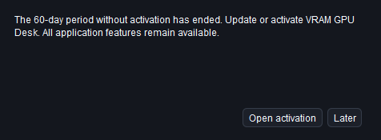
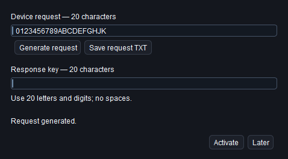
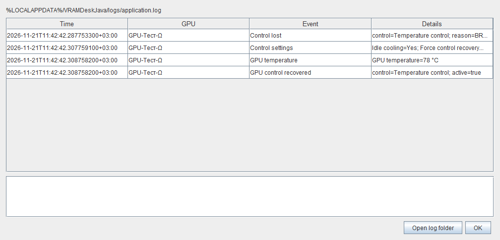
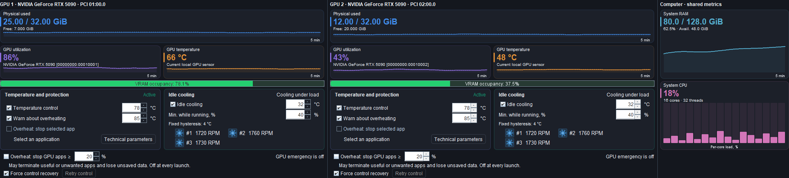
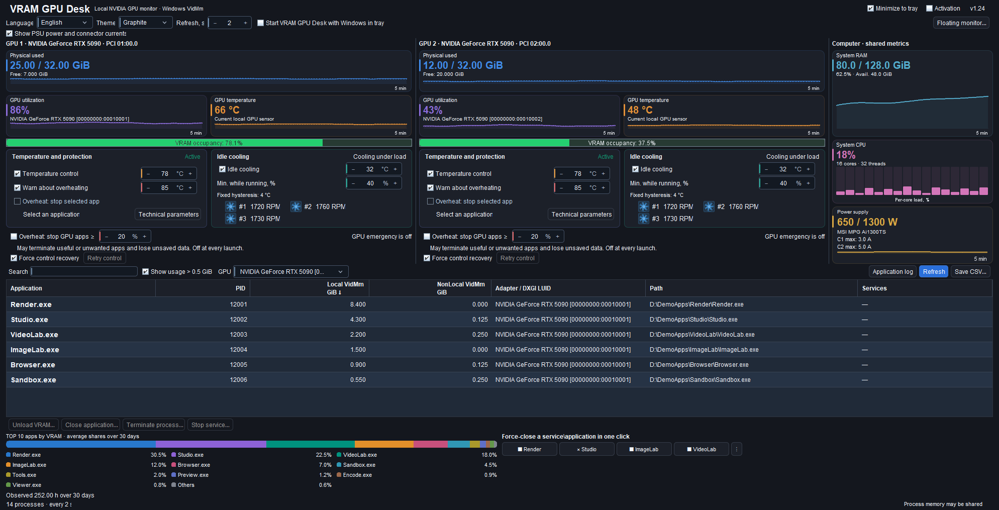

# VRAM GPU Desk 1.24

[English](README.md) · [Русский](README.ru.md) · [Deutsch](README.de.md) · [Español](README.es.md) · [Français](README.fr.md) · [Italiano](README.it.md) · [简体中文](README.zh.md) · [한국어](README.ko.md) · [日本語](README.ja.md) · [العربية](README.ar.md) · [हिन्दी](README.hi.md) · [Tiếng Việt](README.vi.md)

**Local NVIDIA GPU memory monitoring and temperature control for Windows x64. NVIDIA GPUs only; AMD and Intel GPUs are not supported.**

## What this application is for

- **Monitor and free NVIDIA video memory in Windows.** See which applications use VRAM and force-close selected applications to reclaim it, including through configurable one-click quick buttons.
- **Manage applications competing for VRAM.** Useful when running one or several workloads at once: local code-generation models, image or video generation, transcription and data analysis.
- **Gentle temperature and cooling control.** Flexible regulation of supported GPU temperature-related settings and cooling, both under load and while idle.
- **Emergency mode for overheating.** An optional mode can force-close GPU-intensive applications to reduce load when overheating is detected. It is OFF at every launch; forced closure can lose unsaved work.

## Key features

- A 60-day period from first launch of an activation-enabled edition, followed by localized activation reminders; all features remain available.

- Compact horizontal −/+ controls, inline units and consistent light/dark input contrast, with red text for higher configured temperature thresholds.

- Persistent control recovery, a timestamped application log, and explicit maximum-pin or total PSU-current labels.

- Optional, model-qualified PSU power and currents for up to two GPU power connectors when reported; OFF by default.
- Automatic overlay text contrast is ON by default, with manual light/dark text available when disabled.

- Local NVIDIA VRAM, GPU load and temperature monitoring, plus system RAM and CPU utilization, with graphs and per-core bars.
- Per-process GPU memory, search, sorting and UTF-8 CSV export.
- Temperature control and idle cooling adapted to each GPU’s reported capabilities.
- Four configurable one-click buttons bound to exact process instances; optional emergency termination is OFF at every launch.
- A 30-day top 10 of applications by recorded VRAM usage.
- 12 languages, two themes, system tray and optional Windows startup.
- Two NVIDIA GPU panels with independent settings; second GPU control is experimental.
- Control-loss warning and manual retry; forced recovery is ON for new settings, with saved OFF choices preserved.

Version **1.24** · [Download Windows installer](downloads/VRAM-GPU-Desk-1.24-Setup-x64.exe) · [Installer ZIP](downloads/VRAM-GPU-Desk-1.24-Installer.zip)

**RAM, CPU and optional smart/AI PSU monitoring**

- System RAM: used/total GiB, available memory and a five-minute graph.
- CPU: overall utilization and load bars for each physical core; no CPU temperature.
- Optional compatible smart/AI PSU: output watts and currents for up to two physical GPU power ports when available; OFF by default.

Compatibility: MSI MPG Ai1300TS sensor reads verified on hardware; Ai1600TS, selected Corsair HXi/RMi and Thermaltake DPS G/iRGB PLUS have qualified readers, with physical validation still pending for those models.

## New in 1.24 — 60-day activation period and offline device activation

**Protected-state path and control startup fixed.** Activation state now resolves through the canonical Windows machine-wide data folder, including scheduled-task launches with a minimal environment. This prevents a relative-path/permissions error from blocking native GPU control startup. Ownership, access-control and recovery checks remain enabled; this does not give exclusive control over other GPU utilities.

**60 days from the first supported launch on this computer.** The period starts when an activation-enabled edition first runs on the machine, not from older, unverified usage records. Its protected local anchor is retained through ordinary application updates and uninstall/reinstall. Updating alone does not restart the 60 days or stop reminders after expiry.

**Reminders without functional restrictions.** After the period, every feature remains available. A localized, nonmodal reminder appears at least once an hour while the application runs and is kept above ordinary Windows windows. The Activation checkbox becomes visible after the period. Opening or closing the activation dialog does not disable GPU control, cooling, monitoring or process actions.

**20-character offline request and response.** Open Activation, generate a device request and save the 20-character code as a UTF-8 TXT file. The owner uses a private generator to produce a matching 20-character response tied to that device identity. Enter the response in the application; a valid response stops the reminders. If the machine identity changes, a new response may be required; the original trial period is not restarted.

**Local state and a private issuer.** The request is an opaque device-derived code, with no online HWID upload by the activation flow. The generator and owner master-key file are not published. Compact offline verification is not a guarantee against reverse engineering or application tampering. Existing saved settings, temperature/cooling behavior and the System/Graphite input inversion are retained.

[Activation privacy and local data](PRIVACY.md).

## New in 1.23 — compact numeric controls and consistent theme contrast

**Seven numeric fields use horizontal −/+ controls.** Temperature target, overheat-warning threshold, idle-cooling target, minimum fan percentage, emergency GPU-load percentage, refresh interval and overlay scale share compact controls with inline units and a thin color accent. Keyboard entry and dynamic model limits, including reported hardware bounds, are retained.

**Matching inputs in both themes.** The language, theme and GPU selectors, search field and quick-button editor follow the same accent style. The System theme uses white input backgrounds with dark text; Graphite uses dark input backgrounds with light text. Focused, selected and disabled states and dropdown popups follow the active theme.

**Higher configured thresholds stand out.** The soft temperature target uses red text when set **above 80 °C (81 °C and higher)**; the overheat-warning threshold uses red text from **86 °C**. These colors describe the **configured threshold**, not the current GPU temperature or a live temperature alarm. Control algorithms, the 78/85 °C default target/warning values and saved preferences are unchanged. Persistent recovery, the application log and maximum-pin/total PSU-current labels from 1.22 are retained.

[System theme — light fields](images/temperature-fields-light.png) · [Graphite theme — dark fields](images/temperature-fields-dark.png)

## New in 1.22 — persistent recovery, application log and clearer PSU current

**Persistent control recovery.** While Force control recovery is enabled, checked retries continue without a retry-count limit: after 5, 10, 30, then every 60 seconds. The latest ON/OFF choice is retained through controller stop and restart. A nonmodal loss warning closes automatically only after fresh telemetry confirms recovery. Native ownership, teardown and hardware-limit checks remain in force; this does not provide exclusive control over MSI Afterburner or another controller.

**Application log.** A separate button opens a log of per-GPU control loss, recovery and retry events, plus initial states and changes of all control-related checkboxes. Each record includes UTC and local timestamps. Temperature logging starts at **78 °C**, records subsequent whole-degree changes, and marks the return below 78 °C. The viewer shows up to 500 events from the current session. UTF-8 files persist locally at `%LOCALAPPDATA%/VRAMDeskJava/logs/application.log`, rotating at 2 MiB with five archives.

**Maximum pin current or connector total.** For each of up to two physical PSU GPU-power ports, the card shows the maximum of the available individual pin-current readings if at least one is known, including incomplete pin data. If no individual readings are available, it shows the measured connector total instead. Labels explicitly distinguish **max** and **total**. Unknown sensors remain —; a measured zero stays zero. Tooltips retain individual pin readings and the total when available. A rail current is not substituted for a connector measurement.

**Updating from an old 1.9 installation.** An older copy under LocalAppData can remain running even when 1.22 has installed correctly in Program Files, making the old interface appear to lack newer settings. Before setup, exit the old copy through its tray menu; after setup, use the current Start menu shortcut and check **v1.22**. If a shortcut still points to the old folder, use the installed Program Files copy and correct that shortcut. An old running window does not mean the new controls were removed.

## System RAM, CPU and smart/AI PSU indicators

- **System RAM:** physical memory used/total in GiB, usage percentage, available memory and a five-minute history graph.
- **CPU:** overall utilization percentage, physical-core and logical-thread counts, plus a load bar for each physical core. CPU indicators show utilization only, without CPU temperature.
- **Compatible USB digital/smart/AI power supplies:** read-only PSU telemetry shows measured output watts when reported and currents for up to two physical GPU power ports, including six pin-current readings per port where available. Read-only sensor queries have been verified on **MSI MPG Ai1300TS**. Calculated values are identified separately; a rail current is not an individual connector measurement.

PSU monitoring has a separate checkbox and is **OFF by default**. If it is OFF or no compatible PSU is found, its card is hidden and the remaining cards fill the available width, without an empty placeholder. Once a PSU has been detected, temporarily unavailable readings retain its card with dashes.

With two NVIDIA GPUs, RAM, CPU and PSU indicators are shared and appear only once. “AI” or another marketing label alone does not guarantee compatibility: support depends on the exact model and protocol. See [PSU compatibility](docs/psu-compatibility.md). The image uses synthetic demonstration values; the displayed readings are not hardware-test results.

[Without PSU: remaining cards expanded](images/without-psu-strip.png)

### Which power supplies are compatible?

| Models / qualified identity | Available readings and validation |
| --- | --- |
| MSI MPG Ai1300TS PCIE5 / Ai1600TS PCIE5 | Ai1300TS: read-only sensor queries verified on hardware, measured output W and two ports with six pin-current readings each. Ai1600TS: implemented reader and qualified protocol; no physical hardware test. |
| Corsair HX750i, HX850i, HX1000i, HX1200i, HX1500i; RM650i, RM750i, RM850i, RM1000i | Measured output W; no individual GPU-port currents. Implemented reader, synthetic checks passed; physical hardware validation pending. Only the qualified USB identities in the full list are covered. |
| Thermaltake DPS G / iRGB PLUS | 264A:2329 only. Output ≈W is calculated from rail voltage × current; no individual GPU-port currents. Implemented reader with synthetic checks; physical validation pending. |
| NZXT E500 / E650 / E850 | Additional partial reader: rail sensors only; no measured total output W or physical GPU-port currents for the PSU card. Synthetic checks passed; not full PSU-card support. |

Research only: be quiet! Dark Power Pro 14 IO 1300W/1600W has no adapter in 1.21. Seasonic and ASUS have no qualified reader in 1.21. An “AI” label does not establish compatibility.

## New in 1.21 — optional PSU telemetry and automatic overlay contrast

**Optional layout.** When PSU monitoring is OFF or no compatible PSU is detected, the PSU card is hidden and the other cards use the available width, without an empty placeholder. Once a PSU has been detected, temporarily unavailable readings keep its card visible with dashes.

[PSU shown](images/with-psu-strip.png) · [PSU hidden; other cards expanded](images/without-psu-strip.png)

**More compact dashboard.** The “Time with VRAM > 50%” card has been removed from both single- and dual-GPU layouts. The 30-day application ranking and stored history are retained.

**Optional PSU monitoring is OFF by default.** Enable it with the separate settings checkbox to add a PSU card beside the existing indicators. It shows available output power and up to two actual GPU power-connector current groups. Missing or stale measurements display —; rail currents are not presented as individual GPU connector readings. Read-only PSU queries use a separate protected component installed with the application's one-time UAC setup; they do not acquire GPU control.

**Compatibility is model-specific.** Read-only telemetry was verified on an MSI MPG Ai1300TS. Ai1600TS is protocol-qualified. Selected Corsair HXi/RMi, Thermaltake DPS G/iRGB PLUS and additional NZXT E-series readers passed synthetic protocol checks; their physical hardware validation is pending. Corsair provides measured output watts; Thermaltake's rail-derived total is explicitly marked calculated; NZXT provides rail data without inventing a total. be quiet! Dark Power Pro 14 IO is researched; Seasonic OptiGuard and ASUS products have no qualified reader in this release. This is not universal support for six brands. See [PSU compatibility](docs/psu-compatibility.md).

**Automatic overlay text contrast is ON by default.** Text adapts to the background; turn the option off to retain manual light/dark text selection. Transparent backgrounds, compact gauges, separate overlays for two NVIDIA GPUs, double-click to open the main window, saved positions and temperature colors/alarms are retained.

The graphite screenshots below use synthetic demonstration readings, including PSU values. GPU settings, process actions, emergency modes and existing saved choices retain their behavior.

Two NVIDIA GPUs: with PSU telemetry / without a compatible PSU.

## 1.20.1

Double-click an overlay to open the main application.

## 1.20 — Floating GPU monitor

Optional compact transparent monitor above ordinary Windows windows, without a background panel. One separate ≈164 × 114 physical-pixel overlay per NVIDIA GPU; up to two cards. Move each independently, lock its position, adjust scale and text contrast. Display is off by default; sound is on by default and can be disabled independently. Preferences persist. Existing telemetry is reused; no additional GPU control is requested.

VRAM and GPU load; temperature: ≤40 green, 41–75 yellow, 76–81 orange, 82–86 red, ≥87 blinking. Sound starts at 88 °C.

Synthetic demonstration data and simulated controller states. Both emergency options are OFF at every launch. Recovery is ON for new settings; saved OFF choices are preserved.

> **GPU control:** GPU temperature parameter control requires one UAC confirmation when installing the control component. Subsequent enabling of temperature control and cooling proceeds without further UAC prompts. Monitoring itself does not require UAC.

> **Concurrent GPU control:** GPU temperature parameter control may conflict with other programs that change power limits, clocks or fan speeds at the same time, such as MSI Afterburner. Use only one active controller for these settings. This warning concerns simultaneous changes to settings, not passive monitoring.

## New in 1.19: per-device adaptation for NVIDIA RTX 30, 40 and 50

**Actual device limits, not a fixed wattage preset.** Each control session reads that GPU’s power bounds and captures its starting limit as the session ceiling and restoration baseline, rather than using the factory default. Acquiring the session does not issue an initial power or clock write. Power changes scale at **1% of the session baseline per second**, within the reported bounds and session ceiling. Clock adjustments are relative to a validated supported range.

**Use only available controls.** If clock control is unsupported, supported power-only regulation remains available. Valid temperature readings can support power-only control even when GPU utilization is unknown. A target above a reported hardware temperature limit is blocked; missing limits stay unknown. Unsupported features remain visible as unavailable. Fan recovery is independent of power-client recovery. BIOS, OEM, driver and laptop restrictions can change which controls work; each GPU is assessed separately.

**Reference data is separate from control commands.** The [RTX 30-and-newer reference](docs/nvidia-rtx30-plus/README.md) and [UTF-8 CSV](docs/nvidia-rtx30-plus/REFERENCE-GPUS.csv) cover **45 model/variant groups: 27 desktop and 18 laptop**. These are documentary reference groups, not 45 hardware tests, and published board power or laptop TGP values are not executable presets. The RTX 3060 Ti 200 W row is a reference specification, not a limit asserted for every GDDR6X or OEM variant.

**Compact CPU area with two GPUs.** The CPU card now ends level with the adjacent idle-cooling panel, above the emergency and recovery rows. RAM stays above it; CPU load and physical-core bars remain visible. The single-GPU six-card layout is unchanged.

## New in 1.18: CPU utilization and a clearer two-GPU workspace

**CPU load beside system RAM.** The CPU card shows overall utilization, physical-core and logical-thread counts, and an instantaneous utilization bar for each physical core. Each core bar groups its logical threads; the overall percentage is weighted by logical processors. Built-in Windows measurements require no additional UAC prompt, driver or monitoring application. Missing, invalid or more than six-second-old readings show **—**, with unavailable core bars.

**One GPU: six cards at 1200×900.** The four GPU cards, system RAM and CPU load remain visible together. **Two NVIDIA GPUs: minimum 1920×1050.** Each GPU has its own four-card 2×2 block, aligned readings and complete controls. Thin vertical dividers separate the GPU areas from the shared column on the right, with RAM above the taller CPU card. System RAM and CPU appear only once and do not follow GPU selection. Second-GPU control remains experimental.

All three fan indicators remain visible through wrapping when space is limited. This improves the display without changing fan-control logic. Compact quick buttons, process readability and all existing settings are retained.

## New in 1.17: system RAM at a glance

A fifth **System RAM** card shows physical memory used/total in GiB, usage percentage, available memory and a five-minute graph. Its total is the physical RAM usable by Windows; this is system memory, separate from VRAM and page-file commit.

RAM readings describe the whole computer and are independent of the selected GPU. With two NVIDIA panels, the primary panel has five cards and the secondary retains its four GPU cards; system RAM appears only once. Existing GPU controls remain available.

RAM updates at the existing refresh interval and needs no UAC prompt. Missing, invalid or more than six-second-old readings display **—**, with a gap in the graph instead of a fabricated value.

## New in 1.16: reliable control recovery and optional tray minimization

**Control recovery starts enabled for new or missing settings.** Each GPU keeps its own choice; an explicitly saved OFF remains OFF. Recovery reconnects to the same card with backoff and confirmed cleanup. It does not grant exclusive control over MSI Afterburner or other GPU controllers.

**Choose how the window minimizes.** “Minimize to tray” is ON by default. Turn it OFF for ordinary Windows taskbar minimization. This choice is saved; the separate Windows startup setting remains independent.

**More reliable communication and clearer status.** The Java request deadline is now 7 seconds, matching the native channel’s 6-second response window with a margin. The native watchdog starts counting after successful GPU acquisition; its 6-second safety guard remains. Failed or old readings no longer appear fresh: stale RPM is hidden, and connection timeouts are distinguished from confirmed external setting changes. A bounded local journal retains errors and slow-response metadata without connection secrets.

## New in 1.15: independent NVIDIA panels and control recovery

Two supported NVIDIA GPUs have separate metrics, four graphs each and independent control settings. **Second NVIDIA GPU control is experimental.** One NVIDIA GPU with AMD/Intel uses one NVIDIA panel. The GPU selector filters the shared process list and history; it does not retarget either controller.

**Four compact quick buttons stay in one horizontal row.** The single `⋮` menu offers Assign/Reassign, Rename and Clear for every slot, including missing targets. A custom name can be edited without rebinding; captions fit the available width and the tooltip keeps the full name. Exact PID, creation-time and path checks remain in force.

**Control loss shows a warning and a manual Retry action. In 1.16, forced recovery is ON for new or missing settings and saved separately for each GPU; an explicitly saved OFF is preserved.** Retries use 5/10/30/60-second backoff, confirmed cleanup and fresh readings from the same GPU. Native lease, ownership, readback and safety checks remain mandatory. This cannot exclusively block MSI Afterburner or another controller. Both emergency options remain OFF at every launch.

Verified for 1.15: **2262 UI checks**, **215 native checks**, **61 client lifecycle/I/O checks**, **48 recovery-coordinator checks**, **167 package files** and **93 Java classes**. One-GPU minimum: **1200×900**; two-panel minimum: **1600×950**. The 1.14 consent-based installer shutdown and checked-by-default final launch option are retained.

## New in 1.14: compact workspace and easier updates

**Graphite Studio (1.12).** All primary settings and actions stay visible together at 1200×900: seven process columns, at least six rows, four graphs and the complete top-10 legend. Process names use a high-contrast 14 px bold font. New profiles start in Graphite; an explicitly saved System or Graphite theme is preserved. Four editable one-click buttons retain their exact process-instance bindings and Close/Terminate actions.

**Visible cooling hysteresis (1.13).** The cooling panel now shows the fixed **4 °C** hysteresis. Its tooltip explains 32→36 °C and 35→39 °C examples. This makes the existing rule visible without changing the cooling algorithm.

**Installer flow (1.14).** Setup asks permission to close the running target copy. With consent it requests normal JVM shutdown through Windows Restart Manager, waits for the app, its launcher and controller files to be released, then continues. It targets verified instances of this installation, without forced termination. Declining, cancellation, a shutdown veto, remaining locks or a timeout blocks replacement; silent setup does not close a running app automatically.

The final **Launch VRAM GPU Desk** checkbox is checked by default and can be cleared. Launch uses normal rights for the same signed-in user; if that context is unavailable, use the normal Start menu shortcut. This is a one-time launch after installation; the saved Windows startup choice is preserved.

Verified for 1.14: **9 installer-flow cases, 107 Restart Manager/JDK checks and 17 fixed-launch gate checks**, all **166 package files and 88 Java classes**, broker pins, Unicode paths and the bundled-runtime launcher.

## New in 1.11: emergency GPU-load process termination

A separate checkbox is **OFF at every launch**. After confirmed temperature stays strictly above the configured overheat threshold for **10 seconds**, it can terminate accessible processes that have loaded the selected GPU at or above **20% by default (adjustable 10–100%) for at least 3 seconds**. This uses the process’s busiest GPU engine, **not VRAM allocation**. It is one-shot and switches OFF after the attempt; another attempt needs explicit reactivation. Confirmed process-load data and a valid sensor are required.

**Warning: this may terminate useful as well as unwanted applications and lose unsaved work.** Fresh temperature, GPU identity, PID, creation time, EXE path and the same process handle are checked. Protected Windows/NVIDIA components, critical or unverifiable processes and the utility itself are excluded. It does not terminate process trees, stop services or request more elevation. The older selected-application emergency option remains separate. This is an additional measure, not a guarantee against GPU damage.

Verified for 1.11: **40 native CPU checks**, **256 Java/catalog/guard checks**, **673 UI assertions in 48 cases** across twelve languages and two themes, read-only access to **710 valid PDH counter instances**, independent native review, all **164 package files**, **87 compiled Java classes**, embedded broker pins, isolated installation/uninstallation, and the packaged Unicode launcher with its bundled runtime.

## What it does

- Shows physical VRAM used/free, GPU utilization and GPU temperature, with compact history graphs.
- Lists local applications and services using GPU memory, with search, sorting and an optional **over 0.5 GiB** filter.
- Displays the top 10 applications and an “Others” category as normalized shares over the last 30 days of observed samples. Percentages sum to 100%; this is a historical allocation of recorded process-memory readings, not an additive breakdown of physical VRAM.
- Exports a UTF-8 CSV report to a chosen local path.
- Supports a saved choice between minimizing to the system tray and ordinary Windows taskbar minimization, restores the existing window on repeat launch, and offers optional Windows startup.
- Offers system and dark graphite themes, 12 interface languages, and a configurable 1–5 second UI refresh interval (default: 2 seconds).
- Provides optional soft GPU temperature control through supported power and core-clock limits; protection runs independently of the UI refresh interval.
- Provides idle cooling, fan RPM indicators, and animated fan icons. Fresh settings request both temperature control and idle cooling on; a previously saved manual OFF is preserved. Active control is shown only after a confirmed connection.
- Can show an alert after temperature stays strictly above the selected 75–92°C threshold for at least 10 seconds. Short spikes do not produce an alert.
- Provides a separate, initially disabled emergency option for the explicitly selected application. Closing or terminating an application can lose unsaved work; protected or unverifiable processes cannot be selected for this action.

## Four quick action buttons

Assign **Close application** or **Terminate process** to one of four compact buttons, and reassign it through the adjacent `⋮` menu. Each binding refers to the explicitly selected process instance: PID, creation time and executable path. When that instance ends, a neighboring process or a reused PID is not selected automatically.

A configured button executes with one click **without an additional confirmation**. Closing or terminating a process may lose unsaved work. Native checks for protected, critical or unverifiable processes remain in place. The separate emergency option is initially off and retains its existing selected-application behavior.

## Temperature targets and hysteresis

Some settings deliberately use separate stop/restart thresholds and short waiting periods. This avoids rapid switching when a reading fluctuates by a few degrees.

| Setting | Actual behavior | Why |
|---|---|---|
| Idle target, default **32°C** (28–40°C adjustable) | During idle, after temperature stays at or below 32°C for 3 seconds, control returns to firmware AUTO. Cooling restarts at 36°C, which is target +4°C. With a 35°C target, the corresponding restart point is 39°C. | The 4°C hysteresis prevents repeated fan starts and stops around one threshold. Firmware AUTO, rather than the application, decides whether fans stop completely. |
| Idle/load classification | At GPU utilization up to 10%, idle behavior is allowed. From 15%, the load cooling curve applies. Between 11% and 14%, the previous classification is retained. Unknown utilization keeps cooling active. | The gap avoids toggling between idle and load due to small utilization fluctuations. |
| Soft temperature target, 70–88°C | Power and core-clock limits adjust gradually using temperature trend, with an operating band around the target. Actual temperature can be somewhat below the target or briefly exceed it. | Thermal inertia, sensor updates and driver limits make an exact hard ceiling impossible. The target is a control goal, not an emergency cutoff. |
| Overheat alert | The reading must remain strictly above its threshold for at least 10 seconds. | Suppresses short temperature spikes. |

Idle temperature is **not** the temperature limit under sustained load. Ambient conditions, board firmware and driver restrictions affect attainable temperatures and fan response. Do not run competing fan or clock controllers against the same card at the same time.

## Hardware and requirements

For NVIDIA GeForce **RTX 30 / 40 / 50** GPUs. Monitoring and available controls depend on the GPU and driver; unsupported controls remain unavailable rather than being simulated.

Windows 10/11 x64, .NET Framework 4.8 and a supported NVIDIA driver. The installer includes its Java runtime, so a separate Java installation is not required. The signed-in Windows user must be an administrator using a normal filtered desktop token. Setup requests UAC once and installs the control component in a fixed protected Program Files directory; entering credentials for a different administrator is not supported. Two GPU-control tasks and a separate read-only PSU task use protected, demand-only fixed launchers and typed local communication. The installed channel is designed to start control without a further UAC prompt; if it cannot be authenticated, control stays unavailable instead of falling back to another elevation prompt. Driver versions and DLL hashes are not allowlisted. The installed system NVML library must pass offline Windows signature verification with a verified NVIDIA Corporation signer, safe-path checks and the required API checks. Driver updates do not require adding a new version or hash. Offline trust verification can fail when required trust data is not available locally; no certificates or drivers are downloaded by the application.

## Installation and privacy

1. Download the installer and compare its SHA-256 with [SHA256SUMS.txt](SHA256SUMS.txt).
2. Run setup normally from the signed-in administrator account and approve UAC. If the target copy is running, answer its shutdown question; setup continues after normal exit and released files. The protected installation folder is fixed.
3. Open the new VRAM GPU Desk shortcut, select the GPU and check the confirmed controller status. Configure the controls and quick buttons as needed. Settings are saved locally; saved OFF choices remain OFF.

The application uses local Windows/GPU interfaces. It contains no designed-in telemetry uploads, cloud inference, updater or runtime model downloads. CSV files, history and settings remain local. This is **not** a claim of OS-wide network isolation or a guarantee about third-party drivers, Windows diagnostics or synchronization software.

The installer is unsigned. The application is distributed as compiled binaries; **application source code is not published in this repository**. Java bytecode is not encrypted or guaranteed to resist decompilation. Third-party runtime license notices are retained in the installed runtime.

Screenshots use synthetic demonstration data and simulated controller state. They illustrate the interface and do not demonstrate hardware operation or performance.

## Changes in 1.10

- Adds four configurable, process-instance-bound quick buttons for one-click close or terminate, with reassignment and preserved native safety checks.
- Uses smaller dashboard descriptions and increases mini-graph height from 35 to 55 pixels; keeps the high-contrast tray icon.
- Installs a protected control component once with UAC. Fresh thermal and idle-cooling settings are on; saved manual OFF choices are preserved.
- Includes the conservative adapter-alias correction: confirmed non-render indirect-display aliases are excluded without merging separate physical GPUs by name or memory values.
- Repairs safe incomplete installations and reports a concrete setup phase, code and HRESULT when component setup fails.
- Preserves both themes, 12 languages, local history, UTF-8 CSV, GPU identity checks and existing lease/watchdog/restore policies.

Verified for this release: 48 isolated interface cases across 12 languages and two themes, tray icons, settings defaults, quick-action binding/runner checks, actual CLR token checks, Unicode paths, all 163 package files and embedded broker pins, isolated installation/uninstallation, and a real elevated temporary Task Scheduler registration test with XML/DACL readback, rollback and cleanup. The temporary tasks were **not run**.

Screenshots use synthetic demonstration data and simulated controller state, without demonstrating hardware operation or performance.

## License

Free for noncommercial use under [PolyForm Noncommercial 1.0.0](LICENSE.md), subject to its terms and notice requirements. Commercial use requires separate permission. This is not an open-source license; application source code is not published. Third-party runtime licenses remain unchanged.

[Light background](images/floating-monitor-light.png) · [GPU × 2](images/dual-floating-monitors-light.png)

**1080p → ≈122 × 86 px · 1440p → ≈164 × 114 px · 2160p / 4K → ≈245 × 171 px**

## Support the project

If VRAM GPU Desk is useful to you, you can [support its development voluntarily](https://github.com/2018-spec-fdsds/multiroute-downloader/blob/main/docs/support.md).

Scan the QR code with a compatible wallet.
