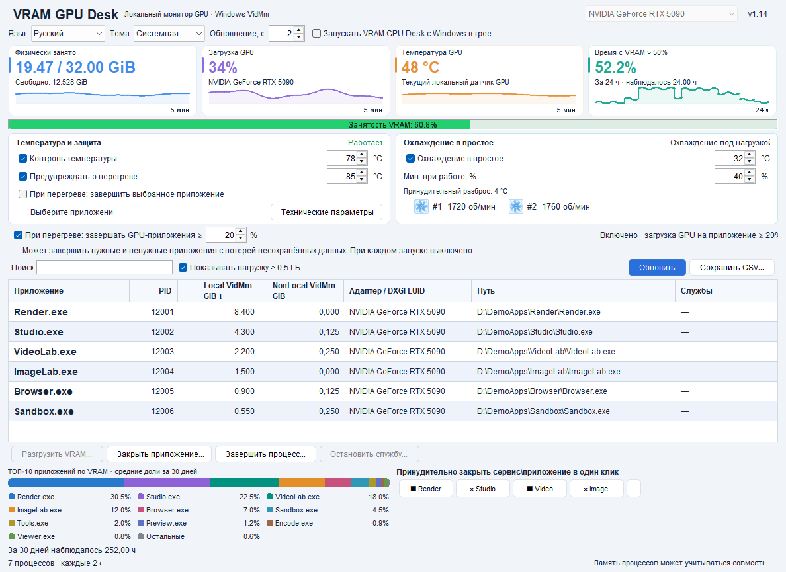

# VRAM GPU Desk 1.10

[English](README.md) · [Русский](README.ru.md) · [Deutsch](README.de.md) · [Español](README.es.md) · [Français](README.fr.md) · [Italiano](README.it.md) · [简体中文](README.zh.md) · [한국어](README.ko.md) · [日本語](README.ja.md) · [العربية](README.ar.md) · [हिन्दी](README.hi.md) · [Tiếng Việt](README.vi.md)

Локальный монитор видеопамяти и управление температурой GPU для Windows x64.

[Скачать установщик](downloads/VRAM-GPU-Desk-1.10-Setup-x64.exe) · [ZIP с установщиком](downloads/VRAM-GPU-Desk-1.10-Installer.zip)

> **Управление GPU:** Для управления температурными параметрами GPU требуется однократное подтверждение UAC при установке компонента управления. Последующее включение контроля температуры и охлаждения выполняется без повторных запросов UAC. Мониторинг сам по себе UAC не требует.

> **Одновременное управление GPU:** Управление температурными параметрами GPU может конфликтовать с другими программами, которые одновременно изменяют мощность, частоты или скорость вентиляторов, например MSI Afterburner. Используйте один активный регулятор этих параметров. Это предупреждение относится к одновременному изменению параметров, а не к пассивному мониторингу.

## Возможности

- Физически занятая и свободная VRAM, загрузка GPU, температура и миниграфики.
- Таблица приложений и служб: поиск, сортировка, отключаемый фильтр использования более 0,5 ГиБ.
- ТОП-10 приложений и «Остальные»: нормированные доли по накопленным показаниям за последние 30 дней. Сумма долей — 100%. Это распределение наблюдавшихся показаний процессов, а не физически складываемые участки видеопамяти.
- Доля наблюдавшегося времени за последние 24 часа, когда физическая занятость VRAM превышала 50%; пропуски наблюдений не учитываются.
- Сохранение CSV в UTF-8 с выбором пути, работа в трее, необязательный запуск с Windows.
- Системная и тёмная графитовая темы, 12 языков. Интервал обновления интерфейса 1–5 секунд, по умолчанию 2 секунды.
- Мягкая цель температуры GPU 70–88°C: постепенное управление доступными пределами мощности и частоты ядра. Контроль работает независимо от частоты обновления интерфейса.
- Охлаждение в простое, реальные RPM вентиляторов и анимированные значки. В новых настройках контроль температуры и охлаждение включены; ранее сохранённое ручное отключение сохраняется. Активность показывается только после подтверждённого подключения.
- Отключаемое предупреждение при температуре строго выше заданного порога 75–92°C непрерывно не менее 10 секунд; короткие всплески игнорируются.
- Отдельная выключенная по умолчанию опция аварийного завершения заранее выбранного приложения. Незавершённая работа может быть потеряна. Системные и неподтверждённые процессы защищены.

## Четыре быстрые кнопки

Назначьте кнопке «Закрыть приложение» или «Завершить процесс». Настройка и переназначение доступны через `⋮` рядом с кнопкой. Привязка относится к выбранному экземпляру: PID, времени создания и пути EXE. После его завершения соседний процесс или новый процесс с тем же PID автоматически не подхватывается.

Назначенная кнопка действует одним нажатием **без дополнительного подтверждения**. Незавершённая работа может быть потеряна. Проверки защищённых, критических и неподтверждённых процессов сохранены. Отдельная аварийная опция по-прежнему изначально выключена и относится к заранее выбранному приложению.

## Почему температуры включения и выключения различаются

**Охлаждение в простое:** цель по умолчанию 32°C, настраивается от 28 до 40°C. При простое и температуре не выше цели в течение 3 секунд управление возвращается прошивке карты — AUTO. Повторный запуск охлаждения происходит при **цели +4°C**: при цели 32°C это 36°C, при цели 35°C — 39°C. Такой температурный гистерезис предотвращает частые включения и выключения вентиляторов около одной отметки. В режиме AUTO полную остановку вентиляторов определяет прошивка карты.

Режим простоя допускается при загрузке GPU до 10%. При загрузке от 15% применяется охлаждение по нагрузке. В промежутке 11–14% сохраняется предыдущий режим; неизвестная загрузка не отключает охлаждение. Разница между границами тоже предотвращает частые переключения.

**Мягкая цель под нагрузкой** — ориентир регулятора, а не точный аварийный потолок. Мощность и частота изменяются плавно с учётом тенденции нагрева, поэтому температура может быть немного ниже цели или кратковременно выше неё. Влияют инерция охлаждения, датчики и допустимые драйвером пределы. Температура простоя не является ограничением температуры при полной нагрузке.

**Алерт** требует превышения порога не менее 10 секунд, чтобы единичный всплеск не вызывал окно.

Не используйте несколько конкурирующих регуляторов вентиляторов, мощности или частоты на одной карте одновременно.

## Видеокарты и установка

Для видеокарт NVIDIA GeForce **RTX 5000 Series**. Доступность управления зависит от карты и драйвера; неподдерживаемые функции не имитируются.

Windows 10/11 x64, .NET Framework 4.8, поддерживаемый драйвер NVIDIA. Java уже включена. Поддерживается вошедший в Windows пользователь-администратор с обычным ограниченным токеном рабочего стола. Установщик однократно запрашивает UAC и устанавливает компонент управления в фиксированную защищённую папку Program Files. Ввод данных другого администратора не поддерживается. Две защищённые задачи запускаются по запросу с фиксированными действиями и типизированным локальным обменом. Установленный канал рассчитан на дальнейшее включение управления без нового UAC; если компонент не прошёл проверку, управление остаётся недоступным, без дополнительного запроса повышения прав. Версия и хеш драйвера не включены в список допуска; проверяются подпись NVIDIA, безопасный системный путь и нужные API.

[Скачать установщик](downloads/VRAM-GPU-Desk-1.10-Setup-x64.exe). Сравните его SHA-256 с [SHA256SUMS.txt](SHA256SUMS.txt), штатно завершите прежнюю копию через «Выход» в трее, запустите установщик и подтвердите UAC. Затем откройте новый ярлык, выберите GPU и проверьте подтверждённое состояние регуляторов. Настройки сохраняются автоматически; ручное OFF сохраняется.

## Приватность и состав публикации

Приложение использует локальные интерфейсы Windows и GPU; предусмотренных отправок телеметрии, облачной обработки, самообновления и загрузок моделей при работе нет. История, настройки и CSV остаются локальными. Полная сетевая изоляция всей ОС, поведение драйверов и сторонних программ синхронизации не гарантируются.

Публикуются готовые бинарники, описание и демонстрационные изображения. **Исходники приложения не публикуются.** Байт-код Java не зашифрован; невозможность декомпиляции не обещается. Лицензии стороннего runtime сохранены в установленном приложении. Установщик не подписан персональным сертификатом.

Скриншоты содержат искусственные демонстрационные данные и имитированное состояние регуляторов. Они иллюстрируют интерфейс и не подтверждают работу аппаратного управления или его эффективность.

## Изменения 1.10

- Четыре переназначаемые кнопки закрытия или завершения выбранного экземпляра процесса одним нажатием, с сохранёнными native-проверками.
- Меньший шрифт пояснений карточек, высота миниграфиков увеличена с 35 до 55 пикселей; контрастная иконка трея сохранена.
- Защищённый компонент управления устанавливается однократно с UAC. Оба режима включены в новых настройках, сохранённое ручное отключение сохраняется.
- Исключены только подтверждённые non-render IDD aliases; разные физические GPU не объединяются по имени или объёму памяти.
- Повторная установка умеет исправлять безопасную незавершённую копию; ошибка компонента содержит конкретные phase, code и HRESULT.
- Сохранены две темы, 12 языков, локальная история, UTF-8 CSV, проверки GPU identity и существующие lease/watchdog/restore.

Проверены 48 изолированных вариантов интерфейса на 12 языках в двух темах, иконки, настройки по умолчанию, быстрые привязки и runner, реальные CLR token checks, Unicode-пути, все 163 файла пакета и закреплённые хеши брокеров, изолированная установка и удаление. Отдельный реальный повышенный тест Scheduler выполнил регистрацию временных задач, чтение XML/DACL, откат и очистку. **Сами задачи не запускались**, GPU setters и production-задачи этим тестом не вызывались.

Этот тест не является проверкой полного production-установщика и последующего аппаратного управления без UAC. Эффективность термоконтроля под длительной нагрузкой этими проверками не подтверждается. Скриншоты показывают искусственные демонстрационные данные и имитированное состояние регуляторов, без подтверждения работы аппаратного управления или его эффективности.

## Лицензия

Бесплатное некоммерческое использование разрешено по [PolyForm Noncommercial 1.0.0](LICENSE.md) с соблюдением её условий и требований к уведомлениям. Для коммерческого использования требуется отдельное разрешение. Это не open-source лицензия; исходники приложения не публикуются. Лицензии стороннего runtime остаются без изменений.
