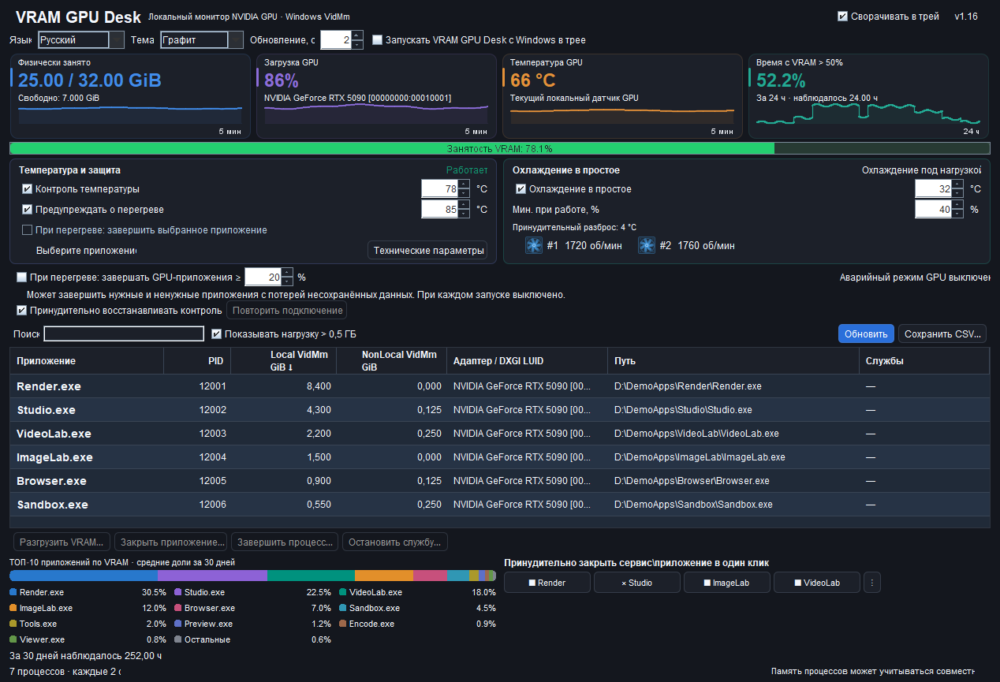
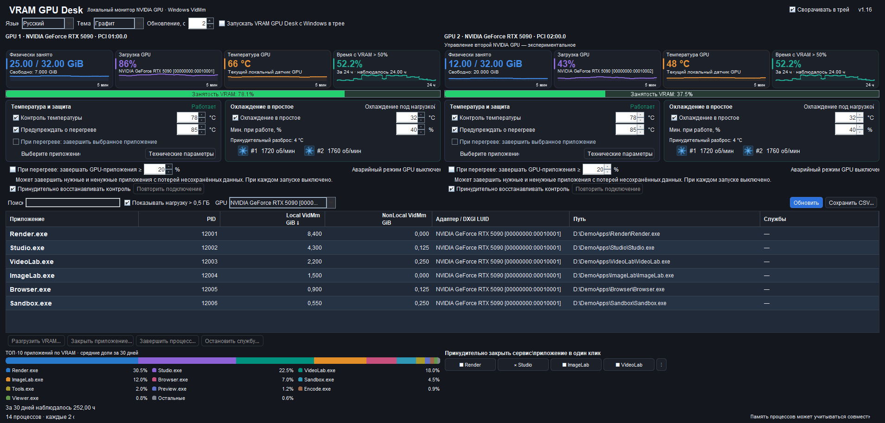

# VRAM GPU Desk 1.16

[English](README.md) · [Русский](README.ru.md) · [Deutsch](README.de.md) · [Español](README.es.md) · [Français](README.fr.md) · [Italiano](README.it.md) · [简体中文](README.zh.md) · [한국어](README.ko.md) · [日本語](README.ja.md) · [العربية](README.ar.md) · [हिन्दी](README.hi.md) · [Tiếng Việt](README.vi.md)

**Локальный монитор видеопамяти и управление температурой NVIDIA GPU для Windows x64. Только NVIDIA; AMD и Intel не поддерживаются.**

## Основные возможности

- Локальный мониторинг VRAM, загрузки и температуры NVIDIA GPU с графиками.
- Память GPU по процессам, поиск, сортировка и экспорт CSV в UTF-8.
- Контроль температуры и охлаждение в простое.
- Четыре настраиваемые кнопки в один клик с привязкой к конкретным экземплярам процессов; аварийное завершение включается отдельно и снято при каждом запуске.
- История VRAM за 24 часа и топ-10 приложений за 30 дней.
- 12 языков, две темы, работа в трее и необязательный запуск с Windows.
- Две панели NVIDIA с независимыми настройками; управление второй GPU — экспериментальное.
- Предупреждение о потере контроля и ручной повтор; восстановление включено для новых настроек, сохранённое отключение учитывается.

[Скачать установщик](downloads/VRAM-GPU-Desk-1.16-Setup-x64.exe) · [ZIP с установщиком](downloads/VRAM-GPU-Desk-1.16-Installer.zip)

Синтетические демонстрационные данные и смоделированные состояния регуляторов. Оба аварийных режима выключены при каждом запуске. Восстановление включено для новых настроек; сохранённое отключение учитывается.

> **Управление GPU:** Для управления температурными параметрами GPU требуется однократное подтверждение UAC при установке компонента управления. Последующее включение контроля температуры и охлаждения выполняется без повторных запросов UAC. Мониторинг сам по себе UAC не требует.

> **Одновременное управление GPU:** Управление температурными параметрами GPU может конфликтовать с другими программами, которые одновременно изменяют мощность, частоты или скорость вентиляторов, например MSI Afterburner. Используйте один активный регулятор этих параметров. Это предупреждение относится к одновременному изменению параметров, а не к пассивному мониторингу.

## Новое в 1.16: восстановление контроля и выбор сворачивания

**Восстановление контроля включено для новых настроек и отсутствующего параметра.** Выбор сохраняется отдельно для каждой GPU; ранее явно сохранённое отключение остаётся в силе. Повторное подключение выполняется к той же карте с паузами и подтверждённым завершением прежнего клиента. Это не даёт исключительного управления относительно MSI Afterburner и других регуляторов.

**Выберите поведение при сворачивании.** Галка «Сворачивать в трей» включена по умолчанию. Если снять её, окно сворачивается на панель задач Windows как обычное приложение. Выбор сохраняется; настройка запуска с Windows остаётся независимой.

**Надёжнее обмен и понятнее состояние.** Срок ожидания Java-запроса увеличен до 7 секунд с учётом 6-секундного окна внутреннего канала и небольшого запаса. Рабочий watchdog начинает отсчёт после успешного подключения к GPU; защитный предел 6 секунд сохранён. Ошибка и устаревшие данные больше не выглядят свежими: старые RPM скрываются, а таймаут связи отличается от подтверждённой внешней смены параметров. Ограниченный локальный журнал сохраняет причины ошибок и сведения о медленных ответах без секретов подключения.

## Новое в 1.15: независимые панели NVIDIA и восстановление контроля

Две поддерживаемые NVIDIA GPU получают отдельные показатели, по четыре графика и независимые настройки управления. **Управление второй NVIDIA GPU — экспериментальное.** При одной NVIDIA и AMD/Intel используется одна панель NVIDIA. Выбор GPU фильтрует общую таблицу процессов и историю, а не переназначает регуляторы.

**Четыре компактные быстрые кнопки сохранены в одной горизонтальной строке.** Общее меню `⋮` позволяет назначить или сменить цель, переименовать и сбросить каждый слот, в том числе с исчезнувшей целью. Своё имя меняется без перепривязки; текст подстраивается под ширину, полное имя остаётся в подсказке. Проверки точных PID, времени создания и пути сохранены.

**При потере контроля появляются предупреждение и ручная кнопка повтора. В 1.16 восстановление включено для новых настроек и отсутствующего параметра и сохраняется отдельно для каждой GPU; сохранённое явное отключение учитывается.** Используются интервалы 5/10/30/60 секунд, подтверждённое завершение прежнего клиента и свежие данные той же GPU. Проверки lease, владения, обратного чтения и безопасных границ сохраняются. Исключительно заблокировать MSI Afterburner или другой регулятор это не может. Оба аварийных режима выключены при каждом запуске.

Проверено в 1.15: **2262 UI-проверки**, **215 native-проверок**, **61 проверка жизненного цикла и I/O клиентов**, **48 проверок восстановления**, **167 файлов пакета** и **93 Java-класса**. Минимум для одной GPU: **1200×900**, для двух панелей: **1600×950**. Сохранены остановка текущей версии установщиком с согласия пользователя и отмеченный по умолчанию финальный запуск из 1.14.

## Новое в 1.14: компактный интерфейс и удобное обновление

**Graphite Studio (1.12).** При 1200×900 все основные настройки и действия видны одновременно: семь колонок и не менее шести строк процессов, четыре графика и полная легенда ТОП-10. Имена процессов показаны контрастным полужирным шрифтом 14 px. Для нового профиля выбрана Graphite; сохранённая System или Graphite остаётся прежней. Четыре переназначаемые миникнопки сохраняют привязку к точному экземпляру процесса и действия Close/Terminate.

**Видимый гистерезис охлаждения (1.13).** В группе охлаждения добавлена подпись **«Принудительный разброс: 4 °C»**. Подсказка поясняет переходы 32→36 °C и 35→39 °C. Это отображение существующего правила, без изменения алгоритма.

**Установка и обновление (1.14).** Установщик спрашивает разрешение штатно завершить запущенную целевую копию. После согласия использует Windows Restart Manager, ждёт выхода JVM, её launcher и освобождения файлов регуляторов, затем продолжает. Проверяется точный экземпляр этой установки; принудительное завершение не применяется. Отказ, отмена, veto приложения, занятые файлы или таймаут блокируют замену. Тихая установка сама не закрывает работающее приложение.

На последней странице галка **«Запустить VRAM GPU Desk»** отмечена по умолчанию; её можно снять. Приложение запускается с обычными правами вошедшего пользователя. Если такой контекст недоступен, откройте его обычным ярлыком из меню «Пуск». Это однократный запуск после установки; сохранённый выбор автозапуска Windows сохраняется.

Для 1.14 проверены **9 сценариев установщика, 107 проверок Restart Manager/JDK и 17 проверок фиксированного launch gate**, все **166 файлов пакета и 88 Java-классов**, хеши брокеров, Unicode-пути и лаунчер со встроенной Java.

## Новое в 1.11: аварийное завершение нагружающих GPU процессов

Отдельная галка **снята при каждом запуске**. После **10 секунд** подтверждённой температуры строго выше порога перегрева она может завершить доступные процессы, которые нагружают выбранную GPU не ниже **20% по умолчанию (настройка 10–100%) не менее 3 секунд**. Измеряется самый загруженный GPU engine процесса, **а не объём VRAM**. Срабатывание однократное: после попытки галка снимается; для следующей попытки нужно явно включить её снова. Без подтверждённых данных нагрузки процессов и исправного датчика включение недоступно.

**Внимание: могут завершиться как ненужные, так и нужные приложения, с потерей несохранённой работы.** Перед действием проверяются свежая температура, личность GPU, PID, время создания, EXE-путь и тот же хэндл процесса. Защищённые Windows/NVIDIA-компоненты, критические и непроверяемые процессы и сама утилита исключены. Нет завершения деревьев процессов, остановки служб или дополнительного повышения прав. Прежняя аварийная опция выбранного приложения сохранена отдельно. Это дополнительная мера, а не гарантия защиты GPU от повреждений.

Для 1.11 проверены: **40 нативных CPU-проверок**, **256 Java/catalog/guard-проверок**, **673 проверки интерфейса в 48 сценариях** на двенадцати языках и двух темах, чтение **710 действительных PDH-счётчиков**, независимый аудит, все **164 файла пакета**, **87 Java-классов**, встроенные хеши брокеров, изолированная установка/удаление и упакованный Unicode-лаунчер со встроенной Java.

## Возможности

- Физически занятая и свободная VRAM, загрузка GPU, температура и миниграфики.
- Таблица приложений и служб: поиск, сортировка, отключаемый фильтр использования более 0,5 ГиБ.
- ТОП-10 приложений и «Остальные»: нормированные доли по накопленным показаниям за последние 30 дней. Сумма долей — 100%. Это распределение наблюдавшихся показаний процессов, а не физически складываемые участки видеопамяти.
- Доля наблюдавшегося времени за последние 24 часа, когда физическая занятость VRAM превышала 50%; пропуски наблюдений не учитываются.
- Сохранение CSV в UTF-8 с выбором пути; сохраняемый выбор сворачивания в трей или на панель задач Windows; необязательный запуск с Windows.
- Системная и тёмная графитовая темы, 12 языков. Интервал обновления интерфейса 1–5 секунд, по умолчанию 2 секунды.
- Мягкая цель температуры GPU 70–88°C: постепенное управление доступными пределами мощности и частоты ядра. Контроль работает независимо от частоты обновления интерфейса.
- Охлаждение в простое, реальные RPM вентиляторов и анимированные значки. В новых настройках контроль температуры и охлаждение включены; ранее сохранённое ручное отключение сохраняется. Активность показывается только после подтверждённого подключения.
- Отключаемое предупреждение при температуре строго выше заданного порога 75–92°C непрерывно не менее 10 секунд; короткие всплески игнорируются.
- Отдельная выключенная по умолчанию опция аварийного завершения заранее выбранного приложения. Незавершённая работа может быть потеряна. Системные и неподтверждённые процессы защищены.

## Четыре быстрые кнопки

Назначьте кнопке «Закрыть приложение» или «Завершить процесс». Настройка и переназначение доступны через `⋮` рядом с кнопкой. Привязка относится к выбранному экземпляру: PID, времени создания и пути EXE. После его завершения соседний процесс или новый процесс с тем же PID автоматически не подхватывается.

Назначенная кнопка действует одним нажатием **без дополнительного подтверждения**. Незавершённая работа может быть потеряна. Проверки защищённых, критических и неподтверждённых процессов сохранены. Отдельная аварийная опция по-прежнему изначально выключена и относится к заранее выбранному приложению.

## Почему температуры включения и выключения различаются

**Охлаждение в простое:** цель по умолчанию 32°C, настраивается от 28 до 40°C. При простое и температуре не выше цели в течение 3 секунд управление возвращается прошивке карты — AUTO. Повторный запуск охлаждения происходит при **цели +4°C**: при цели 32°C это 36°C, при цели 35°C — 39°C. Такой температурный гистерезис предотвращает частые включения и выключения вентиляторов около одной отметки. В режиме AUTO полную остановку вентиляторов определяет прошивка карты.

Режим простоя допускается при загрузке GPU до 10%. При загрузке от 15% применяется охлаждение по нагрузке. В промежутке 11–14% сохраняется предыдущий режим; неизвестная загрузка не отключает охлаждение. Разница между границами тоже предотвращает частые переключения.

**Мягкая цель под нагрузкой** — ориентир регулятора, а не точный аварийный потолок. Мощность и частота изменяются плавно с учётом тенденции нагрева, поэтому температура может быть немного ниже цели или кратковременно выше неё. Влияют инерция охлаждения, датчики и допустимые драйвером пределы. Температура простоя не является ограничением температуры при полной нагрузке.

**Алерт** требует превышения порога не менее 10 секунд, чтобы единичный всплеск не вызывал окно.

Не используйте несколько конкурирующих регуляторов вентиляторов, мощности или частоты на одной карте одновременно.

## Видеокарты и установка

Для видеокарт NVIDIA GeForce **RTX 5000 Series**. Доступность управления зависит от карты и драйвера; неподдерживаемые функции не имитируются.

Windows 10/11 x64, .NET Framework 4.8, поддерживаемый драйвер NVIDIA. Java уже включена. Поддерживается вошедший в Windows пользователь-администратор с обычным ограниченным токеном рабочего стола. Установщик однократно запрашивает UAC и устанавливает компонент управления в фиксированную защищённую папку Program Files. Ввод данных другого администратора не поддерживается. Две защищённые задачи запускаются по запросу с фиксированными действиями и типизированным локальным обменом. Установленный канал рассчитан на дальнейшее включение управления без нового UAC; если компонент не прошёл проверку, управление остаётся недоступным, без дополнительного запроса повышения прав. Версия и хеш драйвера не включены в список допуска; проверяются подпись NVIDIA, безопасный системный путь и нужные API.

[Скачайте установщик](downloads/VRAM-GPU-Desk-1.16-Setup-x64.exe) и сравните SHA-256 с [SHA256SUMS.txt](SHA256SUMS.txt). Запустите его обычным способом из вошедшей учётной записи администратора и подтвердите UAC. Если целевая копия работает, установщик предложит завершить её и продолжит после штатного выхода и освобождения файлов. На последней странице можно оставить или снять галку запуска приложения. После запуска выберите GPU и проверьте подтверждённое состояние регуляторов. Настройки сохраняются автоматически; ручное OFF сохраняется.

## Приватность и состав публикации

Приложение использует локальные интерфейсы Windows и GPU; предусмотренных отправок телеметрии, облачной обработки, самообновления и загрузок моделей при работе нет. История, настройки и CSV остаются локальными. Полная сетевая изоляция всей ОС, поведение драйверов и сторонних программ синхронизации не гарантируются.

Публикуются готовые бинарники, описание и демонстрационные изображения. **Исходники приложения не публикуются.** Байт-код Java не зашифрован; невозможность декомпиляции не обещается. Лицензии стороннего runtime сохранены в установленном приложении. Установщик не подписан персональным сертификатом.

Скриншоты содержат искусственные демонстрационные данные и имитированное состояние регуляторов. Они иллюстрируют интерфейс и не подтверждают работу аппаратного управления или его эффективность.

## Изменения 1.10

- Четыре переназначаемые кнопки закрытия или завершения выбранного экземпляра процесса одним нажатием, с сохранёнными native-проверками.
- Меньший шрифт пояснений карточек, высота миниграфиков увеличена с 35 до 55 пикселей; контрастная иконка трея сохранена.
- Защищённый компонент управления устанавливается однократно с UAC. Оба режима включены в новых настройках, сохранённое ручное отключение сохраняется.
- Исключены только подтверждённые non-render IDD aliases; разные физические GPU не объединяются по имени или объёму памяти.
- Повторная установка умеет исправлять безопасную незавершённую копию; ошибка компонента содержит конкретные phase, code и HRESULT.
- Сохранены две темы, 12 языков, локальная история, UTF-8 CSV, проверки GPU identity и существующие lease/watchdog/restore.

Проверены 48 изолированных вариантов интерфейса на 12 языках в двух темах, иконки, настройки по умолчанию, быстрые привязки и runner, реальные CLR token checks, Unicode-пути, все 163 файла пакета и закреплённые хеши брокеров, изолированная установка и удаление. Отдельный реальный повышенный тест Scheduler выполнил регистрацию временных задач, чтение XML/DACL, откат и очистку. **Сами задачи не запускались**.

Скриншоты показывают искусственные демонстрационные данные и имитированное состояние регуляторов, без подтверждения работы аппаратного управления или его эффективности.

## Лицензия

Бесплатное некоммерческое использование разрешено по [PolyForm Noncommercial 1.0.0](LICENSE.md) с соблюдением её условий и требований к уведомлениям. Для коммерческого использования требуется отдельное разрешение. Это не open-source лицензия; исходники приложения не публикуются. Лицензии стороннего runtime остаются без изменений.
