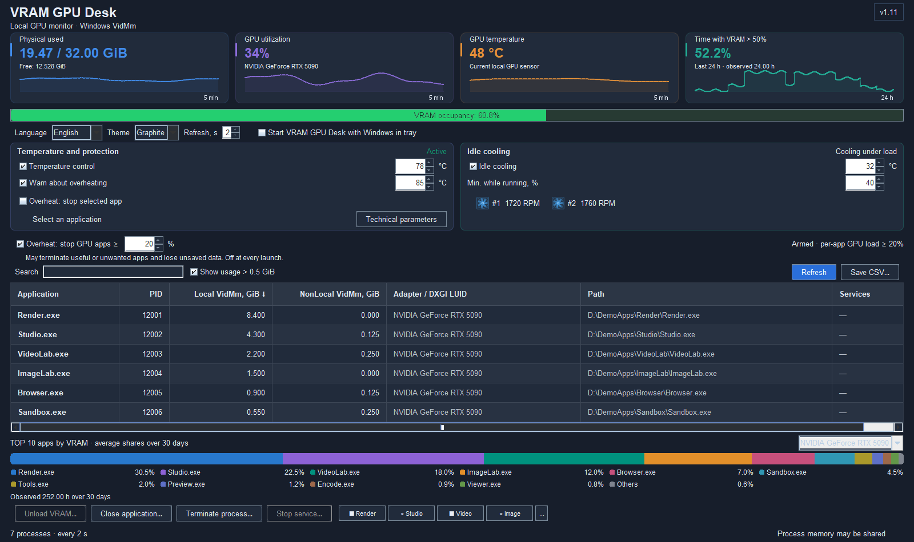
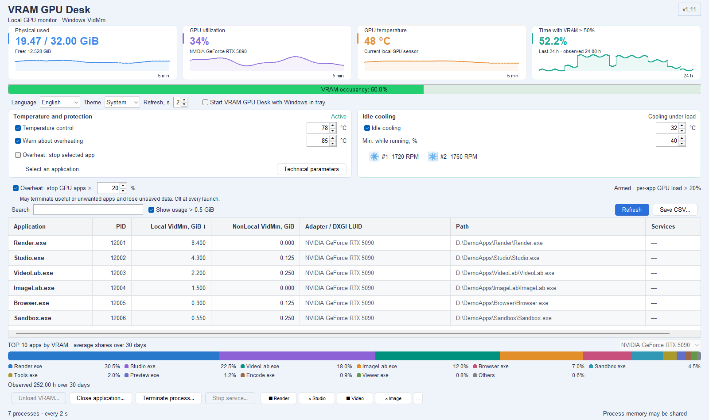

# VRAM GPU Desk

[English](README.md) · [Русский](README.ru.md) · [Deutsch](README.de.md) · [Español](README.es.md) · [Français](README.fr.md) · [Italiano](README.it.md) · [中文](README.zh.md) · [한국어](README.ko.md) · [日本語](README.ja.md) · [العربية](README.ar.md) · [हिन्दी](README.hi.md) · [Tiếng Việt](README.vi.md)

**Theo dõi bộ nhớ GPU và điều khiển nhiệt độ cục bộ cho Windows x64.**

Phiên bản **1.11** · [Bộ cài Windows](downloads/VRAM-GPU-Desk-1.11-Setup-x64.exe) · [ZIP bộ cài](downloads/VRAM-GPU-Desk-1.11-Installer.zip)

Trạng thái bật chỉ để minh họa. Tùy chọn khẩn cấp này tắt ở mỗi lần khởi động.

> **Điều khiển GPU:** Điều khiển các tham số nhiệt độ GPU cần xác nhận UAC một lần khi cài thành phần điều khiển. Sau đó, bật điều khiển nhiệt độ và làm mát không yêu cầu UAC lần nữa. Chỉ giám sát thì không cần UAC.

> **Điều khiển GPU đồng thời:** Điều khiển các tham số nhiệt độ GPU có thể xung đột với chương trình khác đồng thời thay đổi công suất, xung nhịp hoặc tốc độ quạt, chẳng hạn MSI Afterburner. Chỉ sử dụng một bộ điều khiển đang hoạt động cho các tham số này. Cảnh báo này nói về việc thay đổi cài đặt đồng thời, không phải giám sát thụ động.

## Chức năng

- Hiển thị VRAM vật lý đã dùng/còn trống, mức sử dụng GPU và nhiệt độ cùng biểu đồ lịch sử nhỏ.
- Liệt kê ứng dụng và dịch vụ cục bộ dùng bộ nhớ GPU, có tìm kiếm, sắp xếp và bộ lọc tùy chọn **trên 0,5 GiB**.
- Hiển thị mười ứng dụng đứng đầu và nhóm «Khác» bằng tỷ lệ chuẩn hóa của các mẫu bộ nhớ tiến trình quan sát trong 30 ngày qua. Tổng là 100%; đây là phân bổ lịch sử số đo, không phải các phần VRAM vật lý có thể cộng lại.
- Hiển thị tỷ lệ thời gian quan sát hợp lệ trong 24 giờ qua có VRAM vật lý sử dụng trên 50%. Không tính khoảng trống giám sát.
- Xuất báo cáo CSV UTF-8 đến đường dẫn cục bộ đã chọn.
- Thu nhỏ vào khay hệ thống, khôi phục cửa sổ hiện có khi chạy lại và tùy chọn khởi động cùng Windows.
- Có giao diện hệ thống và graphite tối, mười hai ngôn ngữ, cập nhật mỗi 1–5 giây, mặc định 2 giây.
- Điều khiển nhiệt độ mềm tùy chọn qua giới hạn công suất và xung nhân được hỗ trợ. Bảo vệ độc lập với chu kỳ cập nhật giao diện.
- Làm mát nhàn rỗi, số vòng/phút và biểu tượng quạt động. Cấu hình mới yêu cầu bật điều khiển nhiệt độ và làm mát nhàn rỗi; lựa chọn tắt thủ công đã lưu được giữ nguyên. Chỉ hiển thị điều khiển hoạt động sau kết nối đã xác nhận.
- Cảnh báo khi nhiệt độ cao hơn ngưỡng 75–92 °C đã chọn trong ít nhất mười giây. Đỉnh nhiệt ngắn không gây cảnh báo.
- Tùy chọn khẩn cấp riêng, ban đầu tắt, cho ứng dụng được chọn rõ ràng. Đóng/kết thúc có thể mất công việc chưa lưu; loại trừ tiến trình được bảo vệ hoặc không xác minh được.

## Bốn nút thao tác nhanh

Gán **Đóng ứng dụng** hoặc **Kết thúc tiến trình** cho một trong bốn nút nhỏ; thay đổi bằng menu `⋮` bên cạnh. Mỗi liên kết chỉ áp dụng cho phiên bản tiến trình đã chọn, nhận dạng bằng PID, thời điểm tạo và đường dẫn tệp thực thi. Khi tiến trình kết thúc, ứng dụng không tự chọn tiến trình khác hoặc PID được tái sử dụng.

Nút đã gán thực hiện bằng một lần nhấp **không xác nhận thêm**. Có thể mất công việc chưa lưu. Các kiểm tra gốc đối với tiến trình được bảo vệ, quan trọng hoặc không xác minh được vẫn giữ nguyên. Tùy chọn khẩn cấp riêng ban đầu tắt và vẫn chỉ áp dụng cho ứng dụng đã chọn.

## Khẩn cấp: kết thúc tiến trình có tải GPU cao — 1.11

Một tùy chọn **riêng, tắt ở mỗi lần khởi động**, có thể kết thúc các tiến trình có thể truy cập đang tải nặng GPU đã chọn sau ít nhất **mười giây** nhiệt độ xác nhận cao hơn ngưỡng quá nhiệt. Ngưỡng tải mặc định **20%**, chỉnh từ **10 đến 100%**; mỗi tiến trình phải giữ mức tải đó ít nhất **ba giây**. Đo GPU engine bận nhất của tiến trình, **không dùng lượng VRAM**.

**Cảnh báo: có thể kết thúc cả ứng dụng cần thiết lẫn không cần thiết và làm mất công việc chưa lưu.** Tùy chọn chỉ thực hiện một lần rồi tự tắt sau lần thử. Muốn thử lại phải chủ động bật lại. Không thể bật nếu chưa có dữ liệu tải tiến trình được xác nhận và cảm biến hợp lệ; dữ liệu không rõ hoặc cũ không cho phép kết thúc tiến trình.

GPU được gắn duy nhất; nhiệt độ và danh tính tiến trình được kiểm tra lại trước khi thực hiện. PID, thời điểm tạo, đường dẫn EXE và cùng handle tiến trình ngăn việc tự chọn PID đã tái sử dụng. Bỏ qua thành phần Windows/NVIDIA được bảo vệ, tiến trình quan trọng hoặc không xác minh được và chính tiện ích. Không kết thúc cây tiến trình, không dừng dịch vụ hay yêu cầu nâng quyền thêm. Tùy chọn khẩn cấp hiện có dành cho một ứng dụng đã chọn vẫn tách biệt. Đây là biện pháp bổ sung, không bảo đảm ngăn hư hại GPU.

Đã kiểm tra cho 1.11: 40 bài kiểm tra CPU gốc với hành động kết thúc mô phỏng, 256 kiểm tra Java/danh mục/bảo vệ, 673 kiểm tra giao diện trong 48 trường hợp bao phủ mười hai ngôn ngữ và hai giao diện, đọc bộ đếm PDH thật, rà soát mã gốc độc lập, đủ 164 tệp và hash broker, cài/gỡ cô lập và khởi chạy gói với Java đi kèm qua đường dẫn Unicode. **Các bài thử không kết thúc ứng dụng thật và không ghi cài đặt GPU.** Chưa xác nhận toàn bộ bộ cài sản xuất hay hiệu quả nhiệt thực tế.

## Nhiệt độ mục tiêu và độ trễ chuyển trạng thái

Ngưỡng dừng/khởi động lại riêng và thời gian chờ ngắn tránh chuyển trạng thái liên tục khi số đo dao động.

| Cài đặt | Hoạt động thực tế | Lý do |
|---|---|---|
| Mục tiêu nhàn rỗi, mặc định **32 °C**, chỉnh 28–40 °C | Sau ba giây ở 32 °C hoặc thấp hơn khi nhàn rỗi, trở về AUTO của firmware. Làm mát khởi động lại ở 36 °C, tức mục tiêu +4 °C. Với mục tiêu 35 °C, khởi động lại ở 39 °C. | Khoảng trễ 4 °C tránh bật/tắt quạt liên tục. Firmware AUTO quyết định có dừng quạt hoàn toàn hay không. |
| Nhàn rỗi/có tải | Cho phép nhàn rỗi khi GPU dùng tối đa 10%; từ 15% dùng đường cong tải. Khoảng 11–14% giữ trạng thái trước. Không biết mức sử dụng: tiếp tục làm mát. | Tránh chuyển trạng thái vì dao động nhỏ. |
| Mục tiêu nhiệt độ mềm, 70–88 °C | Giới hạn công suất và xung nhân điều chỉnh dần theo xu hướng nhiệt. Nhiệt độ có thể thấp hơn hoặc tạm thời vượt mục tiêu. | Quán tính nhiệt, cảm biến và driver không cho phép trần nhiệt tuyệt đối. Đây là mục tiêu điều chỉnh, không phải ngắt khẩn cấp. |
| Cảnh báo quá nhiệt | Nhiệt độ phải cao hơn ngưỡng trong ít nhất mười giây. | Bỏ qua đỉnh nhiệt ngắn. |

Nhiệt độ nhàn rỗi **không phải** giới hạn khi tải kéo dài. Môi trường, firmware và driver ảnh hưởng nhiệt độ đạt được và phản ứng quạt. Không chạy đồng thời bộ điều khiển quạt/xung cạnh tranh trên cùng GPU.

## Phần cứng và yêu cầu

Dành cho NVIDIA GeForce **RTX 5000 Series**. Theo dõi và điều khiển phụ thuộc GPU và driver; chức năng không được hỗ trợ sẽ không khả dụng thay vì được mô phỏng.

Windows 10/11 x64, .NET Framework 4.8 và driver NVIDIA phù hợp. Có sẵn Java runtime, không cần cài Java riêng. Người dùng Windows đang đăng nhập phải là quản trị viên với token desktop được lọc thông thường. Bộ cài yêu cầu UAC một lần, đặt thành phần điều khiển trong thư mục Program Files cố định được bảo vệ; không hỗ trợ thông tin quản trị viên khác. Hai tác vụ được bảo vệ, chỉ theo yêu cầu, dùng trình khởi chạy cố định và giao tiếp cục bộ có kiểu dữ liệu. Kênh đã cài được thiết kế để khởi động điều khiển không hỏi UAC lần nữa; nếu không xác thực được, điều khiển không khả dụng thay vì yêu cầu nâng quyền khác.

Không có danh sách cho phép theo phiên bản driver hoặc hash DLL. NVML hệ thống phải vượt qua kiểm tra chữ ký Windows ngoại tuyến với bên ký NVIDIA Corporation đã xác minh, đường dẫn an toàn và API cần thiết. Cập nhật driver không cần thêm phiên bản/hash. Thiếu dữ liệu tin cậy cục bộ có thể làm kiểm tra thất bại; ứng dụng không tải chứng chỉ hoặc driver.

## Cài đặt và quyền riêng tư

1. Tải bộ cài và so SHA-256 với [SHA256SUMS.txt](SHA256SUMS.txt).
2. Thoát bản cũ qua menu khay. Chạy bộ cài bình thường từ tài khoản quản trị đang đăng nhập và chấp nhận UAC. Thư mục cài được bảo vệ là cố định.
3. Mở lối tắt mới, chọn GPU và kiểm tra trạng thái điều khiển đã xác nhận. Cấu hình điều khiển và nút nhanh. Cài đặt lưu cục bộ; lựa chọn tắt đã lưu vẫn tắt.

Ứng dụng dùng giao diện Windows/GPU cục bộ. Không thiết kế gửi telemetry, suy luận đám mây, tự cập nhật hoặc tải mô hình khi chạy. CSV, lịch sử và cài đặt ở cục bộ. Điều này **không bảo đảm** cách ly mạng toàn hệ thống hoặc hành vi driver bên thứ ba, chẩn đoán Windows hay phần mềm đồng bộ.

Bộ cài không có chữ ký. Phân phối ứng dụng dạng nhị phân đã biên dịch; **mã nguồn ứng dụng không được công bố trong kho này**. Bytecode Java không mã hóa và không bảo đảm chống dịch ngược. Thông báo giấy phép runtime bên thứ ba được giữ nguyên.

Ảnh chụp dùng dữ liệu minh họa tổng hợp và trạng thái điều khiển mô phỏng. Chúng minh họa giao diện, không chứng minh hoạt động hay hiệu năng phần cứng.

## Thay đổi trong 1.10

- Bốn nút tùy chỉnh gắn đúng phiên bản tiến trình, đóng/kết thúc bằng một nhấp, gán lại được và giữ kiểm tra gốc.
- Chú thích nhỏ hơn, chiều cao biểu đồ tăng từ 35 lên 55 pixel; giữ biểu tượng khay tương phản cao.
- Cài thành phần điều khiển được bảo vệ một lần qua UAC. Cấu hình nhiệt/nhàn rỗi mới bật; lựa chọn tắt thủ công đã lưu giữ nguyên.
- Sửa alias thận trọng: loại alias màn hình gián tiếp không render đã xác nhận, không gộp GPU vật lý riêng dựa vào tên hoặc bộ nhớ.
- Sửa cài đặt dở dang an toàn và báo giai đoạn, mã, HRESULT cụ thể khi thiết lập thành phần thất bại.
- Giữ hai giao diện, mười hai ngôn ngữ, lịch sử cục bộ, CSV UTF-8, danh tính GPU và quy tắc lease, watchdog, khôi phục hiện có.

Đã kiểm tra: 48 trường hợp giao diện cô lập trong mười hai ngôn ngữ và hai giao diện, biểu tượng, mặc định cài đặt, liên kết/thực thi nút nhanh, kiểm tra token CLR thực tế, đường dẫn Unicode, đủ 163 tệp và hash broker nhúng, cài/gỡ cô lập và đăng ký tác vụ tạm thời thực tế với quyền nâng cao, đọc lại XML/DACL, rollback và dọn dẹp. Các tác vụ **không chạy**; thử nghiệm không gọi hàm thay đổi GPU hay tác vụ sản xuất.

Thử nghiệm chưa chạy toàn bộ bộ cài sản xuất và điều khiển GPU không UAC sau cài. Các kiểm tra không chứng minh hiệu quả nhiệt khi tải kéo dài. Ảnh chụp là minh họa tổng hợp với điều khiển mô phỏng.

## Giấy phép

Được sử dụng miễn phí cho mục đích phi thương mại theo [PolyForm Noncommercial 1.0.0](LICENSE.md), với điều kiện tuân thủ các điều khoản và yêu cầu thông báo. Sử dụng thương mại cần được cho phép riêng. Đây không phải giấy phép mã nguồn mở; mã nguồn ứng dụng không được công bố. Giấy phép của runtime bên thứ ba không thay đổi.
