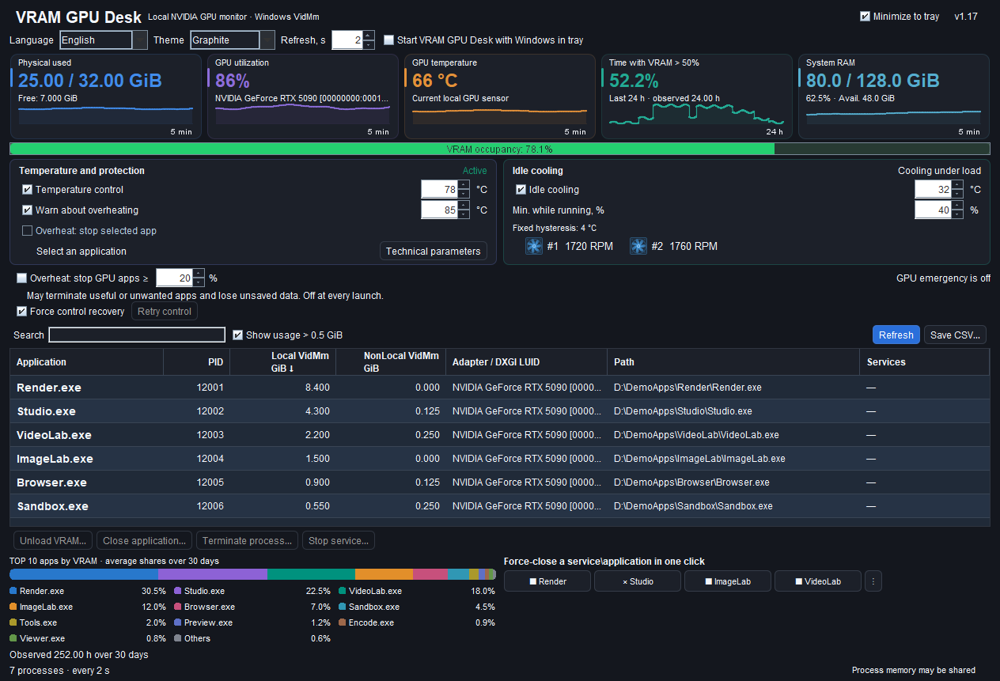
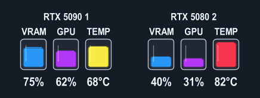

# VRAM GPU Desk 1.19

[English](README.md) · [Русский](README.ru.md) · [Deutsch](README.de.md) · [Español](README.es.md) · [Français](README.fr.md) · [Italiano](README.it.md) · [简体中文](README.zh.md) · [한국어](README.ko.md) · [日本語](README.ja.md) · [العربية](README.ar.md) · [हिन्दी](README.hi.md) · [Tiếng Việt](README.vi.md)

**适用于 Windows x64 的本地 NVIDIA GPU 显存监控与温度控制工具。仅支持 NVIDIA，不支持 AMD 或 Intel GPU。**

## 本应用的用途

- **在 Windows 中监控并释放 NVIDIA 显存。** 查看各应用的 VRAM 使用情况，并强制关闭选定应用以释放显存；也可使用可配置的一键快捷按钮。
- **管理竞争显存的应用。** 适用于单个任务或多个任务同时运行的场景，例如本地代码生成模型、图像或视频生成、转录及数据分析。
- **温和调节温度与散热。** 在 GPU 负载运行及空闲时，灵活调节硬件支持的温度相关设置和散热控制。
- **过热应急模式。** 可选模式可在检测到过热时强制关闭高 GPU 负载应用，以降低负载。每次启动时均为关闭状态；强制关闭可能导致未保存的数据丢失。

## 主要功能

- 本地监控 NVIDIA VRAM、GPU 负载与温度、系统 RAM 和 CPU 利用率，并提供图表与核心使用条。
- 查看各进程的 GPU 内存，支持搜索、排序和 UTF-8 CSV 导出。
- 温度控制与空闲散热按每张 GPU 报告的能力进行适配。
- 四个可配置的一键按钮，绑定到确切的进程实例；紧急终止功能须单独启用，每次启动时均为关闭状态。
- 24 小时显存历史记录与 30 天应用前十排行榜。
- 12 种语言、两种主题、系统托盘和可选的 Windows 开机启动。
- 两个独立设置的 NVIDIA 面板；第二块 GPU 的控制功能为实验性功能。
- 控制丢失警告与手动重试；新设置默认开启恢复，保留已明确保存的关闭选择。

[下载 Windows 安装程序](downloads/VRAM-GPU-Desk-1.20-Setup-x64.exe) · [安装程序 ZIP 包](downloads/VRAM-GPU-Desk-1.20-Installer.zip)

## 1.20 — GPU 悬浮监视器

透明紧凑监视器位于普通 Windows 窗口上方，没有整体背景面板。每张 NVIDIA 显卡对应一个独立的 ≈164 × 114 物理像素悬浮窗口，最多支持两张卡。分别保存位置，可拖动、锁定、调整缩放和文字对比度。默认不显示，声音默认开启且可单独关闭。复用已有遥测，不请求额外 GPU 控制。

显存占用和 GPU 负载；温度：≤40 为绿色，41–75 为黄色，76–81 为橙色，82–86 为红色，≥87 时闪烁。88 °C 起发出声音。

合成演示数据与模拟控制器状态。两种紧急选项在每次启动时均关闭。新设置默认开启恢复；已保存的关闭选择保持不变。

> **GPU 控制:** 控制 GPU 温度参数需要在安装控制组件时确认一次 UAC。此后启用温度控制和散热无需再次确认 UAC。仅进行监控不需要 UAC。

> **同时控制 GPU:** GPU 温度参数控制可能与同时更改功率、频率或风扇转速的其他程序发生冲突，例如 MSI Afterburner。请仅使用一个活动控制器来调节这些参数。此警告针对同时修改设置，不针对被动监控。

## 1.19 新增：针对 NVIDIA RTX 30、40、50 的逐卡适配

**使用设备实际限制，而非固定瓦数预设。** 每个控制会话读取该 GPU 的功耗边界，并将会话初始限制保存为上限及恢复基准，而不是使用出厂默认值。取得会话本身不会立即写入功耗或频率。功耗变化按**每秒会话初始限制的 1%**缩放，且不超出设备边界和会话上限。频率调整相对于已验证的支持范围计算。

**只使用可用的控制方式。** 不支持频率控制时，仍可使用受支持的纯功耗调节。只要温度有效，即使 GPU 利用率未知，也可以继续纯功耗控制。高于已报告硬件温度上限的目标会被阻止；缺失上限仍保持未知。不支持的功能继续显示为不可用。风扇恢复独立于功耗客户端恢复。BIOS、OEM、驱动及笔记本限制会影响可用功能；每张 GPU 单独评估。

**参考数据不是控制命令。** [RTX 30 及更新系列参考](docs/nvidia-rtx30-plus/README.md)与 [UTF-8 CSV](docs/nvidia-rtx30-plus/REFERENCE-GPUS.csv)包含**45 个型号/变体组：27 个桌面组、18 个笔记本组**。这些是文档参考组，不代表 45 次硬件测试；公布的板卡功耗与笔记本 TGP 不是可执行预设。RTX 3060 Ti 的 200 W 行指参考规格，不适用于所有 GDDR6X 或 OEM 变体。

**双 GPU 下更紧凑的 CPU 区域。** CPU 卡片底部现在与旁边的空闲散热面板底部对齐，位于紧急操作和恢复选项行的上方。RAM 仍在上方，CPU 负载与物理核心条保持可见。单 GPU 的六卡片布局不变。

## 1.18 新增：CPU 利用率与更清晰的双 GPU 工作区

**在系统 RAM 旁查看 CPU 负载。** CPU 卡片显示总利用率、物理核心数和逻辑线程数、每个物理核心的即时利用率条。每个核心条汇总该核心的逻辑线程；总百分比按逻辑处理器加权。使用 Windows 内置测量，无需额外 UAC、驱动或其他监控程序。缺失、无效或超过六秒的读数显示 **—**，核心条表示数据不可用。

**单 GPU：1200×900 下显示六张卡片。** 四张 GPU 卡片、系统 RAM 和 CPU 负载同时可见。**双 NVIDIA GPU：最低 1920×1050。** 每张 GPU 各有一个 2×2 的四卡片区域、对齐的读数及完整控制项。细竖线分隔 GPU 区域和右侧共享列：上方是 RAM，下方是更高的 CPU 卡片。系统 RAM 和 CPU 只显示一次，不受 GPU 选择影响。第二张 GPU 的控制仍属实验性。

空间不足时，三个风扇指示器会换行，确保全部可见；风扇控制逻辑不变。紧凑快速按钮、进程文字可读性和原有设置均保留。

## 1.17 新增：一眼查看系统 RAM

第五张 **系统 RAM** 卡片显示已用/总物理内存（GiB）、使用百分比、可用内存及五分钟图表。总量是 Windows 可使用的物理 RAM；这是系统内存，与 VRAM 及包含分页文件的提交上限不同。

RAM 读数属于整台计算机，不受所选 GPU 影响。双 NVIDIA 面板中，主面板有五张卡片，第二面板保留四张 GPU 卡片；系统 RAM 只显示一次。原有 GPU 控制项仍然可用。

RAM 按现有刷新间隔更新，无需 UAC。缺失、无效或超过六秒的读数显示 **—**，图表留空，而不会填入虚构值。

## 1.16 新增：更可靠的控制恢复与可选托盘最小化

**新设置或缺少该参数时，控制恢复默认开启。** 每块 GPU 单独保存选择；已明确保存的关闭状态不会被覆盖。恢复会在等待后重新连接同一张卡，并要求确认旧客户端已结束。它不能保证相对于 MSI Afterburner 或其他控制器的独占控制。

**可选择窗口最小化方式。** “最小化到托盘”默认开启。取消勾选后，窗口会像普通 Windows 应用一样最小化到任务栏。此选择会保存；Windows 开机启动仍是独立设置。

**通信更可靠，状态更清晰。** Java 请求时限改为 7 秒，为原生通道的 6 秒响应窗口留出余量。原生 watchdog 在成功取得 GPU 控制后开始计时，保留 6 秒安全保护。错误和旧读数不再被当作最新数据：过期 RPM 会隐藏，通信超时与已确认的外部参数变更分开提示。容量受限的本地日志记录错误和慢响应元数据，不记录连接秘密。

## 1.15 新增：独立 NVIDIA 面板与控制恢复

两块受支持的 NVIDIA GPU 各有独立指标、四张图表和控制设置。**第二块 NVIDIA GPU 的控制功能为实验性功能。** 一块 NVIDIA 与 AMD/Intel 混用时，仅显示一个 NVIDIA 面板。GPU 选择器只筛选共享进程表和历史记录，不会更改控制器所绑定的显卡。

**四个紧凑快捷按钮仍位于同一水平行。** 统一的 `⋮` 菜单为每个槽位提供分配/重新分配、重命名和清除，目标进程消失后也可操作。自定义名称可在不重新绑定的情况下修改；文字按可用宽度显示，提示保留完整名称。仍严格核对 PID、创建时间和可执行文件路径。

**控制丢失时显示警告并提供手动重试。1.16 对新设置或缺少该参数的设置默认开启恢复，按 GPU 分别保存；已明确保存的关闭选择保持不变。** 重试间隔为 5/10/30/60 秒，要求确认旧客户端已结束，并取得同一 GPU 的新鲜数据。原生 lease、所有权、读回和安全检查仍然有效。它不能独占阻止 MSI Afterburner 或其他控制器。两种紧急选项在每次启动时均关闭。

1.15 已验证：**2262 项界面检查**、**215 项原生检查**、**61 项客户端生命周期/I/O 检查**、**48 项恢复检查**、**167 个包文件**及 **93 个 Java 类**。单 GPU 最小窗口 **1200×900**，双面板 **1600×950**。保留 1.14 安装程序经同意关闭旧版本的流程，以及默认勾选的安装后启动选项。

## 1.14 新增：紧凑界面与便捷更新

**Graphite Studio（1.12）。** 在 1200×900 窗口中同时显示全部主要设置与操作：七个进程列、至少六行进程、四个图表和完整的前十名图例。进程名称采用高对比度 14 px 粗体。新配置默认使用 Graphite；已保存的 System 或 Graphite 主题保持不变。四个可配置的一键按钮仍绑定到准确的进程实例，执行关闭或终止操作。

**可见的冷却滞回（1.13）。** 冷却区域现在直接显示固定的 **4 °C** 滞回，提示中解释 32→36 °C 和 35→39 °C。这里只展示现有规则，不改变冷却算法。

**安装与更新（1.14）。** 安装程序会询问是否正常关闭正在运行的目标副本。经同意后，通过 Windows Restart Manager 请求 JVM 正常退出，等待应用、启动器退出及控制器文件释放，再继续安装。仅针对经过核实的本安装实例，不强制结束进程。拒绝、取消、应用否决、文件仍被占用或超时都会阻止替换；静默安装不会自动关闭运行中的应用。

最后一页的 **启动 VRAM GPU Desk** 默认勾选，也可取消。应用以当前登录用户的普通权限启动；若无法取得该上下文，请使用“开始”菜单中的普通快捷方式。这是安装后的一次启动，原有 Windows 开机启动选择保持不变。

1.14 已验证 **9 个安装流程场景、107 项 Restart Manager/JDK 检查、17 项固定启动入口检查**，以及全部 **166 个包文件、88 个 Java 类**、代理哈希、Unicode 路径和内置运行时启动器。

## 功能

- 显示物理显存的已用和可用容量、GPU 使用率及温度，并提供紧凑的历史曲线。
- 列出使用 GPU 显存的本地应用程序和服务，支持搜索、排序，以及可选的“超过 0.5 GiB”筛选。
- 根据最近 30 天内观测到的样本，显示前 10 个应用及“其他”的归一化占比，总和为 100%。这是已记录进程显存读数的历史分配比例，并非可以相加得到物理显存总量的实际分区。
- 显示最近 24 小时有效观测时间中，物理显存占用率超过 50% 的时间比例；未监测到的时间不计入。
- 将 UTF-8 CSV 报告导出到用户选择的本地路径。
- 可保存最小化到系统托盘或普通 Windows 任务栏的选择；重复启动时恢复现有窗口，并支持可选的 Windows 开机启动。
- 提供系统主题、深色石墨主题和 12 种界面语言；界面刷新间隔可设为 1–5 秒，默认 2 秒。
- 通过受支持的功耗与核心频率限制，提供可选的 GPU 温度软目标控制；控制逻辑独立于界面刷新间隔运行。
- 提供空闲散热、风扇 RPM 指示及动画风扇图标。全新设置默认请求开启温度控制和空闲散热；已保存的手动关闭状态会保留。只有连接确认成功后，界面才显示控制已激活。
- 温度持续严格高于所选 75–92°C 阈值至少 10 秒时，可发出警报；短暂峰值不会触发警报。
- 为明确选定的应用提供独立的紧急操作选项，默认关闭。关闭应用或终止进程可能丢失未保存的工作；受保护或无法验证的进程不能用于此操作。

## 1.11：GPU 高负载应用紧急终止

这是独立于“终止所选应用”的新复选框，**每次启动均为关闭，必须明确选择启用**。它可能终止有用或不需要的应用，并导致未保存的数据丢失；请在理解风险后启用。

当所选 GPU 的温度连续 **10 秒严格高于温度警报阈值**时，尝试终止在该 GPU 上连续至少 **3 秒**达到负载阈值的合规应用。每个应用的 GPU 负载阈值默认为 **20%**，可设为 **10–100%**；保存的是阈值，不是启用状态。一次尝试后自动关闭，包括取消或没有合规应用的情况。修改温度或负载阈值也会关闭此模式。

判断依据是真实的每进程 GPU 引擎负载，**不是显存大小、进程显存占比或其他 VRAM 推断**。新测量值、唯一的物理 GPU 及进程的创建时间、可执行文件路径和适配器 LUID 会被核验；执行前再次检查，并使用与该实例对应的精确句柄。数据未知、过期、身份变化、不同适配器、受保护、关键或无法验证的进程会被跳过。计数器不可用时无法启用。此前的所选应用紧急选项保留不变。

## 四个快捷操作按钮

可为四个紧凑按钮分别指定“关闭应用程序”或“终止进程”，并通过旁边的 `⋮` 菜单重新指定。每个绑定都针对明确选定的进程实例，依据 PID、创建时间和可执行文件路径识别。该实例结束后，不会自动转向相邻进程，也不会选择后来复用了同一 PID 的进程。

已配置的按钮点击一次就会执行，**不会再次请求确认**。关闭或终止进程可能丢失未保存的工作。针对受保护、关键或无法验证进程的本机检查仍然保留。独立的紧急操作选项默认关闭，并保持原有的指定应用行为。

## 温度目标与滞回

部分设置有意采用不同的停止与重启阈值，并加入短暂等待，以免读数在几度范围内波动时频繁切换。

| 设置 | 实际行为 | 原因 |
|---|---|---|
| 空闲目标默认 **32°C**，可调范围 28–40°C | 空闲时，温度连续 3 秒不高于 32°C 后，控制交还显卡固件 AUTO。升至 36°C，即目标 +4°C 时重新散热。目标为 35°C 时，重启点为 39°C。 | 4°C 滞回避免风扇在同一阈值附近反复启停。风扇是否完全停止由固件 AUTO 决定，而不是应用决定。 |
| 空闲与负载分类 | GPU 使用率不超过 10% 时允许空闲模式；达到 15% 时使用负载散热曲线。11–14% 时保留前一分类；使用率未知时继续散热。 | 阈值间隔避免因小幅使用率波动而频繁切换模式。 |
| 温度软目标 70–88°C | 功耗与核心频率限制根据升温趋势逐步调整，并在目标附近的工作区间内运行。实际温度可能低于目标，也可能短暂超过目标。 | 热惯性、传感器更新和驱动限制使精确的硬上限无法保证。该目标是调节目标，并非紧急切断阈值。 |
| 过热警报 | 温度必须连续至少 10 秒严格高于所设阈值。 | 避免短暂峰值触发警报。 |

空闲温度**不是**持续负载时的温度上限。环境条件、显卡固件和驱动限制会影响可达到的温度及风扇响应。请勿同时使用多个相互竞争的风扇或频率控制器管理同一显卡。

## 硬件与要求

面向 NVIDIA GeForce **RTX 5000 Series** GPU。监测能力及可用控制取决于显卡和驱动；不支持的控制会保持不可用，不会被模拟为可用。

需要 Windows 10/11 x64、.NET Framework 4.8 和受支持的 NVIDIA 驱动。安装包已包含 Java 运行时，无需单独安装 Java。当前登录的 Windows 用户必须是管理员，并使用普通的受限桌面令牌。安装程序请求一次 UAC，将控制组件安装到固定且受保护的 Program Files 目录；不支持输入另一位管理员的凭据。

两项受保护的任务仅按需启动，使用固定的控制启动器和类型明确的本地通信。安装后的通道设计为之后启动控制时无需再次显示 UAC；若无法通过身份验证，控制保持不可用，不会退回到另一次提权请求。

驱动版本和 DLL 哈希不采用白名单。系统安装的 NVML 库必须通过离线 Windows 签名验证，签名者须为经过验证的 NVIDIA Corporation，并满足安全路径及所需 API 检查。驱动更新无需添加新版本或哈希。若所需信任数据未保存在本机，离线信任验证可能失败；应用不会下载证书或驱动。

## 安装与隐私

1. 下载安装程序，并与 [SHA256SUMS.txt](SHA256SUMS.txt) 中的 SHA-256 比较。
2. 从当前登录的管理员账户正常运行安装程序并确认 UAC。若目标副本正在运行，请回答正常关闭提示；应用退出并释放文件后，安装程序继续。受保护的安装目录固定不变。
3. 打开新的 VRAM GPU Desk 快捷方式，选择 GPU，并检查已确认的控制器状态。按需配置控制和快捷按钮。设置保存在本地；已保存的关闭选择仍保持关闭。

应用使用本地 Windows/GPU 接口。程序未设计遥测上传、云端推理、自动更新或运行时模型下载。CSV、历史记录和设置保留在本地。这**不代表**整个操作系统具有网络隔离，也不保证第三方驱动、Windows 诊断或同步软件的行为。

安装程序未签名。本应用以编译后的二进制文件发布；**本仓库不公开应用源代码**。Java 字节码未加密，也不保证无法反编译。第三方运行时的许可证声明保留在安装后的运行时目录中。

截图使用人工合成的演示数据和模拟的控制器状态，用于展示界面，并不能证明硬件控制实际运行或其性能。

## 1.10 更新

- 新增四个可配置的快捷按钮，绑定到特定进程实例，一次点击即可关闭或终止，支持重新指定，并保留本机安全检查。
- 缩小仪表板说明文字，将迷你曲线高度从 35 像素增至 55 像素，并保留高对比度托盘图标。
- 一次 UAC 安装受保护的控制组件。全新温度及空闲散热设置默认开启，已保存的手动关闭状态保留。
- 采用保守的适配器别名修正：仅排除已确认不参与渲染的间接显示别名，不按名称或显存数值合并不同物理 GPU。
- 可修复安全的未完成安装；组件安装失败时提供明确的阶段、错误代码和 HRESULT。
- 保留两种主题、12 种语言、本地历史、UTF-8 CSV、GPU 身份检查，以及现有 lease/watchdog/restore 策略。

1.11 的验证覆盖全部 **164 个软件包文件、87 个 Java 类**、40 项隔离 native 检查、256 项 Java/设置/翻译检查，以及 12 种语言、两种主题和两种窗口宽度共 48 个场景中的 673 项 UI 检查。最小窗口仍为 1200×900，新警告完整可见。

一次只读 PDH 检查读取了 710 个有效 GPU 引擎实例，没有读取进程身份。紧急操作使用自有合成数据及模拟 RPC 验证。截图是合成演示数据和模拟控制器状态，不是硬件操作或性能证据。

## 许可证

依据 [PolyForm Noncommercial 1.0.0](LICENSE.md)，在遵守其条款和通知要求的前提下，可免费用于非商业目的。商业使用须另行获得许可。这不是开源许可证；应用程序源代码不公开。第三方运行时的许可证保持不变。

[浅色背景](images/floating-monitor-light.png) · [GPU × 2](images/dual-floating-monitors-light.png)

**1080p → ≈122 × 86 px · 1440p → ≈164 × 114 px · 2160p / 4K → ≈245 × 171 px**
