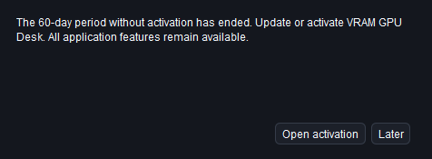
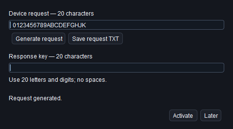
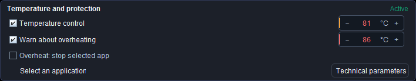

# VRAM GPU Desk 1.24

## 1.24 में नया: 60 दिन का पूर्ण उपयोग और ऑफ़लाइन डिवाइस सक्रियण

**सुरक्षित स्थिति का पथ और नियंत्रण का आरंभ ठीक किया गया।** सक्रियण स्थिति अब Windows के मानक पूरे कंप्यूटर के साझा डेटा फ़ोल्डर का उपयोग करती है, न्यूनतम वातावरण वाली शेड्यूल की गई टास्क से शुरू होने पर भी। इससे सापेक्ष पथ और अनुमति की वह त्रुटि दूर होती है जो मूल GPU नियंत्रण को शुरू होने से रोक सकती थी। स्वामित्व, पहुँच और पुनर्प्राप्ति की जाँच चालू रहती है; अन्य GPU उपयोगिताओं के विरुद्ध विशेष नियंत्रण की गारंटी नहीं है।

**गणना इस कंप्यूटर पर पहले लॉन्च से होती है।** सक्रियण-सक्षम संस्करण को इस कंप्यूटर पर पहली बार चलाने पर 60 दिन की पूर्ण उपयोग अवधि शुरू होती है। सुरक्षित स्थानीय आरंभ रिकॉर्ड सामान्य अपडेट और अनइंस्टॉल के बाद भी बना रहता है। ऐप अपडेट करने से 60 दिन दोबारा शुरू नहीं होते और सक्रियण अनुस्मारक अपने आप नहीं हटते।

**अवधि समाप्त होने पर भी सभी सुविधाएँ उपलब्ध रहती हैं।** 60 दिन के बाद भी निगरानी, तापमान और कूलिंग नियंत्रण, त्वरित बटन तथा आपातकालीन सुविधाएँ काम करती हैं। ऐप चलने के दौरान चुनी गई भाषा में कम-से-कम हर घंटे एक गैर-मोडल अनुस्मारक सामान्य Windows विंडो के ऊपर दिखता है। अनुस्मारक GPU नियंत्रण को रोकता नहीं है; सफल सक्रियण के बाद यह बंद हो जाता है।

**20-अक्षर का अनुरोध और 20-अक्षर का ऑफ़लाइन उत्तर।** अवधि समाप्त होने के बाद इंटरफ़ेस में सक्रियण चेकबॉक्स दिखाई देता है। सक्रियण विंडो में ‘अनुरोध बनाएँ’ चुनकर इस डिवाइस के HWID से जुड़ा 20-अक्षर का अनुरोध बनाएँ और उसे UTF-8 TXT में सहेजें। मालिक द्वारा दिया गया 20-अक्षर का उत्तर कुंजी फ़ील्ड में दर्ज करके सक्रिय करें। सत्यापन स्थानीय रूप से होता है; HWID अपने आप अपलोड नहीं होता और ऑनलाइन सक्रियण सेवा की आवश्यकता नहीं है।

**डिवाइस बंधन और सुरक्षा की सीमा।** हार्डवेयर पहचान बदलने पर पुराना सक्रियण अमान्य हो जाता है, लेकिन उपयोग अवधि दोबारा शुरू नहीं होती। अनुरोध में मूल हार्डवेयर पहचान के बजाय उससे निकला कोड होता है। निजी जनरेटर और मास्टर कुंजी मालिक के पास रहते हैं; वे सार्वजनिक इंस्टॉलर या रिपॉज़िटरी में शामिल नहीं हैं। चुना गया छोटा ऑफ़लाइन तरीका अभेद्य DRM नहीं है: प्रोग्राम से सत्यापन रहस्य रिवर्स इंजीनियरिंग द्वारा निकाला जा सकता है, और प्रशासक द्वारा छेड़छाड़ को पूरी तरह रोकना संभव नहीं है।

[Windows x64 EXE](downloads/VRAM-GPU-Desk-1.24-Setup-x64.exe) · [ZIP](downloads/VRAM-GPU-Desk-1.24-Installer.zip)

# VRAM GPU Desk 1.23

## 1.23 में नया: एक जैसे कॉम्पैक्ट इनपुट और तापमान सेटिंग के रंग

**एक जैसे कॉम्पैक्ट नियंत्रण।** सात संख्यात्मक फ़ील्ड में −/+ बटन, फ़ील्ड के भीतर °C या % जैसी इकाई और पतली रंगीन सीमा दी गई है। इनमें लक्ष्य तापमान, अधिक गर्मी की चेतावनी सीमा, निष्क्रिय कूलिंग तापमान, न्यूनतम पंखा गति प्रतिशत, GPU आपातकालीन लोड प्रतिशत, रीफ़्रेश अंतराल और ओवरले स्केल शामिल हैं। कीबोर्ड संचालन और हार्डवेयर द्वारा बताई जाने वाली गतिशील मॉडल सीमाएँ पहले जैसी हैं। भाषा, थीम और GPU की चयन सूचियाँ, खोज फ़ील्ड और क्विक-बटन संपादक भी यही रंगीन शैली अपनाते हैं।

**थीम के अनुरूप कंट्रास्ट।** System में सफ़ेद फ़ील्ड और गहरा पाठ, जबकि Graphite में गहरे फ़ील्ड और हल्का पाठ होता है। अक्षम स्थिति, फ़ोकस, चयन और ड्रॉपडाउन पॉपअप भी थीम का अनुसरण करते हैं।

**लाल रंग तापमान के सेट मान को दिखाता है।** तय किया गया लक्ष्य तापमान **80 °C से अधिक, यानी 81 °C से** हो तो उसके अंक लाल होते हैं। तय चेतावनी सीमा **86 °C या अधिक** हो तो उसके अंक लाल होते हैं। यह सेटिंग मान का दृश्य संकेत है, वर्तमान GPU तापमान का अलार्म नहीं। नियंत्रण एल्गोरिदम, डिफ़ॉल्ट लक्ष्य **78 °C**, डिफ़ॉल्ट चेतावनी सीमा **85 °C** और सहेजी गई पसंद नहीं बदलती। 1.22 की नियंत्रण बहाली, लॉग और PSU धारा सुविधाएँ बरकरार हैं।

Windows x64 EXE · ZIP

# VRAM GPU Desk 1.22

## 1.22 में नया: लगातार नियंत्रण बहाली, ऐप लॉग और स्पष्ट धारा संकेत

**लगातार नियंत्रण बहाली।** जब बलपूर्वक नियंत्रण बहाली चालू हो, तो 5, 10 और 30 सेकंड के अंतराल पर प्रयास होते हैं, फिर हर 60 सेकंड पर बिना संख्या-सीमा के जारी रहते हैं। पहले से सहेजा गया OFF बरकरार रहता है। नई और मान्य टेलीमेट्री से नियंत्रण बहाल होने की पुष्टि के बाद ही गैर-मोडल चेतावनी विंडो अपने-आप बंद होती है। क्लाइंट रोकने और दोबारा शुरू करने के दौरान उपयोगकर्ता की आखिरी चेकबॉक्स पसंद बरकरार रहती है। पुराने क्लाइंट के बंद होने की पुष्टि के बाद ही नया बनाया जाता है; हार्डवेयर पहचान, स्वामित्व और सुरक्षा जाँच लागू रहती हैं। इससे MSI Afterburner या किसी अन्य नियंत्रक की GPU तक पहुँच नहीं रोकी जा सकती।

**ऐप लॉग।** नया लॉग बटन हर GPU के लिए नियंत्रण खोना, बहाली, पुनः प्रयास और नियंत्रण से जुड़े सभी चेकबॉक्स की स्थितियाँ दिखाता है। **78 °C** या अधिक पर पूर्णांक तापमान बदलने और फिर 78 °C से नीचे लौटने की घटना भी दर्ज होती है। हर प्रविष्टि में UTC और स्थानीय समय होता है। UTF-8 लॉग `%LOCALAPPDATA%/VRAMDeskJava/logs/application.log` में रखा जाता है; प्रत्येक फ़ाइल 2 MiB तक और पाँच रोटेशन संग्रह फ़ाइलें रहती हैं। व्यूअर वर्तमान सत्र की नवीनतम 500 घटनाएँ दिखाता है; लॉग फ़ोल्डर बटन से पुराने सत्रों की फ़ाइलें मिलती हैं।

**PSU धारा: अधिकतम या कुल।** हर वास्तविक GPU पावर कनेक्टर में कम-से-कम एक संपर्क की मान्य धारा मिले तो उपलब्ध संपर्कों का सबसे बड़ा मान दिखता है, भले बाकी संपर्कों के आँकड़े न मिलें। संपर्क-स्तर का विवरण न होने पर ही कनेक्टर की मापी गई कुल धारा दिखाई जाती है। लेबल पर स्पष्ट रूप से ‘अधिकतम’ या ‘कुल’ लिखा होता है। अज्ञात मान डैश होते हैं और वास्तविक शून्य मान्य रहता है। टूलटिप में उपलब्ध संपर्क मान और कनेक्टर का कुल मान रहता है; रेल की धारा को कनेक्टर की धारा नहीं बताया जाता।

**पुराने 1.9 से अपग्रेड।** 1.22 के Program Files में सही स्थापित होने के बाद भी LocalAppData वाला पुराना 1.9 चल सकता है, जिससे ट्रे और इंटरफ़ेस में पुराना संस्करण तथा कम सेटिंग दिखती हैं। इंस्टॉल करने से पहले पुराने संस्करण के ट्रे मेनू से बाहर निकलें, फिर इंस्टॉल करके मौजूदा Start मेनू शॉर्टकट से खोलें और मुख्य विंडो में **v1.22** जाँचें। प्रक्रिया को बलपूर्वक समाप्त करने की सलाह नहीं दी जाती।

Windows x64 EXE · ZIP

# VRAM GPU Desk 1.21

## 1.21 में नया — वैकल्पिक PSU निगरानी और स्वचालित ओवरले कंट्रास्ट

**वैकल्पिक लेआउट।** PSU निगरानी बंद होने या संगत PSU न मिलने पर उसका कार्ड छिप जाता है और बाकी कार्ड बिना खाली स्थान छोड़े उपलब्ध चौड़ाई लेते हैं। PSU मिलने के बाद रीडिंग अस्थायी रूप से अनुपलब्ध होने पर कार्ड बना रहता है और डैश दिखाता है।

**अधिक संक्षिप्त डैशबोर्ड।** एक और दो GPU वाले दोनों लेआउट से “VRAM > 50% का समय” कार्ड हटाया गया है। 30 दिनों की ऐप रैंकिंग और सहेजा हुआ इतिहास बना रहता है।

**PSU निगरानी डिफ़ॉल्ट रूप से बंद है।** अलग चेकबॉक्स चालू करने पर मौजूदा संकेतकों के पास PSU कार्ड जुड़ता है। यह उपलब्ध आउटपुट पावर और अधिकतम दो वास्तविक GPU पावर कनेक्टरों की धारा दिखाता है। अनुपलब्ध या पुराने आँकड़े — दिखाते हैं; रेल की धारा को अलग कनेक्टर की धारा नहीं माना जाता। केवल पढ़ने वाला सुरक्षित घटक ऐप की एक बार की UAC स्थापना के साथ जुड़ता है और GPU नियंत्रण नहीं लेता।

**संगतता मॉडल पर निर्भर है।** MSI MPG Ai1300TS पर सेंसर पढ़ना सत्यापित है। Ai1600TS का प्रोटोकॉल प्रमाणित है। कुछ Corsair HXi/RMi, Thermaltake DPS G/iRGB PLUS और अतिरिक्त NZXT E रीडर कृत्रिम परीक्षणों में सफल हुए हैं; वास्तविक हार्डवेयर सत्यापन बाकी है। Corsair मापी गई पावर देता है, Thermaltake के रेल-आधारित योग को गणना किया हुआ बताया जाता है और NZXT कुल पावर गढ़े बिना रेल आँकड़े देता है। be quiet! Dark Power Pro 14 IO पर शोध हुआ है; इस संस्करण में Seasonic OptiGuard या ASUS का प्रमाणित रीडर नहीं है। सभी छह ब्रांडों का सार्वभौमिक समर्थन नहीं बताया जाता। [PSU संगतता](docs/psu-compatibility.md) देखें।

**ओवरले पाठ का स्वचालित कंट्रास्ट डिफ़ॉल्ट रूप से चालू है।** पाठ पृष्ठभूमि के अनुसार बदलता है; बंद करने पर हल्का या गहरा पाठ हाथ से चुनें। पारदर्शिता, छोटे संकेतक, दो NVIDIA GPU के अलग ओवरले, दो बार क्लिक से मुख्य विंडो, स्थान और तापमान के रंग व ध्वनि बने रहते हैं।

नीचे ग्रेफाइट चित्रों में PSU सहित कृत्रिम प्रदर्शन आँकड़े हैं। GPU सेटिंग, प्रक्रिया कार्रवाइयाँ, आपातकालीन मोड और सहेजे विकल्प अपना व्यवहार बनाए रखते हैं।

Windows x64 EXE · Installer ZIP
