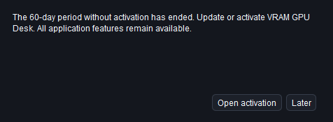
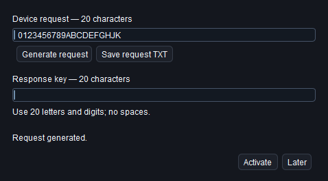

# VRAM GPU Desk 1.24

## 1.24の新機能：60日間の全機能利用期間とオフライン端末認証

**保護状態のパスと制御開始を修正。** アクティベーション状態は、最小限の環境で実行するスケジュールタスクからの起動時も、Windows 標準のコンピューター共通データフォルダーを使用します。相対パスとアクセス権のエラーによりネイティブ GPU 制御が開始できない問題を修正しました。所有権、アクセス権、復旧の確認は維持され、他の GPU ユーティリティに対する排他的な制御は保証しません。

**このPCでの初回起動から計算します。** 認証機能を備えた版をこのPCで初めて起動すると、60日間の全機能利用期間が始まります。保護されたローカル開始記録は通常の更新やアンインストール後も保持されます。アプリを更新しても60日間は再開せず、認証通知も自動的には解除されません。

**期間終了後も全機能を維持します。** 60日後も監視、温度・冷却制御、クイックボタン、緊急機能を利用できます。アプリの実行中は、選択した言語で少なくとも1時間ごとに非モーダル通知を通常のWindowsウィンドウより前面に表示します。通知によってGPU制御が停止することはなく、認証が成功すると通知は終了します。

**20文字の要求と20文字のオフライン応答。** 期間終了後、画面に認証用チェックボックスが表示されます。認証ウィンドウで「要求を生成」を選ぶと、この端末のHWIDに結び付いた20文字の要求を作成し、UTF-8のTXTとして保存できます。所有者から提供された20文字の応答キーを応答欄に入力して認証します。検証はローカルで行い、HWIDの自動アップロードやオンライン認証サービスは使用しません。

**端末との結び付きと保護の範囲。** ハードウェア識別子が変わると以前の認証は無効になりますが、利用期間は再開しません。要求には生のハードウェア識別子ではなく派生コードを使用します。専用の生成ツールとマスターキーは所有者が非公開で保管し、公開インストーラーやリポジトリには含めません。選択した短いオフライン方式は改ざん不能なDRMではありません。アプリ内の検証用秘密情報は解析で抽出される可能性があり、管理者による改変を完全には防げません。

[Windows x64 EXE](downloads/VRAM-GPU-Desk-1.24-Setup-x64.exe) · [ZIP](downloads/VRAM-GPU-Desk-1.24-Installer.zip)

# VRAM GPU Desk 1.23

## 1.23の新機能：統一した小型入力欄と温度設定値の色表示

**統一した小型コントロール。** 7つの数値入力欄に−/+ボタン、欄内の°Cや%などの単位、細いアクセント線を使用します。対象は目標温度、過熱警告のしきい値、アイドル冷却温度、最小ファン速度の割合、GPU緊急負荷の割合、更新間隔、オーバーレイの倍率です。キーボード操作とハードウェアから動的に報告されるモデルの上下限は維持します。言語・テーマ・GPUの選択欄、検索欄、クイックボタンの編集欄にも同じアクセントスタイルを適用します。

**テーマに合わせたコントラスト。** Systemは白い入力欄と濃い文字、Graphiteは暗い入力欄と明るい文字を使用します。無効状態、フォーカス、選択範囲、ドロップダウンのポップアップもテーマに合わせます。

**赤字は温度の設定値を示します。** 設定した目標温度が **80 °Cを超える場合（81 °C以上）**、数値を赤字にします。設定した過熱警告のしきい値は **86 °C以上**で赤字になります。これは設定値の視覚的な表示であり、リアルタイムのGPU温度アラームではありません。制御アルゴリズム、既定の目標 **78 °C**、警告しきい値 **85 °C**、保存済みの設定は変わりません。1.22の制御復旧、ログ、電源電流の機能も維持します。

Windows x64 EXE · ZIP

# VRAM GPU Desk 1.22

## 1.22の新機能：継続的な制御復旧、アプリログ、明確な電流表示

**継続的な制御復旧。** 強制的な制御復旧が有効な間は、5秒、10秒、30秒の間隔で再試行し、その後は60秒ごとに回数制限なく続けます。保存済みの無効設定は維持されます。新しい有効なテレメトリーで制御復旧を確認した後に限り、モードレスの警告ウィンドウが自動で閉じます。停止・再起動の途中でも、最後にユーザーが指定したチェック状態を保持します。前の制御クライアントの終了を確認してから新しいものを生成し、ハードウェアの識別、所有権、安全性の検査を維持します。MSI Afterburnerなど他の制御ソフトによるGPUへのアクセスを排除するものではありません。

**アプリログ。** ログボタンを追加しました。GPUごとの制御喪失・復旧・再試行、制御に関するすべてのチェックボックス状態、**78 °C**以上で整数温度が変化した際の値、および78 °C未満に戻ったイベントを記録します。各記録にはUTCと現地時刻が含まれます。UTF-8ログは `%LOCALAPPDATA%/VRAMDeskJava/logs/application.log` に保存し、1ファイル2 MiB、ローテーション用の保存ファイルは5個です。ビューアーには現在のセッションの最新500件を表示し、ログフォルダーボタンから以前のセッションのファイルも開けます。

**電源電流：最大値または合計。** 実際のGPU電源コネクターごとに有効な接点電流が1つでもあれば、他の接点が欠測でも取得済みの値の最大を表示します。接点別の情報がない場合に限り、実測のコネクター合計電流を使います。ラベルに「最大」または「合計」を明示し、不明値はダッシュ、実際のゼロは有効な測定値として扱います。ツールチップには取得できる接点ごとの値とコネクター合計を残し、レール電流をコネクター電流として扱いません。

**旧版1.9からの更新。** 1.22がProgram Filesに正しくインストールされていても、LocalAppData内の旧版1.9が動作中なら、トレイと画面には旧バージョンと少ない設定項目が表示される場合があります。インストール前に旧版のトレイメニューから終了し、その後インストールして現在のスタートメニューのショートカットから開いてください。メインウィンドウの **v1.22** を確認してください。プロセスの強制終了は推奨しません。

Windows x64 EXE · ZIP

# VRAM GPU Desk 1.21

## 1.21 の新機能 — 電源監視とオーバーレイ文字の自動コントラスト

**任意表示のレイアウト。** 電源監視がオフ、または対応電源が未検出の場合、電源カードを隠し、空の枠を残さず他のカードが利用可能な幅を使います。一度電源を検出した後に測定値が一時的に取得できなくなった場合は、カードを維持してダッシュを表示します。

**よりコンパクトな画面。** 1枚および2枚のGPUの両レイアウトから「VRAM > 50% の時間」カードを削除しました。30日間のアプリ順位と保存済み履歴は維持します。

**電源監視は初期設定でオフです。** 独立したチェックボックスを有効にすると、既存の指標の隣に電源カードを追加し、利用可能な出力電力と最大2個の実際の GPU 電源コネクターの電流を表示します。欠落・古い値は — と表示し、電源レールの電流を個別コネクターの電流として扱いません。読み取り専用の保護コンポーネントはアプリの一度限りの UAC インストールで構成され、GPU 制御権を取得しません。

**対応はモデルごとに判断します。** MSI MPG Ai1300TS でセンサー読み取りを検証済みです。Ai1600TS はプロトコルを確認済みです。一部の Corsair HXi/RMi、Thermaltake DPS G/iRGB PLUS と追加の NZXT E は合成テストに合格し、実機検証は未完了です。Corsair は測定した出力ワット数、Thermaltake は計算値と明記した合計、NZXT は架空の合計を作らずレールデータを提供します。be quiet! Dark Power Pro 14 IO は調査済みで、Seasonic OptiGuard と ASUS の検証済みリーダーはありません。6ブランドの全面対応は主張しません。[電源の互換性](docs/psu-compatibility.md)を参照してください。

**文字の自動コントラストは初期設定でオンです。** 背景に応じて文字を調整し、オフにすれば明暗を手動で選択できます。透明背景、小型メーター、2枚の NVIDIA GPU の独立オーバーレイ、ダブルクリックで主画面を開く機能、位置、温度の色と音は維持します。

以下のグラファイトの画像は電源値を含む合成デモデータです。GPU 設定、プロセス操作、緊急モードと保存済みの選択は従来どおりです。

Windows x64 EXE · Installer ZIP
