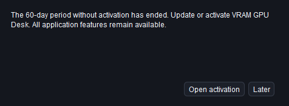
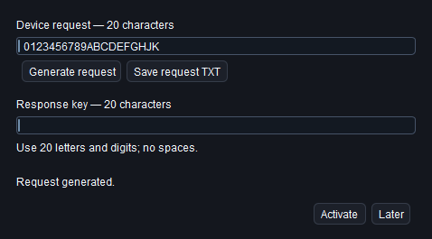

# VRAM GPU Desk 1.24

## Mới trong 1.24: 60 ngày sử dụng đầy đủ và kích hoạt thiết bị ngoại tuyến

**Đã sửa đường dẫn trạng thái được bảo vệ và khởi động điều khiển.** Trạng thái kích hoạt dùng thư mục dữ liệu chung chuẩn của Windows cho toàn máy, kể cả khi chạy bằng tác vụ đã lên lịch với môi trường tối giản. Điều này khắc phục lỗi đường dẫn tương đối và quyền truy cập có thể chặn bộ điều khiển GPU gốc khởi động. Các kiểm tra chủ sở hữu, quyền truy cập và khôi phục vẫn được giữ; không bảo đảm quyền điều khiển độc quyền trước tiện ích GPU khác.

**Tính từ lần chạy đầu trên máy tính này.** Phiên bản có cơ chế kích hoạt bắt đầu thời hạn sử dụng đầy đủ 60 ngày khi được chạy lần đầu trên máy. Mốc bắt đầu cục bộ được bảo vệ và giữ lại qua các lần cập nhật, gỡ cài đặt thông thường. Cập nhật ứng dụng không bắt đầu lại 60 ngày và không tự gỡ lời nhắc kích hoạt.

**Hết thời hạn vẫn dùng được mọi chức năng.** Sau 60 ngày, chức năng giám sát, điều khiển nhiệt độ và làm mát, nút nhanh cùng chế độ khẩn cấp vẫn hoạt động. Khi ứng dụng đang chạy, lời nhắc không khóa cửa sổ xuất hiện bằng ngôn ngữ đã chọn ít nhất mỗi giờ một lần, phía trên các cửa sổ Windows thông thường. Lời nhắc không tạm dừng điều khiển GPU và sẽ dừng khi kích hoạt thành công.

**Yêu cầu 20 ký tự và mã trả lời ngoại tuyến 20 ký tự.** Ô chọn kích hoạt xuất hiện trong giao diện sau khi hết thời hạn. Trong cửa sổ kích hoạt, chọn ‘Tạo yêu cầu’ để tạo mã 20 ký tự gắn với HWID của máy rồi lưu vào TXT UTF-8. Nhập mã trả lời 20 ký tự do chủ sở hữu cung cấp và kích hoạt. Việc kiểm tra diễn ra cục bộ; ứng dụng không tự tải HWID lên và không cần dịch vụ kích hoạt trực tuyến.

**Ràng buộc thiết bị và phạm vi bảo vệ.** Thay đổi định danh phần cứng làm mất hiệu lực kích hoạt cũ nhưng không khởi động lại thời hạn. Yêu cầu chứa mã dẫn xuất, không phải định danh phần cứng thô. Bộ tạo mã riêng và khóa chủ do chủ sở hữu giữ kín, không nằm trong bộ cài hay kho công khai. Cơ chế ngoại tuyến ngắn gọn đã chọn không phải DRM bất khả xâm phạm: bí mật kiểm tra trong chương trình có thể bị trích xuất bằng phân tích ngược và không thể ngăn tuyệt đối việc can thiệp của quản trị viên.

[Windows x64 EXE](downloads/VRAM-GPU-Desk-1.24-Setup-x64.exe) · [ZIP](downloads/VRAM-GPU-Desk-1.24-Installer.zip)

# VRAM GPU Desk 1.23

## Mới trong 1.23: ô nhập nhỏ gọn đồng nhất và màu cho giá trị nhiệt độ đã đặt

**Điều khiển nhỏ gọn, đồng nhất.** Cả bảy ô số đều có nút −/+, đơn vị như °C hoặc % ngay trong ô và đường nhấn màu mảnh: nhiệt độ mục tiêu, ngưỡng cảnh báo quá nhiệt, nhiệt độ làm mát nhàn rỗi, phần trăm tốc độ quạt tối thiểu, phần trăm tải GPU cho chế độ khẩn cấp, chu kỳ làm mới và tỷ lệ lớp phủ. Thao tác bàn phím và giới hạn mô hình động do phần cứng báo cáo được giữ nguyên. Hộp chọn ngôn ngữ, giao diện và GPU, ô tìm kiếm và trình sửa nút nhanh cũng dùng cùng kiểu nhấn màu.

**Tương phản theo giao diện.** System dùng ô trắng với chữ tối; Graphite dùng ô tối với chữ sáng. Trạng thái vô hiệu hóa, tiêu điểm, vùng chọn và danh sách thả xuống cũng khớp giao diện.

**Chữ đỏ biểu thị giá trị nhiệt độ đã đặt.** Nhiệt độ mục tiêu được cấu hình **trên 80 °C, tức từ 81 °C**, có chữ số đỏ. Ngưỡng cảnh báo quá nhiệt được cấu hình **từ 86 °C** cũng có chữ số đỏ. Đây là chỉ dẫn trực quan cho giá trị cài đặt, không phải cảnh báo nhiệt độ GPU tức thời. Thuật toán điều khiển, mục tiêu mặc định **78 °C**, ngưỡng cảnh báo mặc định **85 °C** và lựa chọn đã lưu không đổi. Các tính năng khôi phục điều khiển, nhật ký và dòng nguồn của 1.22 được giữ lại.

Windows x64 EXE · ZIP

# VRAM GPU Desk 1.22

## Mới trong 1.22: khôi phục điều khiển liên tục, nhật ký ứng dụng và loại dòng điện rõ ràng

**Khôi phục điều khiển liên tục.** Khi bật khôi phục điều khiển cưỡng bức, ứng dụng thử sau 5, 10, 30 giây rồi tiếp tục mỗi 60 giây, không giới hạn số lần. Lựa chọn TẮT đã lưu được giữ nguyên. Cửa sổ cảnh báo không chặn chỉ tự đóng khi dữ liệu đo mới, hợp lệ xác nhận điều khiển đã phục hồi. Lựa chọn ô chọn cuối cùng được giữ qua quá trình dừng và khởi động lại. Chỉ tạo trình điều khiển mới sau khi xác nhận trình cũ đã dừng; các kiểm tra nhận dạng phần cứng, quyền sở hữu và an toàn vẫn bắt buộc. Điều này không ngăn MSI Afterburner hay bộ điều khiển khác truy cập GPU.

**Nhật ký ứng dụng.** Nút nhật ký mới ghi theo từng GPU: mất điều khiển, khôi phục, thử lại và trạng thái mọi ô chọn liên quan đến điều khiển. Nhật ký ghi mỗi thay đổi nhiệt độ nguyên từ **78 °C** trở lên và sự kiện trở về dưới 78 °C. Mỗi mục có dấu thời gian UTC và giờ địa phương. Tệp UTF-8 nằm tại `%LOCALAPPDATA%/VRAMDeskJava/logs/application.log`, tối đa 2 MiB mỗi tệp và năm tệp lưu trữ xoay vòng. Trình xem hiển thị 500 sự kiện gần nhất của phiên hiện tại; nút thư mục nhật ký mở nơi lưu cả các phiên trước.

**Dòng nguồn: lớn nhất hoặc tổng.** Với mỗi đầu nối nguồn GPU vật lý, chỉ cần một chân có số đo hợp lệ, ứng dụng hiển thị giá trị lớn nhất trong các chân đã biết, kể cả khi thiếu dữ liệu các chân còn lại. Khi không có thông tin từng chân, mới dùng tổng dòng đo được của đầu nối. Nhãn ghi rõ ‘lớn nhất’ hoặc ‘tổng’; số liệu chưa biết là dấu gạch ngang, số 0 thực vẫn hợp lệ. Chú giải giữ các giá trị chân có sẵn và tổng đầu nối; dòng đường nguồn không được coi là dòng của đầu nối.

**Nâng cấp từ 1.9.** Bản 1.9 cũ trong LocalAppData có thể vẫn đang chạy dù 1.22 đã cài đúng vào Program Files, khiến khay và giao diện hiển thị bản cũ cùng ít thiết lập hơn. Trước khi cài, hãy thoát bản cũ bằng menu khay, rồi cài và mở bằng lối tắt Start hiện tại. Kiểm tra **v1.22** trong cửa sổ chính; không khuyến nghị buộc kết thúc tiến trình.

Windows x64 EXE · ZIP

# VRAM GPU Desk 1.21

## Mới trong 1.21 — giám sát bộ nguồn tùy chọn và tương phản tự động

**Bố cục tùy chọn.** Khi giám sát nguồn TẮT hoặc không phát hiện nguồn tương thích, thẻ nguồn được ẩn và các thẻ khác dùng chiều rộng khả dụng, không để ô trống. Sau khi phát hiện nguồn, nếu số liệu tạm thời không khả dụng, thẻ vẫn hiển thị với dấu gạch ngang.

**Bảng điều khiển gọn hơn.** Đã bỏ thẻ “Thời gian VRAM > 50%” khỏi cả bố cục một và hai GPU. Giữ lại xếp hạng ứng dụng 30 ngày và lịch sử đã lưu.

**Giám sát bộ nguồn mặc định TẮT.** Một ô chọn riêng thêm thẻ nguồn bên cạnh các chỉ số hiện có, hiển thị công suất đầu ra khả dụng và dòng điện của tối đa hai đầu nối nguồn GPU thực tế. Dữ liệu thiếu hoặc cũ hiển thị —; dòng của đường nguồn không được coi là dòng của từng đầu nối. Thành phần chỉ đọc được bảo vệ được cài cùng lần thiết lập UAC duy nhất của ứng dụng, không giành quyền điều khiển GPU.

**Tương thích phụ thuộc từng mẫu.** Đã xác minh việc đọc cảm biến trên MSI MPG Ai1300TS. Ai1600TS đã được xác nhận về giao thức. Một số Corsair HXi/RMi, Thermaltake DPS G/iRGB PLUS và NZXT E bổ sung đã qua kiểm tra tổng hợp; kiểm chứng trên phần cứng thật còn chờ. Corsair cung cấp công suất đo được; tổng từ các đường nguồn Thermaltake được ghi rõ là tính toán; NZXT chỉ cung cấp dữ liệu đường nguồn, không tạo tổng giả. Đã nghiên cứu be quiet! Dark Power Pro 14 IO; chưa có bộ đọc đủ điều kiện cho Seasonic OptiGuard hoặc ASUS. Không tuyên bố hỗ trợ toàn bộ sáu thương hiệu. Xem [tương thích bộ nguồn](docs/psu-compatibility.md).

**Tương phản chữ tự động mặc định BẬT.** Chữ thích ứng với nền; tắt tùy chọn để chọn chữ sáng hoặc tối thủ công. Vẫn giữ nền trong suốt, chỉ báo nhỏ gọn, hai lớp phủ NVIDIA độc lập, nhấp đúp mở cửa sổ chính, vị trí và màu/âm thanh nhiệt độ.

Ảnh giao diện graphite bên dưới dùng dữ liệu trình diễn tổng hợp, gồm cả nguồn. Các thiết lập GPU, thao tác tiến trình, chế độ khẩn cấp và lựa chọn đã lưu giữ nguyên hành vi.

Windows x64 EXE · Installer ZIP
